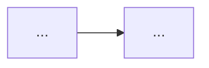

# learn-brief — stage `brief`

The brief is the first thing the learner reads. Its job is to make the topic feel small and
clear in two minutes, so that the lesson pages after it have something to attach to. It is
short on purpose: a beginner who meets ten new terms on page one stops reading.

`tutor` means `node harness/bin/tutor.mjs`, run from the repository root. `<topic>` is the full
topic id. `<slug>` is its last part.

## When to use

- `tutor next` lists stage `brief`. It is in the same wave as `research` but runs after
  `research` is done, because the brief is grounded in the verified sources.
- The brief is run inline by the orchestrator session. It has no units.
- If you run this skill directly and not from `learn`, run `tutor start <topic> brief` first.

### Capacity-aware input allowance

The input allowance is `min(60000, floor(0.4 * actual_window) - reserve)`, including
instructions, role/skill text and assigned excerpts. Ask `tutor budget --window
<actual_window> --reserve <overhead> <files>` before reading. Unknown window defaults
to 32768 and reserve3000. Any 60,000-token figure below is a ceiling only; the CLI's
smaller allowance wins. Split oversized units and persist handoffs before dispatch.
Learner experience comes from plan.learner; this learner is an existing software
developer learning a new subject. Keep clear prerequisite bridges, avoid redundant
basic programming lessons, and teach practical mechanisms and failure modes.

## Inputs

Read only these.

1. `node harness/bin/tutor.mjs paths <topic> --json` — find the path of `01-brief-<slug>.md`.
2. `node harness/bin/tutor.mjs plan <topic> --json` — `summary`, `prerequisites`, `outcomes`.
3. `node harness/bin/tutor.mjs sources <topic> list --json` — pick the entries whose `use_for`
   contains `brief` (for a concept topic this can be a tier-B official page that explains
   the idea in plain words); if none is flagged, pick the entries with tier `A`.
4. `harness/domains/<domain>/playbook.md`, only the heading `## Safety and ethics` (find it
   with `grep -n '^## ' <playbook>`, read only that line range). No other playbook heading
   belongs to this stage.
5. The existing `01-brief-<slug>.md`, if `tutor init` scaffolded one. Keep its frontmatter
   keys and fill in its body.
6. `ls vault/_concepts` — names only, to reuse existing concept notes.
7. At most 3 narrow fetches of the sources flagged `brief` (see step 2).

These are the same inputs that `tutor next` prints for stage `brief`. The vault-notes rubric
is not an input of this stage; the rules the brief needs are in this file.

## Steps

1. **Collect what the plan already decided.** The summary becomes the core of "What it is".
   The prerequisites and outcomes go into the last two sections; do not invent new ones.
   Those two lists are where a brief goes over its limit, so each has a hard cap: a
   prerequisite line has at most 12 words after the dash, and an outcome has at most 15
   words. When the plan's `bridge` or outcome is longer, shorten it here and keep its
   meaning. Never drop an item.

2. **Ground the facts in the sources flagged `brief`.** Make at most 3 fetches, each with
   one question, for example:
   - "In two sentences, what is <topic> and what problem was it created to solve?"
   - "What are the main parts of <topic> and how does data move between them?"
   - "Which companies or products are named as using <topic>, and for what?"

   Use the `engineering-blog` and `repo` entries (their `used_by` and `why_trusted` fields)
   for real-world uses. State a real-world use only when a source in `sources.json` supports
   it. If no source names a concrete user, describe the kind of system that uses it and name
   no company.

3. **Create the concept notes for the prerequisites.** For every entry of
   `plan.prerequisites`, run:

   ```bash
   node harness/bin/tutor.mjs concept "<Concept>"
   ```

   It creates `vault/_concepts/<Concept>.md` if it is missing and prints the path; when a
   note with the same name in another letter case exists, it returns that note. Use the
   file name it prints as the link: `[[<Concept>]]`. Concept names are in sentence case
   ("Message queue", not "Message Queue").

   If the note is new, open it. Directly under its `# ` title stand the line
   `<!-- tutor:placeholder -->` and a line that starts with "_Not written yet". Replace
   those two lines with a definition of 1–3 plain sentences (start from the `bridge` in
   the plan). Change nothing else: not the frontmatter, not the headings. Leave
   `## Where it shows up` empty; `tutor map` fills it with a backlink to every note that
   links to the concept, so nobody writes those lines by hand. Write nothing below
   `## My insights`.

4. **Write the brief** to the path of `01-brief-<slug>.md`, using the exact headings in
   "Output contract". A filled example is in `references/brief-template.md`; read it before
   your first brief. Writing rules:
   - Plain words, short sentences, second person ("you"). Explain any term that is not in the
     prerequisites the first time it appears, in the same sentence.
   - Aim for 220–330 words. The gate allows 150–400. Four prerequisites and five outcomes
     at their caps already take about 130 words, so the four sections above them have
     about 180 words together: two to three short sentences each.
   - One mermaid diagram with at most 7 nodes. It shows the single main flow, not the whole
     system.
   - No history lesson, no feature list, no comparison table. Those belong in the lesson.
   - If the file already has text below `## My insights`, keep it exactly. Change only what
     is above that heading (use the Edit tool, not a full rewrite).

5. **Check the links.** Every `[[...]]` in the brief must be the file name of a note that
   exists. Links to concept notes exist after step 3. Link to `[[00-start-here-<slug>]]`
   only; do not link to notes that later stages have not written yet.

6. **Count the words the way the gate counts them.** Run this before the gate.
   Do not use another word counter; it would also count the frontmatter and the diagram.

   ```bash
   node harness/bin/tutor.mjs words <path of 01-brief-<slug>.md>
   ```

   It prints the count exactly as the validator counts it (frontmatter and code blocks are
   not counted) and the allowed range. If the count is above 400, shorten the prerequisite
   lines and the outcomes to their caps first, then cut background sentences. Do not cut
   the problem statement and do not remove a section.

7. **Gate** (below).

## Output contract

One file: `01-brief-<slug>.md` at the path from `tutor paths`. Exactly this structure:

````markdown
---
title: <Title> — brief
topic: <domain>/<subdomain>/<slug>
stage: brief
tags: [<domain>, <subdomain>]
created: <YYYY-MM-DD>
sources: [<the source ids you used>]
---

# <Title> in brief

## What it is

<2–3 sentences. Start from plan.summary.>

## The problem it solves

<2–4 sentences. The situation before, and what goes wrong without it.>

## How it works in one picture

<1 sentence that says what the diagram shows.>



<1–2 sentences that walk through the diagram.>

## Where it is used in the real world

<2–4 short bullets or sentences. Each is supported by a source.>

## What you need to know first

- [[<Concept>]] — <the bridge sentence, or "you already studied this" when known is true>

## What you will be able to do

- <each item of plan.outcomes, one per bullet>

## My insights
````

Rules for the structure:

- The six headings above and `## My insights` are required, with exactly this text and in
  this order. `## My insights` is the last line of the file; write nothing below it.
- If the scaffold from `tutor init` has frontmatter values already (for example `created`),
  keep them. If the validator asks for a different heading text, the validator wins.
- `sources` lists the ids from `sources.json` that the brief relies on. Do not put URLs in
  the body; the resources note carries them.

## Gate

```bash
node harness/bin/tutor.mjs validate <topic> brief
node harness/bin/tutor.mjs done <topic> brief
```

The gate checks: the file exists, the frontmatter is valid, the text has 150–400 words, the
sections are present, and every link resolves. On failure each line reads
`path: problem. fix.` Fix exactly those lines and rerun. Typical fixes: when over 400
words, shorten the copied prerequisite and outcome lines first (step 1) and check again
with `tutor words`; run `tutor concept "<Name>"` for a link that does not resolve; restore
a renamed heading. After 3 failed attempts run
`node harness/bin/tutor.mjs fail <topic> brief --reason "<the remaining lines>"`.

## Context budget

- **Units.** The brief is one unit and it is small: about 6,000 tokens of reading (plan,
  source list, at most 3 fetch answers). The 60,000-token reading budget is never close if
  you keep to the 3 narrow fetches. Do not read a whole documentation site or a paper; that
  is the digest stage.
- **Write as you go.** Write the file after step 2 with what you have, then improve it. Do
  not hold the whole brief in memory while fetching.
- **Handoff.** A handoff is rarely needed. If you must stop, write
  `<state>/handoffs/brief-brief.md` with the headings Done / Remaining / Next step. A worker
  would also run `node harness/bin/tutor.mjs unit <topic> brief fail brief --handoff <that path>`
  and return only `CONTINUE: <that path>`.
- **Return format**, when a worker runs this skill (150 words at most):

  ```text
  STAGE: brief  UNIT: brief  STATUS: done | failed
  FILES: <vault path>/01-brief-<slug>.md, concept notes created
  FINDINGS:
  - the one-sentence definition used
  - the main flow shown in the diagram
  - real-world uses named, with source ids
  PROBLEMS: none | <what is missing and why>
  ```

## Common mistakes

- **Too long.** Four hundred words is the hard limit, counted by `tutor words`. Shorten the
  prerequisite lines (12 words) and the outcomes (15 words) first, then cut background.
  Never cut the problem statement to make room for long copied lists.
- **Unexplained jargon** ("a persistent, replicated commit log"). Say it in everyday words
  first, then give the term.
- **A diagram of everything.** Seven nodes at most; one flow.
- **A company named from memory.** Name a user only when a recorded source says so.
- **New prerequisites or outcomes.** They come from the plan, word for word or shortened.
- **Writing lines under `## Where it shows up` in a concept note,** or leaving its
  placeholder line in place. `tutor map` writes the backlinks; you write the definition.
- **Links to notes that do not exist yet** (`[[02-lesson-...]]`). They fail the gate.
- **Quote blocks or callout boxes.** Use plain paragraphs; an important remark starts with
  `**Note.**`.
- **Text below `## My insights`.** That area belongs to the learner.
