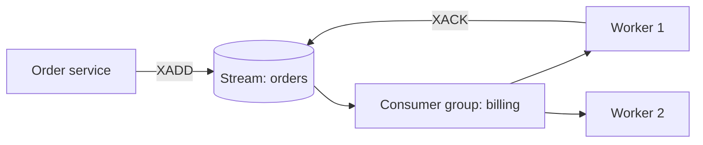

# A filled brief

This is a complete brief for the topic `backend-engineering/messaging/redis-streams`. It has
about 270 words of prose. Use it as the model for tone, length, and structure. The facts in a
real brief come from that topic's own recorded sources, not from this example.

````markdown
---
title: Redis Streams — brief
topic: backend-engineering/messaging/redis-streams
stage: brief
tags: [backend-engineering, messaging]
created: 2026-11-14
sources: [redis-streams-docs]
---

# Redis Streams in brief

## What it is

A Redis Stream is a list of events that only grows at the end, stored inside Redis. Every
event gets an ID when it is added, and several programs can read the same events, each at
its own speed.

## The problem it solves

Imagine a shop where the order service must tell three other services about every new
order. If it calls them directly, one slow service makes every order slow, and an order that
arrives while a service is down is simply lost. A stream sits in the middle: the order
service writes the event once and moves on, and each service reads it when it is ready.

## How it works in one picture

The picture shows one event travelling from the program that writes it to the workers that
handle it.



The order service appends an event. A consumer group, which is a named team of workers,
hands each event to exactly one of its workers. When the worker has finished, it
acknowledges the event, and Redis stops tracking it as unfinished.
[[visual-how-it-works-redis-streams|Explanation and sources of this picture]]

**Analogy.** A stream is like a shared to-do list that nobody erases: each team ticks off
its own items. The comparison stops at storage, because Redis trims old entries by rule.

## Where it is used in the real world

- Background job queues, where web servers hand slow work to workers.
- Activity feeds and notifications, where a user who reconnects must see what they missed.
- Passing events between small services when a full Kafka cluster would be too much to run.

## What you need to know first

- [[Redis basics]] — Redis is an in-memory database that stores values under keys.
- [[Message queue]] — a message queue lets one program leave work for another.
- [[At-least-once delivery]] — delivery may repeat; survival depends on persistence and retention.

## What you will be able to do

- Explain how a stream differs from a list and from pub/sub.
- Explain how a consumer group tracks unfinished events and what XACK changes.
- Build a worker that reads, acknowledges, and recovers events left by a crashed worker.
- Decide when Redis Streams is enough and when a system needs Kafka.

## My insights
````

## Why this brief works

- The first sentence defines the topic with words a beginner already has ("a list of events
  that only grows at the end") before any official term appears.
- The problem is a small story with a concrete failure, not an abstract statement.
- The diagram has six nodes and one direction. The two sentences after it walk through it in
  the same order as the arrows.
- "Consumer group" is explained in the same sentence where it first appears.
- The diagram is registered as visual `how-it-works` (asset
  `visuals/assets/how-it-works-redis-streams.mmd`, `used_in` the brief), so the lesson and
  the final notes reuse it, and its vault note carries the sources and a check question.
- The analogy is marked `**Analogy.**` and says where it stops working.
- Sentences stay short and active (`tutor style` reports above 80%).
- The real-world uses describe kinds of systems, because the recorded sources of this example
  topic name no specific company for those uses. When a source does name one, write it as
  "<Company> uses it for <purpose>" and add the source id to `sources` in the frontmatter.
- The last two sections repeat the plan. Nothing new is promised. Each prerequisite line
  has at most 12 words after the dash and each outcome at most 15 words; that is what keeps
  the whole brief under the 400-word limit.

## Quick self-check before the gate

1. Does `node harness/bin/tutor.mjs words <path of the brief>` print a count between 220 and
   330? (Count only with this command. Other word counters also count the frontmatter and
   the diagram, and disagree with the gate.)
2. Does every heading match the Output contract exactly?
3. Does every `[[link]]` name a note that exists (run `ls vault/_concepts`)?
4. Is there exactly one mermaid block with 7 nodes or fewer?
5. Is `## My insights` the last line?
6. Visual-first plan: is the diagram registered (`tutor visuals <topic> list` shows it) and
   does `tutor style <path of the brief>` show 80% or more?
