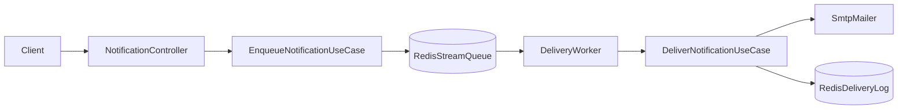

# Decision record, README, and vault note — filled examples

## 1. Architecture decision record

A decision record keeps the reason for a choice next to the code, so that a
reader a year later does not have to guess. Write one for every decision that
had a real alternative. The file name is `docs/adr/NNNN-<short-name>.md`, with a
four-digit number starting at `0001`.

````markdown
# 0001. Deduplicate deliveries with a delivery log instead of trusting acknowledgements

## Status

Accepted, 2026-11-14.

## Context

Redis Streams delivers at least once. If a worker sends the email and crashes
before `XACK`, another worker claims the entry and sends the email again. For
notifications, a duplicate is a visible defect.

## Decision

Before sending, the worker writes the notification id to a delivery log with
`SET <id> 1 NX EX 86400`. If the key already exists, the email was sent before,
so the worker only acknowledges the entry.

## Alternatives considered

- **Acknowledge before sending.** This removes duplicates but loses the
  notification when the worker crashes during sending. Losing is worse than
  duplicating here.
- **Rely on the mail provider's idempotency key.** Not every provider has one,
  and it would tie the domain to one provider.

## Consequences

- A duplicate is possible only if Redis loses the key, which is acceptable.
- Every delivery costs one extra Redis write.
- The log needs an expiry, or it grows forever; 24 hours covers every retry.
````

## 2. README.md

Keep it short. The architecture lives in `ARCHITECTURE.md`; the README gets a
person from a fresh clone to a running, tested project.

````markdown
# Relay — a notification service that does not lose messages

## The problem

A shop sends order confirmations from its web process. When the mail provider
is slow, checkout is slow; when the process restarts, emails are lost.

## What it does

Relay accepts a notification over HTTP, stores it in a Redis Stream, and
delivers it from background workers with retries, crash recovery, and no
duplicates.

## How to run

```bash
cp .env.example .env
docker compose up --build
curl -X POST localhost:3000/notifications \
  -H 'content-type: application/json' \
  -d '{"to":"a@example.com","template":"order-confirmed","orderId":"42"}'
```

## How to test

```bash
npm install
npm test                 # unit tests, no Redis needed
npm run test:integration # starts Redis in Docker
```

## Configuration

| Variable | Meaning | Example |
|----------|---------|---------|
| `REDIS_URL` | Redis connection | `redis://localhost:6379` |
| `SMTP_URL` | Mail server | `smtp://localhost:1025` |
| `STREAM_NAME` | Stream key | `notifications` |
| `MAX_ATTEMPTS` | Deliveries before dead-lettering | `3` |
| `PORT` | HTTP port | `3000` |

## Project layout

```
src/domain/          entities, rules, and ports
src/application/     use cases
src/infrastructure/  Redis, SMTP, config, logger
src/interface/       HTTP controller and worker loop
src/main.ts          wiring
tests/               unit and integration tests
```

## Where to read next

Read `ARCHITECTURE.md`, then `src/domain/Notification.ts`, then
`src/application/DeliverNotificationUseCase.ts`.
````

## 3. Vault note `06-capstone-<slug>.md`

`tutor init` already created this file. Keep its frontmatter and its `# `
title line. Delete the `<!-- tutor:placeholder -->` line and the "Not written
yet" line under it, and write the content in their place. Keep
`## My insights` as the last heading, and write nothing below it.

Rules:

- Project files are not vault notes. Write their paths as inline code.
- `## Architecture at a glance` holds the system architecture diagram (mermaid,
  or the registered SVG embedded with `![[<id>-<slug>.svg]]`) and links the
  visual note of every capstone diagram, `[[visual-<id>-<slug>]]`. The visual
  notes exist after `tutor map <topic>`; run it before validating the note.
- Wikilinks go only to notes that exist: the repo-intel notes of this topic, and
  notes in `vault/_concepts/` and `vault/_tech/` (`ls` both folders first).
- Inside a table, write wikilinks without the `|Shown text` part, because a pipe
  character would split the table cell.
- Keep the diagram to the layers and the main classes; the full version is in
  the project's `ARCHITECTURE.md`.
- `sources` in the frontmatter lists only ids that
  `node harness/bin/tutor.mjs sources <topic> list` prints.

````markdown
---
title: Redis Streams — capstone: Relay
topic: backend-engineering/messaging/redis-streams
stage: capstone
tags: [backend-engineering, messaging]
created: 2026-11-14
sources: [redis-streams-docs]
---

# Redis Streams — capstone

## What it is

Relay is a notification service. It accepts requests over HTTP, stores them in
a Redis Stream, and delivers them from background workers. It solves the
problem of emails being lost on restart or sent twice on retry. The project is
in `projects/backend-engineering/messaging/redis-streams/capstone/`.

## Architecture at a glance



Diagrams with their explanations and sources: [[visual-capstone-architecture-redis-streams]],
[[visual-capstone-request-flow-redis-streams]], [[visual-capstone-deployment-redis-streams]].

## Layers and key classes

| Layer | Key classes | What the layer is for |
|-------|-------------|-----------------------|
| domain | `Notification`, `RetryPolicy`, ports | The rules, with no dependency on Redis |
| application | `EnqueueNotificationUseCase`, `DeliverNotificationUseCase`, `RecoverStaleUseCase` | One class per thing the system does |
| infrastructure | `RedisStreamQueue`, `SmtpMailer`, `RedisDeliveryLog`, `Config`, `Logger` | The adapters to the outside world |
| interface | `NotificationController`, `DeliveryWorker` | Input and output |

## Ideas applied

- [[Consumer group]] and [[At-least-once delivery]]: workers share one group,
  and an entry is acknowledged only after the email is sent.
- [[Idempotency]]: the delivery log makes a repeated delivery harmless.
- [[Dependency inversion]]: use cases depend on ports, so they are tested
  without [[Redis]].

## Borrowed from production

- Atomic claim and acknowledge in a Lua script, from
  [[bullmq-pattern-atomic-scripts|BullMQ: atomic scripts]].
- Delivery attempt cap with a dead-letter stream, from
  [[bullmq-pattern-dead-letter|BullMQ: dead-letter pattern]].
- Approximate trimming on every add, from [[bullmq-findings|BullMQ findings]].

## How to run it

```bash
cd projects/backend-engineering/messaging/redis-streams/capstone
cp .env.example .env
docker compose up --build
npm test
```

Read `ARCHITECTURE.md` in that folder for every class and the decision record in
`docs/adr/0001-delivery-log.md`.

## How to extend it

- Add an SMS channel as a second sender behind the same port.
- Add priorities with one stream per priority.
- Expose the pending count and the oldest idle time as metrics.

## My insights
````
