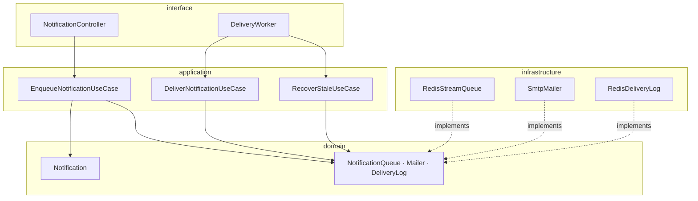
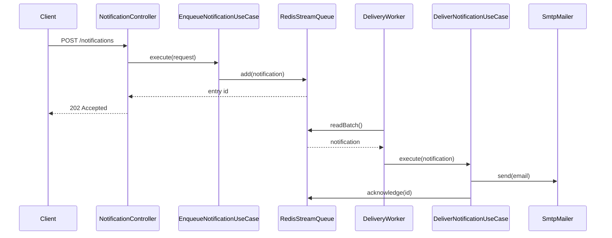

# `ARCHITECTURE.md` — filled example

This is a complete `ARCHITECTURE.md` for a capstone of the topic Redis Streams:
a notification service that must not lose or duplicate messages. Copy the
headings and their order; replace the content with your project's real classes
and files.

What makes it good:

- A beginner can read the overview and the layer diagram and know where
  everything is.
- The class table has one sentence per class, and each sentence names one job.
- Every object-oriented idea points to a file and says which problem it removes.
- Borrowed practices name the note they come from and the file they live in.

````markdown
# Architecture

## Overview

Relay is a small service that accepts notification requests over HTTP and
delivers them by email through background workers. A request is stored in a
Redis Stream first and delivered afterwards, so a crash or a restart never
loses a notification, and a retry never sends one twice.

The code has four layers. Read them from the inside out: `domain` first, then
`application`. Those two contain every rule of the system and run without Redis.

## Layers



Arrows show who depends on whom. Nothing in `domain` points outward.

## Classes and their responsibilities

| Class | Layer | File | Single responsibility |
|-------|-------|------|-----------------------|
| `Notification` | domain | `src/domain/Notification.ts` | Holds one notification and guards its state changes (pending → delivered or failed). |
| `NotificationQueue` | domain (port) | `src/domain/ports/NotificationQueue.ts` | Describes adding, reading, acknowledging, and claiming notifications. |
| `Mailer` | domain (port) | `src/domain/ports/Mailer.ts` | Describes sending one email. |
| `DeliveryLog` | domain (port) | `src/domain/ports/DeliveryLog.ts` | Describes remembering which notifications were already sent. |
| `RetryPolicy` | domain | `src/domain/RetryPolicy.ts` | Decides whether a failed notification is retried or dead-lettered. |
| `EnqueueNotificationUseCase` | application | `src/application/EnqueueNotificationUseCase.ts` | Validates a request and adds it to the queue. |
| `DeliverNotificationUseCase` | application | `src/application/DeliverNotificationUseCase.ts` | Sends one notification exactly once and acknowledges it. |
| `RecoverStaleUseCase` | application | `src/application/RecoverStaleUseCase.ts` | Claims notifications that a crashed worker left pending. |
| `RedisStreamQueue` | infrastructure | `src/infrastructure/RedisStreamQueue.ts` | Implements `NotificationQueue` with XADD, XREADGROUP, XACK, XAUTOCLAIM. |
| `SmtpMailer` | infrastructure | `src/infrastructure/SmtpMailer.ts` | Implements `Mailer` over SMTP. |
| `RedisDeliveryLog` | infrastructure | `src/infrastructure/RedisDeliveryLog.ts` | Implements `DeliveryLog` with `SET NX` and an expiry. |
| `Config` | infrastructure | `src/infrastructure/Config.ts` | Reads and validates environment variables at startup. |
| `Logger` | infrastructure | `src/infrastructure/Logger.ts` | Writes structured JSON log lines. |
| `NotificationController` | interface | `src/interface/NotificationController.ts` | Turns `POST /notifications` into a call to the enqueue use case. |
| `DeliveryWorker` | interface | `src/interface/DeliveryWorker.ts` | Runs the read–deliver loop and stops cleanly on SIGTERM. |

`src/main.ts` is the composition root: it builds `Config`, the adapters, the use
cases, and starts the controller and the worker.

## Request flow



## Object-oriented ideas and where they are used

- **Encapsulation** — `Notification` has private fields and the methods
  `markDelivered()` and `markFailed(reason)`. No other class can set an invalid
  status, so the rule "a delivered notification is never sent again" lives in
  one place.
- **Abstraction and dependency inversion** — use cases depend on the ports in
  `src/domain/ports/`, not on Redis. `RedisStreamQueue` depends on the domain,
  not the other way round. The unit tests therefore need no Redis.
- **Polymorphism** — `InMemoryQueue` (in `tests/fakes/`) and `RedisStreamQueue`
  both implement `NotificationQueue`. `main.ts` chooses one; the use cases cannot
  tell the difference.
- **Composition** — `DeliverNotificationUseCase` receives a queue, a mailer, a
  delivery log, and a `RetryPolicy` in its constructor. There is no base class.
- **Single responsibility** — each use case is one class with one `execute`
  method. Adding "send by SMS" does not touch the enqueue path.
- **Open/closed** — a second mail provider is a new class that implements
  `Mailer`, and a different retry rule is a new `RetryPolicy`. Neither change
  edits `DeliverNotificationUseCase`.
- **Where classes do not fit** — the route table in `src/interface/routes.ts` is
  a plain function that registers handlers. A class there would add nothing.

## Borrowed from production

| Practice | Source note | Applied in |
|----------|-------------|------------|
| Claim and acknowledge inside one Lua script so the two steps are atomic | `bullmq-pattern-atomic-scripts` | `src/infrastructure/RedisStreamQueue.ts`, `scripts/claim.lua` |
| Cap delivery attempts and move the entry to a dead-letter stream | `bullmq-pattern-dead-letter` | `src/domain/RetryPolicy.ts`, `RecoverStaleUseCase` |
| Approximate trimming (`MAXLEN ~`) on every add to bound memory | `bullmq-findings` | `src/infrastructure/RedisStreamQueue.ts` |
| Finish in-flight jobs on SIGTERM before closing the connection | `bullmq-takeaways` | `src/interface/DeliveryWorker.ts` |

## Error handling, configuration, logging

- Domain errors (`InvalidNotificationError`, `AlreadyDeliveredError`) are
  classes in `src/domain/errors.ts`. `NotificationController` maps them to 400
  and 409. Anything else is logged with the request id and returned as 500.
- `Config` reads `REDIS_URL`, `SMTP_URL`, `STREAM_NAME`, `MAX_ATTEMPTS`, and
  `PORT`. A missing variable stops the process at startup with its name.
- `Logger` writes one JSON object per line with `level`, `msg`,
  `notificationId`, and `attempt`.

## How to extend it

- Add an SMS channel: add a `Sender` port next to `Mailer`, create `SmsSender`
  that implements it, and register it in `main.ts`.
- Add priorities: use one stream per priority and read the high one first in
  `RedisStreamQueue.readBatch`.
- Add metrics: expose pending count and oldest idle time from `XPENDING` on a
  `/metrics` route.
````
