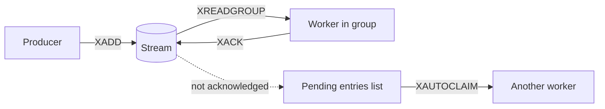

# Digest template, a filled digest, and the index template

Contents: 1. what goes under each heading · 2. a filled digest · 3. the index template.

Length: 800–1,200 words at depth `standard` and `deep`. At depth `quick`, 600–900 words: use
the low end of every "Length" cell below (3 key ideas, 2 result bullets, 2 limitation
bullets, 1–2 sentences on practitioners) and leave the diagram out unless the source is
about a flow. Every heading stays at every depth. Count with
`node harness/bin/tutor.mjs words <file>`.

The filled example shows the shape and the tone. Facts in a real digest come only from the
source you read in this run.

## 1. What goes under each heading

| Heading | Content | Length |
|---------|---------|--------|
| The claim in one sentence | What the source says is true or possible, in plain words. One sentence. | 1 sentence |
| The problem before this | What people did before, and what was painful or impossible. | 2–4 sentences |
| Key ideas | 3–6 ideas, each a `###` subheading and a plain explanation. An idea is something the learner could explain to a friend. | 2–4 sentences each |
| How it works | The mechanism step by step. A mermaid diagram when there is a flow or an architecture, then a numbered walk-through. | 4–8 lines plus diagram |
| Results and evidence | What the source measured or guarantees, with the place it stands (table, figure, section). For docs: the guarantees and limits the docs state. | 2–5 bullets |
| Limitations and criticisms | What it does not do, where it breaks, what later work or practitioners criticised. Name where each point comes from: a section of the source, or the id of another source in `sources.json`. | 2–4 bullets |
| What practitioners took from it | What real systems kept, changed, or dropped. Supported only by a source recorded in `sources.json`, named by its id. Never by a page outside it. | 2–4 sentences |
| How it connects to this topic | Wikilinks to the brief and to concept notes, each with a few words on the connection. | 2–5 bullets |
| Test yourself | Exactly 3 numbered questions answerable from this digest. No answers. | 3 lines |

## 2. A filled digest

Source id `redis-streams-docs`, topic `backend-engineering/messaging/redis-streams`. File
name: `redis-streams-docs-redis-streams.md`.

````markdown
---
title: "Redis Streams (official documentation) — digest"
topic: backend-engineering/messaging/redis-streams
stage: digest
tags: [backend-engineering, messaging, digest]
created: 2026-11-14
sources: [redis-streams-docs]
---

# Redis Streams (official documentation)

Redis, official documentation of the stream data type, read on 2026-11-14.

## The claim in one sentence

A stream is an append-only log inside Redis that many readers can consume independently, and
consumer groups let a team of workers share the entries without losing any when a worker
fails.

## The problem before this

Before streams, Redis offered lists and pub/sub for passing messages. A list gives each
message to one reader and then forgets it. Pub/sub gives each message to everyone who is
listening at that moment and keeps nothing for a reader who was offline. Neither keeps a
history that several independent readers can replay.

## Key ideas

### An entry has an ID made of time and sequence

Every entry gets an ID such as `1526919030474-55`: a millisecond timestamp and a counter.
IDs only grow, so an ID is also a position in the stream (section "Entry IDs").

### Reading does not remove

Reading an entry leaves it in the stream. Each reader only remembers the last ID it saw, so
any number of readers can go through the same entries at their own speed.

### A consumer group is a shared cursor

A consumer group is a named reader that several workers join. The group gives each new entry
to exactly one worker and remembers which entries were handed out.

### Pending entries make failure visible

An entry that was handed to a worker but not yet acknowledged sits in the group's pending
entries list. If the worker dies, the entry stays there until another worker claims it.

## How it works



1. A producer appends an entry with `XADD`; Redis assigns the ID.
2. A worker asks its group for new entries with `XREADGROUP`. The entry is now pending.
3. The worker does its job and confirms with `XACK`. The entry leaves the pending list.
4. If no confirmation arrives, another worker takes the entry over with `XAUTOCLAIM`.

## Results and evidence

- Delivery inside a group is at-least-once: an entry can be delivered again after a claim,
  so workers must tolerate repeats (section "Recovering from permanent failures").
- The stream can be capped with `MAXLEN` or `MINID` so memory stays bounded (section
  "Capped streams").

## Limitations and criticisms

- A stream lives on one Redis primary. It does not partition itself across machines the way
  a Kafka topic does; the documentation leaves sharding to the application.
- Entries can be lost on failover, because replication is asynchronous unless the writer
  waits for replicas (section on persistence and replication).

## What practitioners took from it

Adoption beyond the documentation could not be verified from the sources recorded for this
topic, so nothing is claimed here.

## How it connects to this topic

- [[01-brief-redis-streams|Redis Streams brief]] — this is the source behind the brief's
  diagram.
- [[At-least-once delivery]] — the guarantee a consumer group gives.
- [[Message queue]] — a consumer group turns a stream into a queue with memory.

## Test yourself

1. Why can two independent readers both see every entry of a stream?
2. What is in the pending entries list, and what removes an entry from it?
3. A worker crashes after reading an entry. Which command lets another worker finish it?

## My insights
````

Notice the honest sentence under "What practitioners took from it". That is the correct
content when no recorded source supports the section. Never fill it with general
impressions, and never with a page that is not in `sources.json`; report such a page under
PROBLEMS in your return instead.

The two concept links (`[[At-least-once delivery]]`, `[[Message queue]]`) are in sentence
case and were created with `tutor concept`. In a new concept note you write only the
definition under the title; `tutor map` fills `## Where it shows up`.

## 3. The index template

File: `<vault>/04-digests/00-digests-<slug>.md`.

````markdown
---
title: "<Title> — digests"
topic: <domain>/<subdomain>/<slug>
stage: digest
tags: [<domain>, <subdomain>, digest]
created: <YYYY-MM-DD>
sources: [<source-id-1>, <source-id-2>]
---

# Digests for <Title>

These are the sources worth reading in full one day, each reduced to a ten-minute note. Read
them in this order.

1. [[<source-id-1>-<slug>|<Source title>]] — <why it comes first: it defines the idea>.
2. [[<source-id-2>-<slug>|<Source title>]] — <what it adds: extends, applies, or critiques>.

Back to the map: [[00-start-here-<slug>|Start here]].

## My insights
````

Rules for the index:

- One numbered line per digest that exists. A digest that failed is left out.
- The link target is the digest's file name without `.md`.
- The reason after the dash comes from the worker's findings (the claim and its place in the
  reading order). Keep it to one line.
- If the scaffold created by `tutor init` already contains this file, keep its frontmatter
  and its `# ` title line as they are (add only the `sources:` list when it is missing) and
  fill in the body above `## My insights`. The scaffold wins over the title and tags shown
  above.
