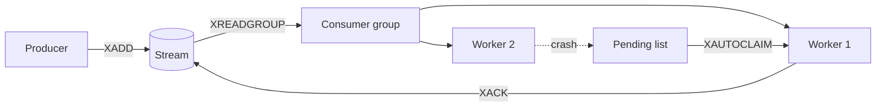

# Final notes — filled example

This is a complete `07-final-notes-<slug>.md` for the topic
`backend-engineering/messaging/redis-streams`. Copy the structure, not the
content. The headings, their order, and their spelling are fixed. The example is
about 370 words, which sits safely inside the 200 to 600 word gate.

What makes it good:

- The first sentence can be repeated from memory.
- The diagram has six nodes and shows the one loop that matters.
- Every key idea carries its reason.
- "When not to" names the alternative, so the note is useful for a decision.
- Failure modes name the symptom the learner would actually see.
- The production section links to the exact repo-intel notes.

````markdown
---
title: Redis Streams — final notes
topic: backend-engineering/messaging/redis-streams
stage: final-notes
tags: [backend-engineering, messaging]
created: 2026-11-14
sources: [redis-streams-docs, redis-source]
---

## In one sentence

A Redis Stream is an append-only log inside Redis that several workers can read
as a group, so each message is processed once and nothing is lost when a worker
crashes.

## The mental model



Entries are never moved, only read. The group remembers what it handed out and
to whom, and an entry leaves the pending list only when a worker acknowledges it.

## Key ideas

- Every entry gets an id of the form `milliseconds-sequence`, so ids are ordered
  and you can ask for "everything after this id".
- A consumer group gives each entry to exactly one consumer, because the group,
  not the consumer, stores the last delivered id.
- Delivery is at-least-once: an unacknowledged entry is delivered again, so
  handlers must be idempotent.
- The pending entries list is the safety net: it records who holds each entry
  and for how long.
- Reading with `>` means "new entries"; reading with `0` means "my own pending
  entries", which is how a restarted worker recovers.
- A stream grows forever unless it is trimmed with `MAXLEN` or `MINID`.

## When to use it / when not to

Use it when you already run Redis, need a work queue or event log with a few
thousand messages per second, and want replay without new infrastructure.

Do not use it when you need retention of weeks of data or many partitions
(use Kafka), or when a lost job is acceptable and simplicity wins (use a list
with `BRPOP`).

## Trade-offs and failure modes

- Memory is the limit: an untrimmed stream ends in an out-of-memory eviction.
- A consumer that never acknowledges makes the pending list grow; the symptom is
  rising `XPENDING` counts while throughput looks normal.
- A poison message is redelivered forever unless you check the delivery count
  and move it to a dead-letter stream.

## Commands or code worth remembering

```bash
XADD orders '*' id 42 total 19.90
XGROUP CREATE orders billing '$' MKSTREAM
XREADGROUP GROUP billing w1 COUNT 10 BLOCK 5000 STREAMS orders '>'
XACK orders billing 1731578400000-0
XAUTOCLAIM orders billing w2 60000 0 COUNT 10
XTRIM orders MAXLEN '~' 100000
```

## What production systems do differently

- They cap delivery attempts and route failures to a dead-letter stream, see
  [[bullmq-pattern-dead-letter|BullMQ dead-letter pattern]].
- They trim approximately (`~`) because exact trimming costs CPU on every write,
  see [[bullmq-findings|BullMQ findings]].
- They run claim and acknowledge steps in Lua scripts to keep them atomic, see
  [[bullmq-takeaways|BullMQ takeaways]].

## Go deeper

- [[00-start-here-redis-streams|Start here: the topic map]]
- [[01-brief-redis-streams|Brief]]
- [[02-lesson-redis-streams|Interactive lesson]]
- [[03-mini-projects-redis-streams|Mini projects]]
- [[00-digests-redis-streams|Digests]]
- [[00-repo-intel-redis-streams|Repository deep dive]]
- [[06-capstone-redis-streams|Capstone]]
- [[08-recall-redis-streams|Recall cards]]

## My insights
````

## Adapting the example

- For a topic without commands (a concept, a design method), put the formula, the
  checklist, or the decision rule the learner would look up again under
  `## Commands or code worth remembering`. Keep the heading unchanged.
- For a topic whose `repo-intel` stage was skipped, write the production section
  from the digests and add the sentence "No repository was analyzed for this
  topic." Leave the repo-intel line out of `## Go deeper`.
- Leave out any `## Go deeper` line whose file does not exist. A broken wikilink
  fails the `finalize` gate.
