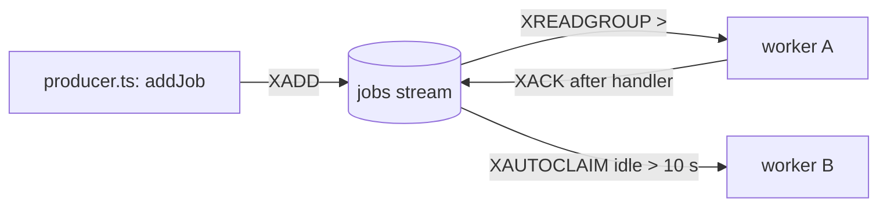

# Project README — filled example

This is a complete `README.md` for a guided mini project. Copy the headings and
their order exactly; replace the content. For a less guided or independent
project, shorten each task to its goal and acceptance check (see
`starter-and-solution.md`, section 2).

What makes it good:

- The use case is a situation from a real job, with a concrete failure.
- "What this proves" names one concept and one plan outcome.
- Every command can be pasted as it is.
- Each task says what done looks like.
- Hints sit at the end, under their own heading, one per task.
- "How it works" shows the real execution flow in one mermaid diagram, and the
  same diagram is registered with `tutor visuals add` (its `.mmd` file sits in
  the topic's `visuals/assets/` folder; the README path is in `used_in`).
- The implementation walkthrough comes after the hints, because it gives the answer.
- Short, active sentences (harness/rubrics/writing-standard.md).

````markdown
# Mini project 01 — A job queue that survives worker crashes

Time: about 2 hours · Guidance: guided

## The real use case

An online shop sends a confirmation email for every order. The emails are sent
by background workers. When a worker is restarted during a deployment, the email
it was sending is lost, and the customer never hears from the shop. You will
build a small job queue on Redis Streams in which a job that a crashed worker
was holding is picked up by another worker.

## What this proves

Consumer groups and the pending entries list give at-least-once delivery: a job
leaves the queue only when a worker acknowledges it. This serves the plan
outcome "explain how a crashed consumer's work is recovered".

## How it works



The producer appends each job to the `jobs` stream. A worker reads it through
the consumer group, and the job stays in the pending entries list until the
worker calls `XACK`. If worker A crashes first, worker B claims the idle job.
The lesson page "Consumer groups" animates this path with a `FlowAnimation`
in which you can switch worker A off.

## Prerequisites

- Node.js 22 or newer (`node --version`)
- Docker, to run Redis locally
- You have read lesson pages 1 to 4 of the Redis Streams lesson

Start Redis:

```bash
docker compose -f starter/docker-compose.yml up -d
```

## How to run

```bash
cd starter
cp .env.example .env
npm install
npm test          # 6 tests fail at the start; that is expected
npm start         # starts one producer and two workers
```

## Your tasks

1. **Add a job.** In `src/queue.ts`, implement `addJob` at `TODO(1)`. Use `XADD`
   with the id `*` and store the job fields. Done when the test "adds a job and
   returns its id" passes.
2. **Read a batch.** In `src/queue.ts`, implement `readBatch` at `TODO(2)`. Use
   `XREADGROUP` with the id `>` and `BLOCK 5000`. Done when the test "delivers
   each job to exactly one worker" passes.
3. **Acknowledge.** In `src/worker.ts`, call `XACK` at `TODO(3)` after the
   handler succeeds, and not before. Done when the test "keeps a failed job
   pending" passes.
4. **Recover.** In `src/worker.ts`, implement `claimStale` at `TODO(4)` with
   `XAUTOCLAIM` and a minimum idle time of 10 seconds. Done when the test "a
   second worker finishes a crashed worker's job" passes.

## How to check your work

```bash
npm test
```

Expected: `6 passed`. Then check it by hand: run `npm start`, stop one worker
with Ctrl+C while it prints `processing`, and watch the other worker print
`claimed` for the same job id within 10 seconds.

## Stretch goals

- Move a job to a `jobs:dead` stream after three failed deliveries.
- Trim the stream so that it keeps about 1,000 entries.
- Print the number of pending jobs per worker every 5 seconds.

## Hints

Read a hint only after you have tried the task for ten minutes.

### Hint for task 1

`XADD` returns the generated id as a string. The fields are passed as a flat
list of names and values.

### Hint for task 2

When the call times out, the client returns `null`, not an empty array. Convert
it before you loop over the result.

### Hint for task 3

If you acknowledge before the handler runs, a crash in the handler loses the
job. Put the acknowledgement on the line after the handler returns.

### Hint for task 4

`XAUTOCLAIM` needs a start id. Use `0` to scan the pending list from the
beginning.

## Implementation walkthrough

Read this only after you finish, or when you are stuck after the hints.

1. `src/queue.ts`, `addJob` (TODO 1): call `XADD jobs * ...fields` and return
   the id. The stream generates the id, so two producers never collide.
2. `src/queue.ts`, `readBatch` (TODO 2): call `XREADGROUP GROUP workers <name>
   COUNT 10 BLOCK 5000 STREAMS jobs >` and return `[]` when the client returns
   `null`. The id `>` asks only for jobs never delivered to this group.
3. `src/worker.ts`, `process` (TODO 3): run the handler, then call `XACK`.
   Acknowledging after success keeps a failed job in the pending list.
4. `src/worker.ts`, `claimStale` (TODO 4): call `XAUTOCLAIM jobs workers
   <name> 10000 0` every 5 seconds and process what it returns. This is the
   recovery path for a crashed worker.

## Compare with the solution

The finished project is in `../solution/`. When you compare, look at where
`XACK` is called in `src/worker.ts`, how `readBatch` handles a timeout, and how
the test for crash recovery simulates a crash without stopping a process.
````
