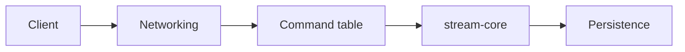
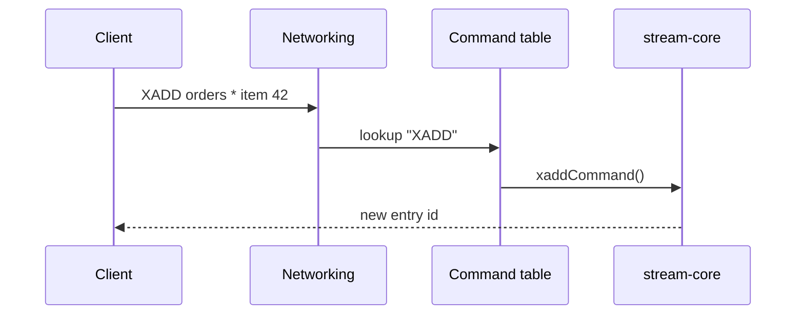

# Note templates for the repository deep dive

Read only the template of the note you are writing. Every template uses the example
repository `redis/redis` (folder `redis-redis`, file prefix `redis-`), topic
`backend-engineering/messaging/redis-streams`, short SHA `a1b2c3d`. Replace all values.

Contents:
1. Rules shared by all notes
2. Slice plan (scout) — `<state>/handoffs/repo-intel-<org>-<repo>-slices.md`
3. `<repo>-overview.md` (scout)
4. `<repo>-module-<name>.md` (module worker)
5. `<repo>-architecture.md` (synthesis)
6. `<repo>-tech-and-services.md` and `_tech` notes (synthesis)
7. `<repo>-findings.md` (synthesis)
8. `<repo>-takeaways.md` (synthesis)
9. `<repo>-pattern-<name>.md` (synthesis)
10. `00-repo-intel-<slug>.md` index (stage runner)

## 1. Rules shared by all notes

- Frontmatter, exactly these keys:

  ```yaml
  ---
  title: "redis/redis — <note kind>"
  topic: backend-engineering/messaging/redis-streams
  stage: repo-intel
  tags: [backend-engineering, messaging, repo-intel]
  created: 2026-11-14
  sources: [redis-redis-repo]
  ---
  ```

- Evidence format, always in backticks: `` `src/t_stream.c:1432 @ a1b2c3d` ``. The path is
  relative to the repository root. The line is one you read in this clone. A range is
  written `` `src/t_stream.c:1432-1450 @ a1b2c3d` ``.
- Links are wikilinks to file names: `[[redis-findings|Findings]]`, `[[Jemalloc]]`.
- Diagrams are mermaid code blocks. No quote blocks, no callout boxes.
- Code snippets: at most 12 lines each, at most 3 per note, each followed by its evidence.
- Plain language. The reader is a beginner who finished the lesson pages.
- `## My insights` is the last line of every note. Nothing is written below it. If a note
  already exists with text below that heading, keep that text and edit only above it.

## 2. Slice plan (scout)

This is a working file, not a vault note. No frontmatter.

```markdown
# Slice plan — redis/redis

Repository: https://github.com/redis/redis
Clone: .cache/repos/redis__redis
Commit: a1b2c3d4e5f60718293a4b5c6d7e8f9012345678 (short: a1b2c3d)
License: BSD-3-Clause
Files tracked: 1,412

## Chosen slices

| Unit id | Module name | What it holds | Est. tokens | Why chosen | File list |
|---------|-------------|---------------|-------------|------------|-----------|
| redis-redis-module-stream-core | stream-core | src/t_stream.c, src/stream.h | 52,000 | implements the stream type | .cache/tmp/redis-streams/redis-redis-module-stream-core.files.txt |
| redis-redis-module-stream-tests | stream-tests | tests/unit/type/stream*.tcl | 41,000 | tests of the topic | .cache/tmp/redis-streams/redis-redis-module-stream-tests.files.txt |
| redis-redis-module-build-and-infra | build-and-infra | Makefile, deps/, .github/workflows, redis.conf | 38,000 | technologies, CI, configuration | .cache/tmp/redis-streams/redis-redis-module-build-and-infra.files.txt |

## Skipped slices

- src/modules/, src/cluster*.c — not part of the topic.
- deps/ source code — vendored third-party code (only its manifest is in build-and-infra).

## Notes for module workers

- Topic keywords to search for: stream, XADD, XREADGROUP, consumer group, PEL.
- Focus from the playbook: <one or two lines copied from "Repository analysis focus">.
```

## 3. `<repo>-overview.md` (scout)

```markdown
<frontmatter, title "redis/redis — overview">

# redis/redis — overview

## What it is

<2–3 sentences from the README and the source entry.>

## Why this repository

<Why it was chosen for this topic: who maintains it, who runs it in production. From
sources.json.>

## What was analyzed

- Repository: https://github.com/redis/redis
- Commit: `a1b2c3d4e5f60718293a4b5c6d7e8f9012345678` (short `a1b2c3d`), cloned 2026-11-14
- License: BSD-3-Clause
- Size: 1,412 tracked files; 3 slices analyzed, listed in the slice plan

## Stack

- Language: C (`Makefile:1 @ a1b2c3d`)
- <build tool, test framework, main libraries, each with evidence from a manifest>

## My insights
```

The overview links to no other note of the deep dive, because the scout writes it before
those notes exist and a link to a missing note fails the gate. The index note gives the
reading order.

## 4. `<repo>-module-<name>.md` (module worker)

```markdown
<frontmatter, title "redis/redis — module stream-core">

# redis/redis — module: stream-core

## Responsibility

<2–3 sentences: what this part of the code is responsible for.>

## Key files

| File | Role |
|------|------|
| `src/t_stream.c` | Commands and core logic of the stream type |
| `src/stream.h` | Data structures |

## How it works

<The main code path, step by step, each step with evidence. A mermaid diagram when the flow
has more than three steps.>

1. `XADD` is parsed and the ID is generated (`src/t_stream.c:1432 @ a1b2c3d`).
2. ...

## Beyond the textbook

### <Short name of the practice>

- Textbook version: <what a simple implementation would do>
- What they do: <what this code does>
- Why: <the reason, from a comment, a test, or the visible behaviour>
- Evidence: `src/t_stream.c:812-840 @ a1b2c3d`

<Repeat for each practice. Aim for 3–6. Write "None found in this slice." if there are none.>

## Tests and what they protect

<Which behaviours the tests check, which edge cases, how failures are simulated. Evidence.>

## Error handling, performance, and security

<What happens on bad input, on failure, under load; limits, timeouts, validation. Evidence.
Write "Not present in this slice." for a part that does not apply.>

## Technologies and services seen

- <Name> — <what it is used for here> (`path:line @ a1b2c3d`)

## Worth exploring interactively

- <Code path name> — <ordered steps, each with `path:line @ a1b2c3d`> — fits <FlowAnimation | SystemDiagram | AlgorithmStepper | StateMachine> because <what the learner would see change>

## Open questions

<Things you could not determine from this slice. The synthesis may resolve them.>

## My insights
```

## 5. `<repo>-architecture.md` (synthesis)

````markdown
<frontmatter, title "redis/redis — architecture">

# redis/redis — architecture

## Module map

| Module | Responsibility | Note |
|--------|----------------|------|
| stream-core | Commands and data structure of streams | [[redis-module-stream-core|stream-core]] |

## The picture



<One sentence: what the module map shows, with the lines that prove the calls, e.g.
`src/server.c:3120 @ a1b2c3d`.> [[visual-redis-module-map-redis-streams|explanation and sources]]

## Main flow



<The main request or data flow through the modules, as numbered steps with evidence taken
from the module notes. Plain words first, then the function names.>
[[visual-redis-request-flow-redis-streams|explanation and sources]]

## Module dependencies (when useful)

<Optional third diagram: which module imports which, when a layer boundary or an avoided
cycle teaches something. Visual-first plans need at least the two diagrams above.>

## Worth exploring interactively

<The best 1–3 code paths collected from the module notes, each with its suggested lesson
component and evidence.>

## Design decisions worth noticing

<2–4 short paragraphs, each linking to a finding or a pattern note.>

## Not analyzed

<The skipped slices from the slice plan, one line each, so the limits are clear.>

## My insights
````

## 6. `<repo>-tech-and-services.md` and `_tech` notes (synthesis)

```markdown
<frontmatter, title "redis/redis — technologies and services">

# redis/redis — technologies and services

## Languages and runtimes

| Technology | Why it is used here | Evidence |
|------------|---------------------|----------|
| [[C language]] | The whole server is written in C for control over memory | `Makefile:1 @ a1b2c3d` |

## Libraries and frameworks

| Technology | Why it is used here | Evidence |
|------------|---------------------|----------|
| [[Jemalloc]] | Default allocator, chosen to reduce memory fragmentation | `deps/README.md:20 @ a1b2c3d` |

## Data stores, queues, and external services

<Same table. Databases, caches, message brokers, cloud services, third-party APIs. Write
"None: this repository is itself the data store." when that is the case.>

## Build, test, and delivery

<Same table. Build tools, test frameworks, CI service, container tooling, release tooling.>

## Observability and security tooling

<Same table. Logging, metrics, tracing, scanners, fuzzers, sanitizers.>

## My insights
```

For each technology or service:

1. Check `ls vault/_tech` for an existing note and reuse its exact name. Use the common
   official name ("PostgreSQL", not "Postgres" or "pg").
2. Run `node harness/bin/tutor.mjs concept "<Name>" --tech`. It creates the note if missing
   and prints its path. When a note with the same name in another letter case exists, it
   returns that note; link to the file name it prints.
3. Open the note. If it is new, the line `<!-- tutor:placeholder -->` and a line that starts
   with "_Not written yet" stand directly under its `# ` title. Replace those two lines with
   1–3 plain sentences: what the technology is and what kind of problem it solves.
4. Write nothing under `## Where it shows up`. `tutor map` (also run by `tutor done`) fills
   that heading with a backlink to every note that links to this one, so the line for this
   repository appears by itself once `<repo>-tech-and-services.md` links to `[[<Name>]]`.
5. Never change the frontmatter or the headings of a shared note, and never remove lines
   that are already in it.

The same four rules hold for a `_concepts` note created with
`node harness/bin/tutor.mjs concept "<Concept>"`. A concept name is in sentence case
("Consistent hashing", "At-least-once delivery"); a technology keeps its official spelling.

## 7. `<repo>-findings.md` (synthesis)

```markdown
<frontmatter, title "redis/redis — findings">

# redis/redis — findings

What this production codebase does beyond the textbook version of Redis Streams, ranked by
how much you gain from knowing it.

## 1. <Short name of the finding>

- Textbook version: <one sentence>
- What they do: <one or two sentences>
- Why: <the reason>
- Evidence: `src/t_stream.c:812-840 @ a1b2c3d`
- Borrow it when: <the situation in which you should do the same>
- More: [[redis-module-stream-core|stream-core]]

## 2. <Next finding>

...

## My insights
```

Rules: 5–10 findings; each has the five bullets and a `More:` line; each has at least one
evidence citation; findings about the topic itself rank above general engineering hygiene.
`More:` links to module notes first. Add the link to a pattern note only after that pattern
note has been written.

## 8. `<repo>-takeaways.md` (synthesis)

```markdown
<frontmatter, title "redis/redis — takeaways">

# redis/redis — takeaways for the capstone

The capstone is "<plan.capstone.name>". These are the things worth borrowing.

1. **<Imperative sentence: do this>.** <One sentence on how it applies to the capstone.>
   From [[redis-findings|finding 1]].
2. ...

## What not to copy

<1–3 things that make sense at their scale but would be over-engineering in a learning
project, each with one line of reasoning.>

## My insights
```

Rules: 5–8 numbered takeaways, each linked to the findings note or to a pattern note that
already exists.

## 9. `<repo>-pattern-<name>.md` (synthesis)

```markdown
<frontmatter, title "redis/redis — pattern: <Name>">

# Pattern: <Name>

## The problem

<What goes wrong without it. 2–3 sentences.>

## What they do

<The practice, in plain words, with a short snippet if the license allows.>

## Evidence

- `src/t_stream.c:812-840 @ a1b2c3d` — <what this place shows>
- `tests/unit/type/stream.tcl:300 @ a1b2c3d` — <what this place shows>

## When to use it, and when not to

<2–4 sentences.>

## Related

- [[<Concept>]] — <the idea behind it>
- [[redis-findings|Findings]]

## My insights
```

## 10. `00-repo-intel-<slug>.md` index (stage runner)

Written from the worker summaries. One section per repository.

```markdown
---
title: "Redis Streams — repository deep dives"
topic: backend-engineering/messaging/redis-streams
stage: repo-intel
tags: [backend-engineering, messaging, repo-intel]
created: 2026-11-14
sources: [redis-redis-repo]
---

# Repository deep dives for Redis Streams

How a production codebase implements this topic. Read the notes of a repository in the
order shown.

## redis/redis

<One line: what it is and why it was chosen. Commit a1b2c3d.>

1. [[redis-overview|Overview]]
2. [[redis-architecture|Architecture]]
3. [[redis-findings|Findings]] — <the top finding in a few words>
4. [[redis-tech-and-services|Technologies and services]]
5. [[redis-takeaways|Takeaways for the capstone]]

Modules: [[redis-module-stream-core|stream-core]], [[redis-module-stream-tests|stream-tests]],
[[redis-module-build-and-infra|build-and-infra]]

Back to the map: [[00-start-here-redis-streams|Start here]].

## My insights
```

List only notes that exist. If the scaffold from `tutor init` already contains this file,
keep its frontmatter and fill in the body above `## My insights`.
