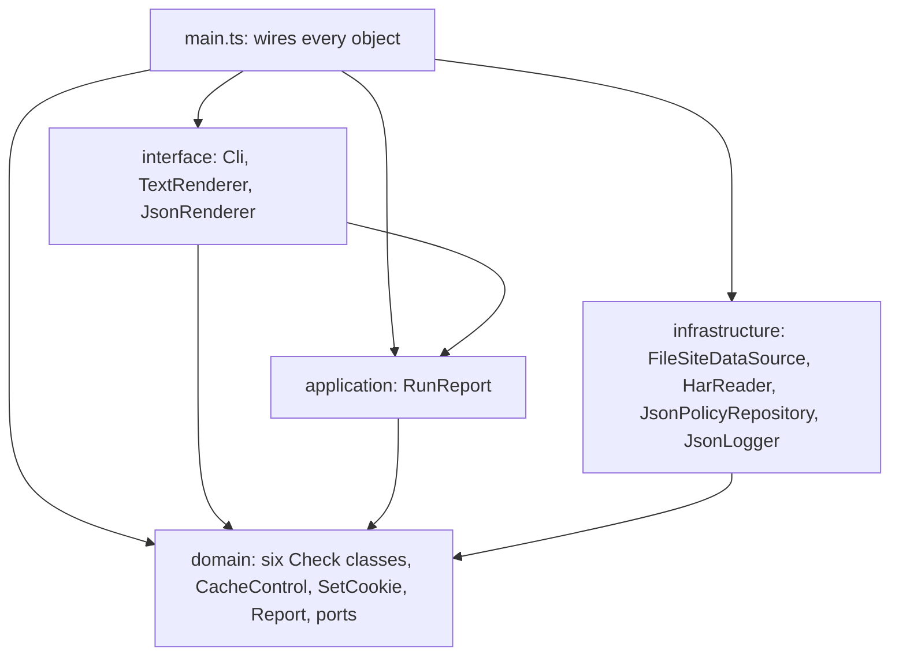
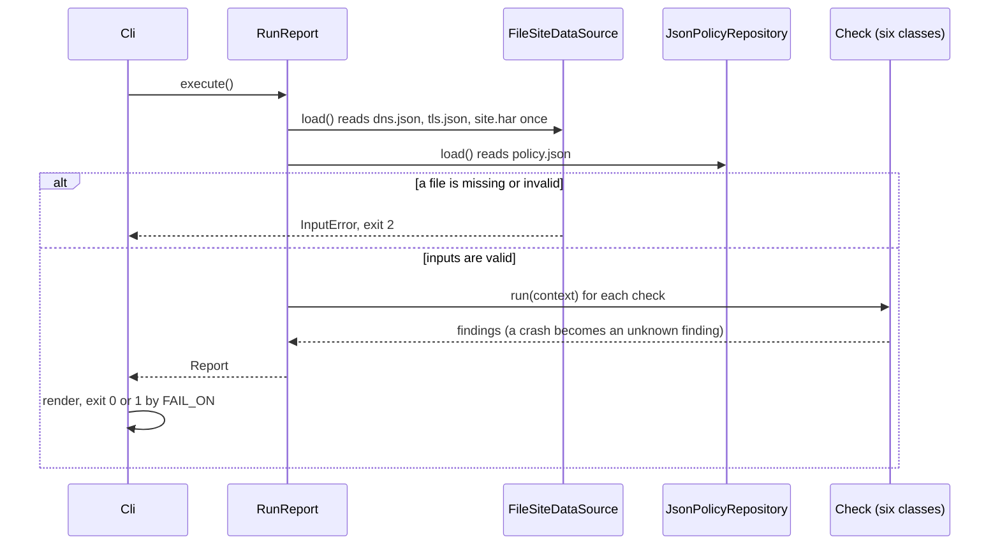
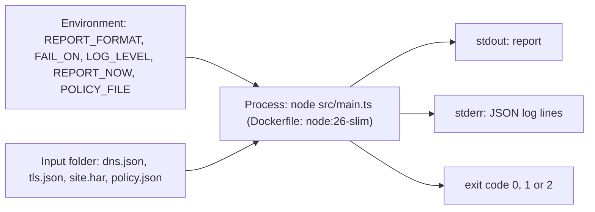

# Architecture

## Overview

Site network report is a Node.js command line tool. It reads saved data about one site and checks it against a written policy. The data is DNS answers (`dns.json`), TLS certificate facts (`tls.json`) and HTTP responses (`site.har`, a HAR file). The policy is `policy.json`. The tool prints a report and sets an exit code, so a team can block a launch in CI.

The design has four layers. Dependencies point inward: the interface and infrastructure layers know the domain, and the domain knows nothing about files, the console or the clock. No repository from the repo-intel stage was copied; the practices below are rules taken from the takeaways notes.

## Layers



Each layer has one job.

- **domain** (`src/domain`): the rules. Six `Check` classes, two parsers, `Report`, and the ports (interfaces) other layers must satisfy.
- **application** (`src/application`): one use case, `RunReport`. It loads the inputs, runs every check and builds the report.
- **infrastructure** (`src/infrastructure`): adapters for the ports. They read files, parse HAR, read the policy, log, and tell the time.
- **interface** (`src/interface`): `Cli` and the renderers. They turn a report into text, JSON and an exit code.
- `src/main.ts` is the composition root. It creates the long-lived objects (sources, checks, renderers) and wires them together; other files only create values and errors.

## Classes and their responsibilities

| Class | File | One job |
|---|---|---|
| `DnsCheck` | `src/domain/checks/dnsCheck.ts` | Address records, CAA, CNAME conflicts, TTL bounds |
| `TlsHstsCheck` | `src/domain/checks/tlsHstsCheck.ts` | TLS version, certificate dates and names, HSTS, plain-HTTP requests |
| `HttpVersionCheck` | `src/domain/checks/httpVersionCheck.ts` | Negotiated HTTP version against the policy minimum |
| `CachingCheck` | `src/domain/checks/cachingCheck.ts` | Cache-Control, validators, hashed assets, shared-cache leaks, Vary |
| `CompressionCheck` | `src/domain/checks/compressionCheck.ts` | Content-Encoding by coding and by type |
| `CookieCheck` | `src/domain/checks/cookieCheck.ts` | Set-Cookie attributes, run through the `COOKIE_RULES` list |
| `CacheControl` | `src/domain/cacheControl.ts` | Read one Cache-Control header without throwing |
| `SetCookie` | `src/domain/setCookie.ts` | Read one Set-Cookie header and list what is wrong |
| `Report` | `src/domain/report.ts` | Hold findings, count them, decide pass or fail |
| `RunReport` | `src/application/runReport.ts` | The use case: load once, run checks, isolate crashes |
| `FileSiteDataSource` | `src/infrastructure/fileSiteDataSource.ts` | Read `dns.json`, `tls.json`, `site.har` |
| `HarReader` | `src/infrastructure/harReader.ts` | Turn a HAR document into `HttpEntry` values |
| `JsonPolicyRepository` | `src/infrastructure/jsonPolicyRepository.ts` | Read and validate the policy |
| `JsonLogger` | `src/infrastructure/jsonLogger.ts` | One JSON log line per event, with a run id |
| `SystemClock`, `FixedClock` | `src/infrastructure/clocks.ts` | Supply "now" |
| `Cli` | `src/interface/cli.ts` | Run the use case, print, map errors to exit codes |
| `TextRenderer`, `JsonRenderer` | `src/interface/renderers.ts` | Format a report |

The ports are `SiteDataSource`, `PolicyRepository`, `Clock`, `Logger` and `Check` in `src/domain/ports.ts`.

## Request flow

One run reads each input once, runs the six checks on the same data, and prints one report.



The failure paths are part of the design. Bad input stops the run with exit code 2. A check that throws does not stop the others: `RunReport` records an `unknown` finding for it.

## Deployment

The tool is one process with no network, database or queue. It runs with `npm start`, or with the `Dockerfile`, which uses the `node:26-slim` image and runs `node src/main.ts`. Node.js 26 runs the TypeScript files directly, so there is no build step.



## Interactive walkthrough

This spec is ready to paste into a lesson page. It uses the `FlowAnimation` props from `site/COMPONENTS.md`. The learner can switch off `source` to see what a missing file does.

```mdx
<FlowAnimation
  title="One run of the site network report"
  nodes={[
    { id: "cli", label: "Cli", kind: "pill" },
    { id: "run", label: "RunReport" },
    { id: "source", label: "FileSiteDataSource", kind: "store" },
    { id: "checks", label: "Six Check classes" },
    { id: "report", label: "Report" }
  ]}
  steps={[
    { from: "cli", to: "run", packet: "execute()", caption: "Cli asks the use case for a report." },
    { from: "run", to: "source", packet: "load()", caption: "RunReport reads dns.json, tls.json and site.har once." },
    { from: "source", to: "run", packet: "SiteData", caption: "The adapter returns typed data." },
    { from: "run", to: "checks", packet: "context", caption: "Every check reads the same site data and policy." },
    { from: "checks", to: "report", packet: "findings", caption: "Findings are collected into a Report." },
    { from: "report", to: "cli", packet: "exit 0 or 1", caption: "Cli prints the report and returns the exit code." }
  ]}
  breakable={["source"]}
  brokenCaptions={{ source: "A file is missing: FileSiteDataSource throws InputError and Cli exits with code 2." }}
/>
```

## Object-oriented ideas and where they are used

| Idea | Where |
|---|---|
| Single responsibility | One `Check` class per area; `HarReader` only reads HAR; `Cli` holds no check logic. |
| Open/closed | A new check is a new class in `src/domain/checks/` plus one line in `src/main.ts`. A new cookie rule is one row in `COOKIE_RULES`. |
| Liskov substitution | Any `Check` can replace another in `RunReport`; `tests/unit/application.test.ts` uses fake checks. |
| Interface segregation | Each port has one to three methods (`src/domain/ports.ts`). |
| Dependency inversion | `RunReport` receives ports in its constructor and never imports an adapter. |
| Composition over inheritance | Only the three error classes extend `Error`; no other class extends another. Objects are joined in `src/main.ts`. |
| Value objects | `CacheControl` and `SetCookie` are built once by `parse` and then only read. |
| Own error classes | `InputError`, `PolicyError`, `ConfigError` in `src/domain/errors.ts`. |

## Borrowed from production

| Practice | Source note | Where it is applied |
|---|---|---|
| Report which freshness rule won (`s-maxage`, `max-age`, `Expires`, 10% heuristic) | `undici-takeaways.md` item 1 | `src/domain/freshness.ts` |
| Treat an unreadable header as its own result, not a pass (ok, problem, unknown) | `undici-takeaways.md` item 2 | `src/domain/finding.ts`, `src/domain/cacheControl.ts` |
| Flag shared-cache leaks and `Vary` problems | `undici-takeaways.md` items 3 and 4 | `src/domain/checks/cachingCheck.ts` |
| Name the client that produced the HAR data, because ALPN decides the HTTP version | `undici-takeaways.md` item 5 | `src/domain/checks/httpVersionCheck.ts` |
| Write the cookie rules as one list, and never throw on a bad header | `cookie-takeaways.md` items 1 and 2 | `src/domain/checks/cookieCheck.ts`, `src/domain/setCookie.ts` |
| Report what a lenient parser would drop silently | `cookie-takeaways.md` item 4 | `CookieCheck` turns `SetCookie.issues` into findings |
| Fixtures with expected findings, and a written skip list | `undici-takeaways.md` item 8, `cookie-takeaways.md` item 6 | `fixtures/`, `tests/integration/cli.test.ts`, README |

## Error handling, configuration, logging

- **Errors.** Bad files raise `InputError`, a bad policy raises `PolicyError`, a bad setting raises `ConfigError`. `Cli` maps all three to exit code 2. Any other error is logged with its stack and also exits 2. Nothing is swallowed.
- **Findings, not errors.** A problem in the site is data, not an exception. It goes into the report with a severity (`error` or `warning`) and a verdict (`problem` or `unknown`).
- **Configuration.** Environment variables only, read once by `loadConfig` in `src/infrastructure/config.ts`: `REPORT_FORMAT`, `FAIL_ON`, `LOG_LEVEL`, `REPORT_NOW`, `POLICY_FILE`. All have defaults, and a wrong value stops the run at startup. `.env.example` lists them.
- **Logging.** `JsonLogger` writes one JSON object per line to stderr, with a `runId`. The report goes to stdout, so the two never mix.

## How to extend it

1. **A new check.** Add `src/domain/checks/<name>Check.ts` with a class that implements `Check`. Add a test in `tests/unit/checks.test.ts`. Add the class to the list in `src/main.ts`.
2. **A new cookie rule.** Add one row to `COOKIE_RULES` and one test.
3. **A new input.** Add a field to `SiteData`, read it in `FileSiteDataSource`, and write a fixture. For live data, write a new `SiteDataSource` class and change one line in `src/main.ts`.
4. **A new output.** Write a class with `render(report)` in `src/interface/renderers.ts` and choose it in `src/main.ts`.
