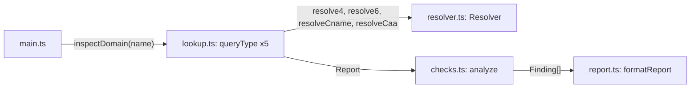

# Mini project 01 — DNS record inspector

Time: about 2 hours · Guidance: guided

## The real use case

A developer is moving a site to a new host. On the day of the switch they change the nameservers or the A record. Then three things go wrong. Old answers stay cached for an hour because the TTL was 3600. The new host cannot get a certificate because a CAA record only allows another CA. A leftover CNAME sits next to an A record, and some resolvers answer with the wrong one. You will build a small command that reads the A, AAAA, CNAME, CAA and HTTPS records of a name and reports these problems before the switch.

## What this proves

DNS records have types, and each type answers a different question. A TTL (time to live) says how long a resolver may keep an answer. Choosing the record type and the TTL is a migration decision. This serves the plan outcome "explain how DNS resolves a name and choose the right record type and TTL".

## How it works



`main.ts` asks `inspectDomain` for the five record types. `queryType` calls one method of the `Resolver` interface per type. The real resolver uses `node:dns/promises`; tests and `npm run demo` use a stub, so they need no network. `analyze` runs `checkTtl`, `checkCnameConflict` and `checkCaa` on the report, and `formatReport` prints the result. The command exits with 1 when it finds an error.

## Prerequisites

- Node.js 26 (`node --version`). Node runs the `.ts` files directly, so there is no build step.
- Lesson page "Domains, DNS resolution and hosting". You know what A, AAAA, CNAME and TTL mean.
- No account and no service. Tests and `npm run demo` run offline.

## How to run

```bash
cd starter
npm install
npm test          # 18 tests fail at the start; that is expected
npm run demo      # fails with "TODO(2)" until you finish the tasks
```

When the tasks are done, query a real name (this needs network access):

```bash
npm start -- example.com --ca letsencrypt.org --max-ttl 300
```

## Your tasks

1. **Query one record type.** In `src/lookup.ts`, implement `queryType` at `TODO(1)`. Call the right `Resolver` method, map the answers to `DnsRecord` values, and treat `ENODATA` and `ENOTFOUND` as "empty". Done when the seven `queryType` tests pass.
2. **Query all five types.** In `src/lookup.ts`, implement `inspectDomain` at `TODO(2)`. Use `Promise.all` and build the `sets` object. Done when the two `inspectDomain` tests pass.
3. **Check TTLs.** In `src/checks.ts`, implement `checkTtl` at `TODO(3)`. Warn about each record with a TTL above `maxTtl`. Done when the two `checkTtl` tests pass.
4. **Check CNAME conflicts.** In `src/checks.ts`, implement `checkCnameConflict` at `TODO(4)`. A CNAME must be the only record at its name. Done when the two `checkCnameConflict` tests pass.
5. **Check CAA.** In `src/checks.ts`, implement `checkCaa` at `TODO(5)`. Done when the three `checkCaa` tests and the two `analyze` tests pass.

## How to check your work

```bash
npm test
```

Expected: `18 passed`. Then check by hand:

```bash
npm run demo
```

The report must show a `WARN` for the 3600 second TTL, an `ERROR` for the CAA record that does not list `letsencrypt.org`, and an `INFO` for the missing AAAA record. The command exits with 1 because of the error.

## Stretch goals

- Add a `--json` flag that prints the `Report` and the findings as JSON.
- Implement `resolveHttps` with a DNS-over-HTTPS JSON endpoint, so the HTTPS record is checked and not skipped.
- Compare two names (old host and new host) and print which record types differ.

## Hints

Read a hint only after you have tried the task for ten minutes.

### Hint for task 1

`resolve4` and `resolve6` return `{ address, ttl }`. `resolveCaa` returns objects where only one of `issue`, `issuewild` or `iodef` is set. Read the `code` property of the caught error, not its message.

### Hint for task 2

`Promise.all` returns an array in the same order as its input. `Object.fromEntries` turns `[type, set]` pairs into the `sets` object.

### Hint for task 3

A record with `ttl === null` has no known TTL. Skip it. Do not compare `null > 300`.

### Hint for task 4

You only need the length of `A.records`, `AAAA.records` and `CNAME.records`.

### Hint for task 5

`"issue letsencrypt.org".slice(6)` gives the CA name. Compare it with `expectedCa` exactly.

## Implementation walkthrough

Read this only after you finish, or when you are stuck after the hints.

1. `src/lookup.ts`, `queryType` (TODO 1): branch on `type`. Map each answer to `{ value, ttl }`. Return `"ok"` or `"empty"` by the number of records. In the `catch`, an `ENODATA` or `ENOTFOUND` code means the name has no such record, so it is `"empty"`. Other errors become `"error"` with the message, so the report shows them.
2. `src/lookup.ts`, `inspectDomain` (TODO 2): run `queryType` for all types in `RECORD_TYPES` with `Promise.all`, then build the `sets` object. The calls run in parallel and none of them throws.
3. `src/checks.ts`, `checkTtl` (TODO 3): filter records with a numeric TTL above `maxTtl` and return one `warn` finding each. A resolver keeps an answer until its TTL ends, so a long TTL slows the switch.
4. `src/checks.ts`, `checkCnameConflict` (TODO 4): when `CNAME` has records and `A` or `AAAA` has records, return one `error` finding.
5. `src/checks.ts`, `checkCaa` (TODO 5): no records gives an `info` finding. A record `issue <expectedCa>` gives no finding. Anything else gives an `error` finding, because the new host's CA could not issue a certificate.

## Compare with the solution

The finished project is in `../solution/`. When you compare, look at:

- How `queryType` hides the differences between four `node:dns` methods behind one `RecordSet` shape.
- How `analyze` stays short because each check is a small function that returns `Finding[]`.
- How the `Resolver` interface lets tests replace DNS completely.
