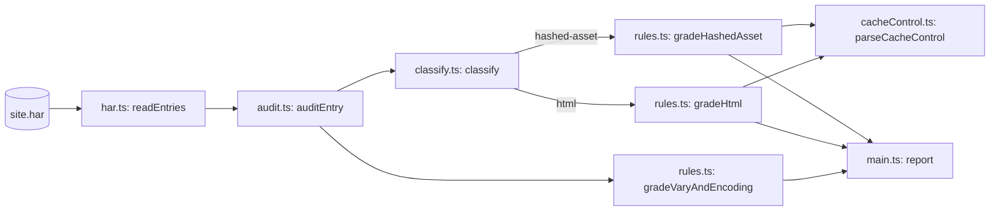

# Mini project 02 — A cache header auditor for hashed assets and HTML

Time: about 2 hours · Guidance: less guided

## The real use case

A frontend team ships a site with hashed files such as `app.3f9a1c2b.js`. The hash changes with every build, so each file can live in a cache for a year. The HTML page is the opposite: it names the newest hashed files, so it must be checked on every visit. Often one header is wrong. A script with `max-age=3600` is downloaded again every hour. An HTML page with `max-age=600` shows users an old page after a deploy. You will build a small CLI that reads a HAR file (a browser's saved record of a page load) and grades these headers.

## What this proves

HTTP caching is steered by `Cache-Control`, validators (`ETag`), `Vary` and `Content-Encoding`, and each has a precise meaning. This serves the plan outcome "configure HTTP caching, CDN caching and compression for a static site with hashed assets". You also practise strict parsing: a header you cannot read is reported as `unknown`, never as a pass.

## How it works



`main.ts` reads the HAR file. `readEntries` turns each response into an `Entry` with lowercase header names. `auditEntry` calls `classify` to pick the rule set, then adds `gradeVaryAndEncoding` for every entry. The two cache graders both read `Cache-Control` through `parseCacheControl`. `main.ts` prints every finding that is not `ok` and exits with 1 when any finding is a `problem`.

Each finding has one of three results: `ok`, `problem` or `unknown`. The lesson page "HTTP caching" has a cache lab that shows the same headers changing what the browser does.

## Prerequisites

- Node.js 22.6 or newer (`node --version`). The project runs `.ts` files directly; Node.js 26 was used to write it.
- npm (comes with Node.js).
- You have read the lesson pages on HTTP messages and HTTP caching.
- No account, network access or running service is needed after `npm install`.

## How to run

```bash
cd starter
npm install
npm test          # 23 of 24 tests fail at the start; that is expected
npm start         # runs the auditor on tests/fixtures/site.har
```

The sample file `tests/fixtures/site.har` holds eight responses written by hand. `tests/fixtures/expected.json` lists the findings the finished auditor must report.

To audit your own site, open DevTools, go to the Network tab, choose "Save all as HAR", and run `node src/main.ts my-site.har`.

## Your tasks

1. **Parse `Cache-Control` strictly.** In `src/cacheControl.ts`, implement `parseCacheControl`. Done when `tests/cacheControl.test.ts` passes. A repeated `max-age` keeps the smallest value, because a cache that sees two values must not use the larger one.
2. **Classify an entry.** In `src/classify.ts`, implement `classify`. Done when `tests/classify.test.ts` passes. HTML is found by its type, not by its path.
3. **Grade hashed assets.** In `src/rules.ts`, implement `gradeHashedAsset`. Done when the `gradeHashedAsset` tests pass.
4. **Grade HTML.** In `src/rules.ts`, implement `gradeHtml`. Done when the `gradeHtml` tests pass.
5. **Grade `Vary` and `Content-Encoding`.** In `src/rules.ts`, implement `gradeVaryAndEncoding`. Done when the `gradeVaryAndEncoding` tests and `tests/audit.test.ts` pass.

## How to check your work

```bash
npm test
```

Expected: `24 passed`. Then check it by hand: run `npm start`. You should see `19 checks: 7 problems, 1 unknown.` and the exit code is 1. Change the `Cache-Control` of `vendor.9b8c7d6e.js` in the HAR to `public, max-age=31536000, immutable` and run again. The two `hashed-` problems for that file disappear.

## Stretch goals

- Add a `freshness` finding that names which rule gives the lifetime: `s-maxage`, `max-age`, `Expires`, or a 10% `Last-Modified` guess.
- Flag `Set-Cookie` on a response that is `public`, because a shared cache could store one user's cookie.
- Add a `--json` flag that prints the findings as JSON, and grade the HAR in CI.

## Hints

Read a hint only after you have tried the task for ten minutes.

### Hint for task 1

Split the value on commas, then split each part on the first `=`. Use a regular expression such as `/^\d+$/` to decide whether a number is readable. Compare with `typeof old === "number"` when a directive repeats.

### Hint for task 2

Test `entry.mimeType === "text/html"` first. For hashed names, look at the last path segment: a hash is eight or more letters and digits between a dot or dash and the file extension. Also require at least one digit, so `application.js` does not match.

### Hint for task 3

Call `readCacheControl(entry)` first. When it returns `stop`, return `[stop]`. Otherwise read `read.parsed.directives` and return three findings. A missing `max-age` counts as 0.

### Hint for task 4

HTML revalidates when it has `no-cache` or `no-store`, or `max-age` equal to 0. Add the `html-validator` finding only when `no-cache` is present and `no-store` is not.

### Hint for task 5

Return `[]` early for 204, 304 and HEAD. Split `vary` on commas before you look for `*`. Use `entry.size`, not the header, to decide whether a body is large (over 1024 bytes).

## Implementation walkthrough

Read this only after you finish, or when you are stuck after the hints.

1. `src/cacheControl.ts`, `parseCacheControl` (TODO 1): split on commas and lowercase each name. Flags become `true`. For `max-age` and `s-maxage`, accept only digits, strip optional quotes, and keep `Math.min` of repeated values. Anything else goes into `invalid`. This is the strict style of undici: an unreadable value is recorded, never guessed.
2. `src/classify.ts`, `classify` (TODO 2): return `html` for `text/html`. Return `hashed-asset` when the file name matches `HASHED_NAME` and contains a digit. Return `other` for the rest.
3. `src/rules.ts`, `gradeHashedAsset` (TODO 3): return the `stop` finding from `readCacheControl` when there is one. Otherwise return `hashed-max-age` (at least `ONE_YEAR`), `hashed-immutable`, and `hashed-no-revalidate`.
4. `src/rules.ts`, `gradeHtml` (TODO 4): `html-revalidates` is `ok` with `no-cache`, `no-store` or `max-age=0`. `html-not-immutable` fails when `immutable` is present. `html-validator` checks for an `ETag` or `Last-Modified`, because `no-cache` revalidates on every use and a 304 needs a validator to work.
5. `src/rules.ts`, `gradeVaryAndEncoding` (TODO 5): skip 204, 304 and HEAD. Add `vary-star`, `compression-missing` (text type, over 1024 bytes, no coding), `compression-coding` (stacked or `compress`) and `vary-accept-encoding` (a coding without `Vary: Accept-Encoding`).

## Compare with the solution

The finished project is in `../solution/`. When you compare, look at how `readCacheControl` stops early and turns an unreadable header into `unknown`, why `parseCacheControl` takes the minimum of repeated values, and which rules this auditor does not check (`Expires`, `s-maxage`, `Age`, `Authorization` traffic). A written skip list like this one is part of a trustworthy audit.
