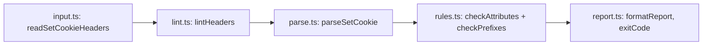

# Mini project 03 — A cookie attribute linter for a login flow

Time: about 3 hours · Guidance: independent

## The real use case

A security reviewer tests a shop's login flow. The server answers with several `Set-Cookie` headers, and the reviewer must say which ones are unsafe. One session cookie has no `Secure` attribute, so it also travels over plain HTTP. Another has no `HttpOnly`, so any script on the page can read it. A cookie named `__Host-csrf` has a `Domain` attribute, so the browser silently drops it and the CSRF check breaks. Reading these by eye across a HAR file is slow and error-prone. You will build a small linter that does it in one command.

## What this proves

A cookie is safe only when its attributes say so, and the prefixes `__Secure-` and `__Host-` add rules that the browser enforces. You will read a header leniently and judge it strictly. This serves the plan outcome "set cookies with safe attributes and explain origin versus site".

## How it works



`main.ts` reads a text file or a HAR file and passes the `Set-Cookie` header strings to `lintHeaders`. For each header, `parseSetCookie` builds a cookie object, or returns `null` when the header is unreadable. `lintCookie` then runs `checkAttributes` and `checkPrefixes` on it. `formatReport` prints the findings, and `exitCode` returns 1 when any finding is an error.

The parser is lenient and the rules are strict, as in the `jshttp/cookie` library: the parser never throws and records what it ignored, and the rules judge the result.

## Prerequisites

- Node.js 24 or newer (`node --version`). Node runs the `.ts` files directly, so there is no build step.
- You know what `Set-Cookie`, `Secure`, `HttpOnly` and `SameSite` mean from lesson 9 (cookies).
- No account, no network and no service. All input comes from files in `fixtures/`.

## How to run

```bash
cd starter
npm install
npm test          # all 24 tests fail at the start; that is expected
npm run demo      # fails with "TODO(4)" until lintHeaders exists
```

The demo lints `fixtures/login-flow.txt`. To lint your own capture, run `node src/main.ts path/to/capture.har`. A file that starts with `{` is read as a HAR file. Any other file is read as one `Set-Cookie` header per line.

## Your tasks

This project gives you goals and checks, not steps. The tests in `tests/` define the exact behavior. Keep the exported names that the tests import.

1. **Read a header.** In `src/parse.ts`, write `parseSetCookie(header)`. It returns a `ParsedCookie` (see `src/types.ts`), or `null` for a header it cannot read. It must never throw, must not use recursion, and must handle a header with 200,000 semicolons. Done when `tests/parse.test.ts` passes.
2. **Judge the attributes.** In `src/rules.ts`, write `checkAttributes(cookie)`. It flags missing `Secure`, missing `HttpOnly`, missing `SameSite`, and `SameSite=None` without `Secure`. Done when the `checkAttributes` tests pass.
3. **Judge the prefixes.** In `src/rules.ts`, write `checkPrefixes(cookie)` for `__Secure-` and `__Host-` cookies. Done when the `checkPrefixes` tests pass.
4. **Lint a whole flow.** In `src/lint.ts`, write `lintHeaders(headers)`. It reports unreadable headers and ignored attributes, and it runs every rule on every cookie. Done when `tests/lint.test.ts` passes.

## How to check your work

```bash
npm test
```

Expected: `Test Files 3 passed (3)` and `Tests 24 passed (24)`.

Manual check:

```bash
npm run demo
```

The report must end with `7 error(s), 5 warning(s).` and the exit code must be 1 (`echo $?`). Then run `node src/main.ts fixtures/login-flow.har`. It must show two errors: the `__Secure-auth` cookie has no `Secure` attribute.

## Stretch goals

- Read the request URL from the HAR file and print it next to each finding, so the reviewer sees which response set the cookie.
- Add a rule for `Max-Age` and `Expires`: flag a session cookie that lives for a year.
- Print the report as JSON with `--json`, and use the exit code in a CI job.

## Hints

### Hint for task 1

Split the header at the first `;`. Use `indexOf(";", position)` in a loop to walk the attributes, so the work stays linear. Split each attribute at its first `=` only, because a value may contain more `=` signs. Compare attribute names in lower case. Where a value is not usable (`SameSite=Sometimes`, `Max-Age=soon`) or the attribute is unknown, push the text to `ignored` and carry on.

### Hint for task 2

Build the list of findings in the order the tests expect: Secure, HttpOnly, then SameSite. For HttpOnly, a name that matches a pattern such as `/sess|sid|auth|token/i` is an error, and any other name is a warning. Check `SameSite=None` only when `SameSite` is present.

### Hint for task 3

Lower-case the name before you test the prefix. For `__Host-`, check three things in this order: `Secure`, `Path` equal to `/`, and no `Domain`. A missing `Path` is not `/`.

### Hint for task 4

Loop over the headers. When `parseSetCookie` returns `null`, push one finding with the rule `unreadable-header` and use `continue`. Otherwise add one `ignored-attribute` warning for each item in `cookie.ignored`, then the output of `lintCookie(cookie)`.

## Implementation walkthrough

1. **`src/parse.ts`, `parseSetCookie` (task 1).** Reject headers with control characters. Cut the name-value pair at the first `;` and the pair at the first `=`. Return `null` when there is no `=` or the name is empty. Then loop with `indexOf(";")` and send each piece to `applyAttribute`, which sets a flag, stores a value, or pushes to `ignored`. The loop is flat, so a hostile header cannot overflow the stack.
2. **`src/rules.ts`, `checkAttributes` (task 2).** Add one finding per broken rule. The severity of `missing-httponly` depends on the name, because a script may need a theme cookie but must never read a session cookie.
3. **`src/rules.ts`, `checkPrefixes` (task 3).** Browsers silently drop a cookie whose prefix rules fail. The linter says why. `__Host-` has three separate rules, so one cookie can produce three findings.
4. **`src/lint.ts`, `lintHeaders` (task 4).** Parse, skip and report unreadable headers, report ignored pieces, then call `lintCookie`. A parser that drops a bad `SameSite` hides a real problem, so the linter turns every dropped piece into a warning.

## Compare with the solution

The finished code is in `solution/`. Run `diff -r starter solution` to see every change. Look for three things:

- The parser and the rules are separate files. The parser accepts nearly anything, and the rules decide what is wrong.
- `parseSetCookie` records `ignored` pieces, so nothing is dropped without a finding.
- Each rule has an id such as `host-prefix-forbids-domain`, so a report line can be searched for and tested.
