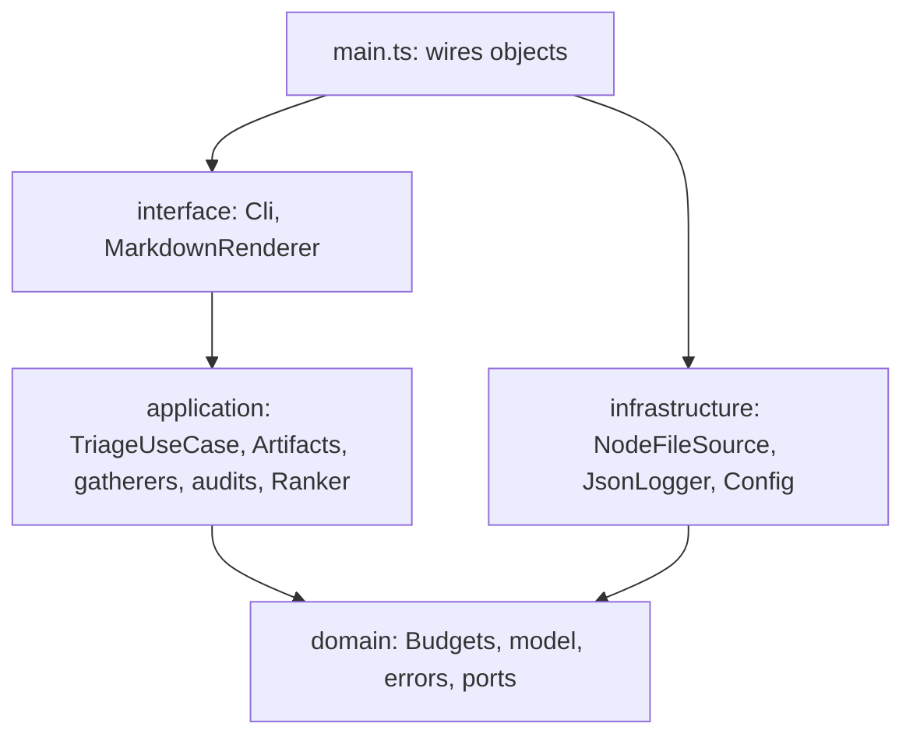
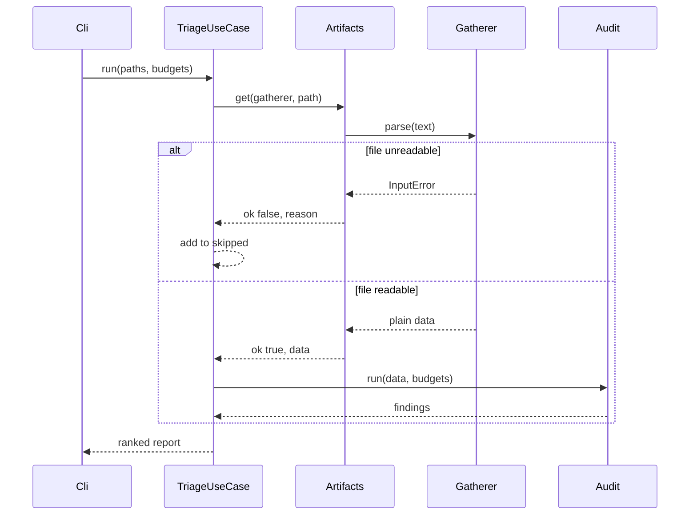
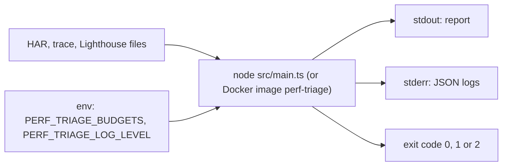

# Architecture

## Overview

Perf-triage is a Node.js command line tool. A frontend team gets a bug report with up to three files: a HAR file (a saved network log), a Performance trace (a saved record of the main thread) and a Lighthouse JSON report. The tool reads each file, checks it against performance budgets, and prints one ranked list of problems.

The design copies one idea from Lighthouse: reading a file and judging it are separate steps. A **gatherer** turns raw text into plain data. An **audit** compares plain data with budgets. A **use case** connects them. This repository analyzed two production codebases (Lighthouse and DevTools frontend), and the practices below come from their takeaways notes.

It builds on the mini projects: the HAR timing phases come from the waterfall report, and the long task rule comes from the trace long task finder.

## Layers

Dependencies point inward. The domain imports nothing from the other layers.



## Classes and their responsibilities

| Class | File | One job |
|---|---|---|
| `Budgets` | `src/domain/Budgets.ts` | Holds the limits, merges overrides, rejects bad values |
| `InputError`, `UsageError` | `src/domain/errors.ts` | Name the two kinds of expected failure |
| `HarGatherer` | `src/application/HarGatherer.ts` | Validates a HAR and computes timing phases |
| `TraceGatherer` | `src/application/TraceGatherer.ts` | Finds long tasks, blocking time and layout shift in a trace |
| `LighthouseGatherer` | `src/application/LighthouseGatherer.ts` | Reads metrics, score and opportunities |
| `HarAudit`, `TraceAudit`, `LighthouseAudit` | `src/application/*Audit.ts` | Compare one kind of data with the budgets |
| `Artifacts` | `src/application/Artifacts.ts` | Reads and parses each file once, turns failures into values |
| `Ranker` | `src/application/Ranker.ts` | Orders findings |
| `TriageUseCase` | `src/application/TriageUseCase.ts` | Runs gather then audit for each input |
| `NodeFileSource` | `src/infrastructure/NodeFileSource.ts` | Reads files from disk |
| `JsonLogger` | `src/infrastructure/JsonLogger.ts` | Writes JSON log lines with a run id |
| `Config` | `src/infrastructure/Config.ts` | Reads and checks environment variables |
| `Cli`, `MarkdownRenderer` | `src/interface/` | Parse flags, set the exit code, format the report |

`src/main.ts` is the composition root. It creates every object and passes dependencies through constructors.

## Request flow

One run: the CLI hands paths to the use case. For each input, `Artifacts` calls the gatherer. A bad file becomes a skipped row, so the other inputs are still checked.



## Deployment

There is no server. The tool runs as one process, or as one container built from the `Dockerfile`. Mount your files into the container and pass them as flags.



## Interactive walkthrough

This spec is ready to paste into a lesson page. It uses `FlowAnimation` from `site/COMPONENTS.md`. The learner can break the trace gatherer and see that the report still comes out.

```mdx
<FlowAnimation
  title="One perf-triage run"
  nodes={[
    { id: "cli", label: "Cli", kind: "pill" },
    { id: "usecase", label: "TriageUseCase" },
    { id: "artifacts", label: "Artifacts" },
    { id: "trace", label: "TraceGatherer" },
    { id: "ranker", label: "Ranker" }
  ]}
  edges={[
    { from: "cli", to: "usecase" },
    { from: "usecase", to: "artifacts" },
    { from: "artifacts", to: "trace" },
    { from: "usecase", to: "ranker" }
  ]}
  steps={[
    { from: "cli", to: "usecase", packet: "paths", caption: "The CLI passes the three file paths to the use case." },
    { from: "usecase", to: "artifacts", packet: "trace path", caption: "The use case asks Artifacts for the trace." },
    {
      from: "artifacts", to: "trace", packet: "text",
      caption: "The gatherer finds long tasks over 50 ms.",
      fallback: { from: "artifacts", to: "usecase", packet: "skipped", caption: "The trace is unreadable, so it becomes a skipped row." }
    },
    { from: "usecase", to: "ranker", packet: "findings", caption: "All findings are ranked: failures first, then by milliseconds saved." },
    { from: "ranker", to: "cli", packet: "report", caption: "The CLI prints the report and sets the exit code." }
  ]}
  breakable={["trace"]}
  brokenCaptions={{ trace: "The trace gatherer is off. The HAR and Lighthouse checks still run, and the report lists the trace as skipped." }}
/>
```

## Object-oriented ideas and where they are used

| Idea | Where | Why |
|---|---|---|
| Single responsibility | `HarGatherer` only parses; `HarAudit` only judges | A change to a budget never touches parsing |
| Dependency inversion | `FileSource` and `Logger` in `src/domain/ports.ts` | `Artifacts` does not know about the disk, so tests use a map |
| Open for extension | `Pipeline` entries in `main.ts` | A new input kind is a new gatherer, audit and one line |
| Composition over inheritance | `TriageUseCase` receives its parts | No class extends another |
| Encapsulation | `Budgets` validates values in `fromJson` | An invalid limit cannot exist |
| Interface segregation | `Gatherer<T>` has one method, `Audit<T>` has one | Each fake in tests is five lines |

TypeScript here uses only syntax that Node can run directly: no parameter properties and no enums. Fields are declared and set in the constructor.

## Borrowed from production

| Practice | Source note | Where it is applied |
|---|---|---|
| Separate reading from judging | lighthouse-takeaways.md (1) | `src/application/*Gatherer.ts` and `*Audit.ts` |
| Parse each input once and cache it | lighthouse-takeaways.md (2) | `src/application/Artifacts.ts` |
| Turn a failure into a result row | lighthouse-takeaways.md (3) | `Artifacts.load`, `TriageUseCase.run`, "Skipped inputs" in the report |
| Rank by time gain, informative checks weigh 0 | lighthouse-takeaways.md (5, 7) | `src/application/Ranker.ts`, `LighthouseAudit.ts` |
| Validate the HAR before use, cap numbers | devtools-frontend-takeaways.md (1, 6) | `src/application/HarGatherer.ts` |
| Keep -1 as "not applicable" in timing phases | devtools-frontend-takeaways.md (2) | `sumKnownPhases` in `HarGatherer.ts` |
| Never print secrets from a HAR | devtools-frontend-takeaways.md (4) | `safeUrl` in `HarAudit.ts` |
| Golden report test | lighthouse-takeaways.md (8) | `tests/integration/cli.test.ts`, `tests/fixtures/expected-report.md` |

Not copied: streaming reads of huge traces (the tool reads whole files, see ADR 0002), the Lantern simulator, and log-normal scoring.

## Error handling, configuration, logging

- **Errors.** `InputError` means a file cannot be trusted. `Artifacts` turns it into a skipped row. `UsageError` means a bad flag or budgets file; the CLI prints usage and exits 2. Any other error is logged with context and rethrown.
- **Exit codes.** 0 for a clean run, 1 when a budget fails, 2 for a usage error or when no input could be read. `--exit-zero` forces 0 for a run that has at least one readable input.
- **Configuration.** `PERF_TRIAGE_BUDGETS` (optional path to a JSON file) and `PERF_TRIAGE_LOG_LEVEL`. `Config.fromEnv` checks them at startup.
- **Logging.** `JsonLogger` writes one JSON line per event to stderr, each with a `runId`.

## How to extend it

1. Add a new input kind, for example a coverage report: write a `CoverageGatherer` and a `CoverageAudit`, then add one entry to the pipeline list in `src/main.ts`.
2. Add a budget: add a key to `BudgetValues` and `DEFAULTS` in `src/domain/Budgets.ts`, then use it in an audit with a test.
3. Add an output format: write a class like `MarkdownRenderer` and choose it in `Cli`.
4. For traces over 100 MB, replace `TraceGatherer.parse` with a streaming reader (ADR 0002 says when).
