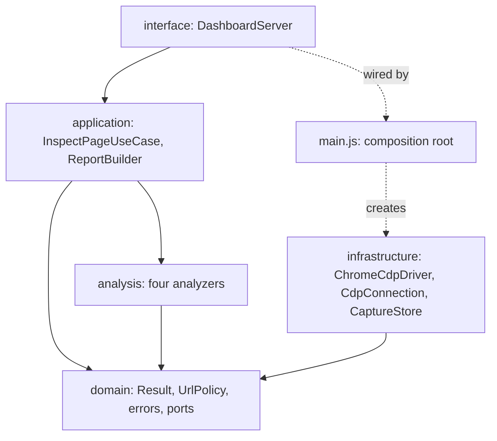
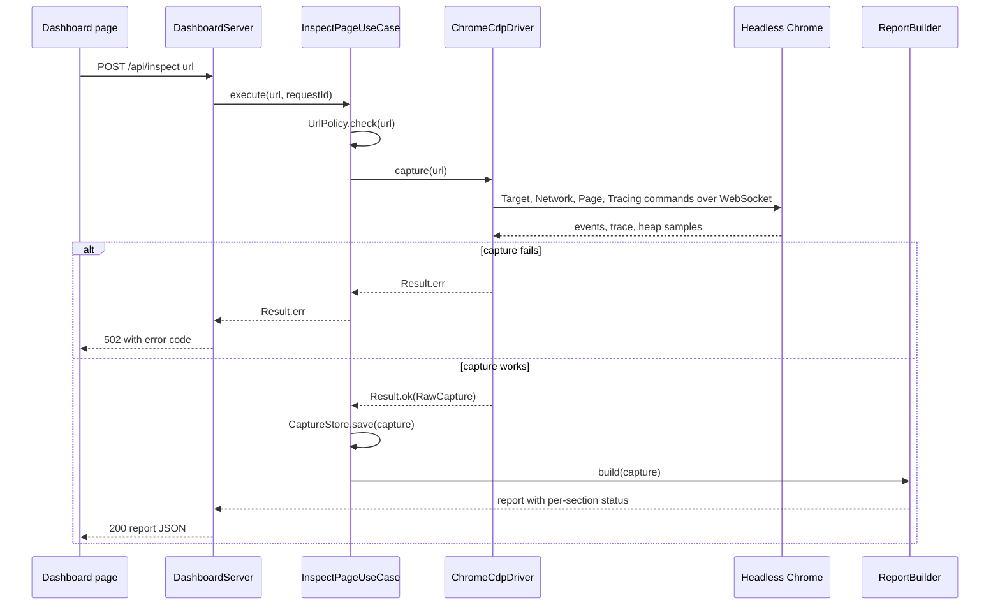
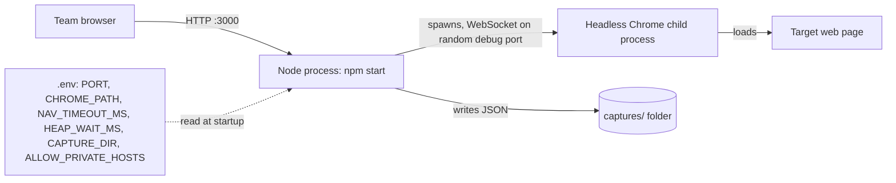

# Architecture

## Overview

The Page health inspector is a small web service. A team member pastes a URL into a dashboard page. The service starts a headless Chrome, loads the page through the Chrome DevTools Protocol (CDP), and shows four things: network timing, Core Web Vitals, console errors, and heap growth.

CDP is the JSON protocol that DevTools itself uses to talk to the browser. The service sends commands and receives events over one WebSocket. No browser library is used. The project has no npm dependencies.

The design rule is "record raw, then derive". The driver and collect code write what Chrome said into one JSON file (a *capture*). Pure analysis classes then turn the capture into a report. Because of this split, every test runs without Chrome. No Chrome is needed to read, test, or extend the analysis code.

Language note: the domain pack suggests TypeScript. This project uses plain JavaScript modules with JSDoc-style comments, so that it runs with zero install steps. See `docs/adr/0002-zero-dependencies-plain-javascript.md`.

## Layers

Dependencies point inward: every arrow goes toward `domain`. The `analysis` layer holds pure classes that read plain data.



| Layer | Folder | Job |
|-------|--------|-----|
| interface | `src/interface/` | HTTP routes and the static dashboard page |
| application | `src/application/` | One class per use case, plus the report builder |
| analysis | `src/analysis/` | Pure functions on a capture: timing, vitals, console, heap |
| domain | `src/domain/` | `Result`, URL rules, error classes, port shapes |
| infrastructure | `src/infrastructure/` | Chrome, WebSocket, files, config, logging |

## Classes and their responsibilities

| Class | File | One responsibility |
|-------|------|--------------------|
| `Result` | `src/domain/Result.js` | Carries a value or an error, never throws across layers |
| `UrlPolicy` | `src/domain/UrlPolicy.js` | Decides which URLs may be opened |
| `Rating` | `src/domain/Rating.js` | Maps a metric value to good, needs-work or poor |
| error classes | `src/domain/errors.js` | One class per failure, each with a code |
| `RequestTimingAnalyzer` | `src/analysis/RequestTimingAnalyzer.js` | Builds the request table and phases from Network events |
| `WebVitalsAnalyzer` | `src/analysis/WebVitalsAnalyzer.js` | LCP, CLS and long tasks from trace events |
| `ConsoleErrorAnalyzer` | `src/analysis/ConsoleErrorAnalyzer.js` | Groups console errors, exceptions and log errors |
| `HeapAnalyzer` | `src/analysis/HeapAnalyzer.js` | Heap delta between two samples |
| `ReportBuilder` | `src/application/ReportBuilder.js` | Runs each analyzer on its own, marks failures as unavailable |
| `InspectPageUseCase` | `src/application/InspectPageUseCase.js` | Check URL, capture, save, build report |
| `AnalyzeSavedCaptureUseCase` | `src/application/AnalyzeSavedCaptureUseCase.js` | Build a report from a saved file |
| `ChromeCdpDriver` | `src/infrastructure/ChromeCdpDriver.js` | Runs one navigation and returns a raw capture |
| `CdpConnection` | `src/infrastructure/CdpConnection.js` | Numbers commands, matches replies, forwards events |
| `ChromeLauncher` | `src/infrastructure/ChromeLauncher.js` | Starts Chrome, finds its debug address |
| `LoadSettler` | `src/infrastructure/LoadSettler.js` | Decides when the page counts as loaded |
| `CaptureStore` | `src/infrastructure/CaptureStore.js` | Saves and loads capture files |
| `Config` | `src/infrastructure/Config.js` | Reads and checks environment variables |
| `Logger` | `src/infrastructure/Logger.js` | JSON log lines |
| `DashboardServer` | `src/interface/DashboardServer.js` | Routes, status codes, static files |

`src/main.js` is the composition root. Its `buildApp` function creates every object and passes dependencies through constructors.

## Request flow

One inspection, from the dashboard to the report. The failure path returns an error value instead of throwing.



Inside `ChromeCdpDriver.capture`: launch Chrome, open a blank tab, enable the Network, Page, Runtime and Log domains, disable the cache, fix the viewport, start a trace, navigate, wait until `LoadSettler` says "loaded", sample the heap twice after garbage collection, end the trace, and close everything in a `finally` block. If the heap or the trace step fails, the driver records `collectionErrors` and still returns the rest.

## Deployment

One Node process and one Chrome child process. There is no database and no container: Chrome must be installed on the host. See `README.md`.



## Interactive walkthrough

A ready-to-paste `FlowAnimation` for the lesson site. The `breakable` node `chrome` shows what happens when Chrome is not available.

```mdx
<FlowAnimation
  title="One inspection, from URL to report"
  nodes={[
    { id: "page", label: "Dashboard page", kind: "pill" },
    { id: "server", label: "DashboardServer" },
    { id: "usecase", label: "InspectPageUseCase" },
    { id: "driver", label: "ChromeCdpDriver" },
    { id: "chrome", label: "Headless Chrome" },
    { id: "files", label: "captures/ folder", kind: "store" }
  ]}
  breakable={["chrome"]}
  brokenCaptions={{ chrome: "Chrome did not start. ChromeLauncher throws ChromeLaunchError, the driver returns Result.err, and the server answers 502 chrome_launch_failed." }}
  steps={[
    { from: "page", to: "server", packet: "url", caption: "The page posts the URL to POST /api/inspect." },
    { from: "server", to: "usecase", packet: "url", caption: "The server calls InspectPageUseCase.execute. UrlPolicy checks the URL first." },
    { from: "usecase", to: "driver", packet: "url", caption: "The use case asks the driver to capture the page." },
    { from: "driver", to: "chrome", packet: "CDP commands", caption: "The driver sends Network, Page and Tracing commands over one WebSocket." },
    { from: "chrome", to: "driver", packet: "events", caption: "Chrome replies with network events, a trace and two heap samples." },
    { from: "usecase", to: "files", packet: "capture.json", caption: "The use case saves the raw capture before any analysis." },
    { from: "usecase", to: "server", packet: "report", caption: "ReportBuilder runs each analyzer on its own and returns the report." },
    { from: "server", to: "page", packet: "JSON", caption: "The dashboard draws four sections. A section that failed says it could not measure." }
  ]}
/>
```

## Object-oriented ideas and where they are used

| Idea | Where | Problem it removes |
|------|-------|--------------------|
| Abstraction (ports) | `src/domain/ports.js` describes `PageDriver` and `CaptureStore` | `InspectPageUseCase` does not know Chrome exists |
| Polymorphism | `FakeDriver` in `tests/integration/DashboardServer.test.js` and `ChromeCdpDriver` share the `capture(url)` shape | HTTP tests run without a browser |
| Composition | Every class takes its collaborators in its constructor; see `buildApp` in `src/main.js` | No inheritance chains, no hidden wiring |
| Single responsibility | One analyzer per measurement; `LoadSettler` only decides "loaded" | A change to heap logic touches only `HeapAnalyzer` |
| Encapsulation | `CdpConnection` keeps its socket, id counter and pending map private (`#` fields) | Callers cannot corrupt command matching |
| Dependency inversion | Use cases receive the driver and store from outside | The direction of dependency stays inward |
| Errors as values | `Result` in `src/domain/Result.js` | A crashed tab ends the run with an error, not a hanging `await` |

No class inherits from another class except the error classes, where each one truly is an `InspectorError`.

## Borrowed from production

| Practice | Source note | Where it lives here |
|----------|-------------|---------------------|
| Three layers: drive Chrome, collect raw data, analyze plain data | lighthouse-takeaways.md (takeaway 1) | `ChromeCdpDriver` vs `src/analysis/` |
| Save raw CDP events as JSON and rebuild the report from the file | lighthouse-takeaways.md (takeaway 2) | `CaptureStore`, `AnalyzeSavedCaptureUseCase`, `npm run analyze` |
| A command wrapper with a timeout and a crash check | lighthouse-takeaways.md (takeaway 3) | `CdpConnection.send` and `#failAll` |
| Define "loaded" on purpose, with a hard maximum and a slow-or-hung probe | lighthouse-takeaways.md (takeaway 4) | `LoadSettler`, `ChromeCdpDriver.#waitUntilLoaded` |
| Each report section fails on its own | lighthouse-takeaways.md (takeaway 5) | `ReportBuilder.#section` |
| Failures as values: `{result}` or `{error}`, pending calls fail on close | devtools-frontend-takeaways.md (takeaways 1 and 2) | `CdpConnection`, `Result` |
| Request table keyed by `requestId`, tolerate gaps and `-1` offsets | devtools-frontend-takeaways.md (takeaways 3 and 4) | `RequestTimingAnalyzer` |
| CLS in sessions (1 s gap, 5 s cap), named error when LCP is missing | lighthouse-takeaways.md (takeaway 6) | `WebVitalsAnalyzer` |
| Test with recorded fixtures and a fake connection | devtools-frontend-takeaways.md (takeaway 8) | `tests/fixtures/capture-sample.json`, `ScriptedConnection` |

Not copied: the Lighthouse score model, Lantern simulation, multi-target routing, and source-map decoding of console stacks (a later extension).

## Error handling, configuration, logging

- **Errors.** Expected failures are classes in `src/domain/errors.js`, each with a `code`. They travel as `Result.err`. `DashboardServer` maps `invalid_url` to 400, `bad_capture` to 404, any other code to 502. Unexpected exceptions are logged with their stack and answered with a plain 500.
- **Partial results.** A section that cannot be measured is `{ status: "unavailable", reason }`. It is never shown as zero.
- **Configuration.** `Config.fromEnv` reads environment variables once and fails at startup on a bad number. See `.env.example`. No secrets exist in this project.
- **Safety.** `UrlPolicy` allows only `http` and `https` and blocks local and private host names by default. It checks the host text, not DNS, so it is a first line of defence only. The dashboard writes report data with `textContent`, never as HTML, because page content is untrusted.
- **Logging.** `Logger` writes one JSON line per event, with a `requestId` on every inspection event.

## How to extend it

- Add a source-map step: decode console-error stacks in `ConsoleErrorAnalyzer` with a new `SourceMapResolver` class.
- Add a throttling profile: send `Network.emulateNetworkConditions` in `ChromeCdpDriver` and print the profile in `settings`.
- Add a metric: write a new analyzer class in `src/analysis/`, then add one `#section` call in `ReportBuilder`.
- Add history: store one summary per run beside each capture and chart them on the dashboard.
- Add a Dockerfile that installs Chrome, then set `CHROME_PATH` inside it.
