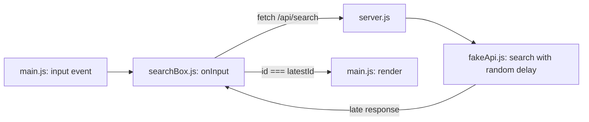

# Mini project 01 — Debug an async race in a search box

Time: about 2 hours · Guidance: guided

## The real use case

A support engineer gets a ticket: "I typed `red`, but the list shows results for `re`." The search box sends one request for each key press. The fake server answers after a random delay, so an old request can finish after a newer one. The page then draws the old answer over the new one. You will reproduce this in Chrome DevTools, find the cause with a conditional breakpoint and the async call stack, and fix it.

## What this proves

Conditional breakpoints and the async call stack let you watch one request among many and see which code started it. This serves the plan outcome "Debug async JavaScript with conditional breakpoints and async call stacks". The Sources panel is one of the panels listed in the official Chrome DevTools docs (source: `chrome-devtools-docs`).

## How it works



Each key press calls `onInput` in `src/searchBox.js`. It asks the server for results. The server calls `search` in `src/fakeApi.js`, which waits a random time. When a response comes back, `onInput` draws it only if no newer request exists.

## Prerequisites

- Node.js 20 or newer (`node --version`). No packages to install.
- Google Chrome with DevTools (F12, or Cmd+Option+I on macOS).
- DOM and HTTP in one line each: the DOM is the live tree of objects for page elements, and HTTP is how the browser asks a server for files and data.

## How to run

```bash
cd starter
npm test          # 4 tests fail at the start; that is expected
npm start         # then open http://localhost:3000
```

## Your tasks

The starter has the bug on purpose. Start with step A, then do tasks 1 to 4.

**A. Reproduce the race in DevTools.**

1. Open `http://localhost:3000` and open DevTools. Go to the Sources panel and open `src/searchBox.js`.
2. Right-click the line number of `render(response);` and choose to add a conditional breakpoint. A conditional breakpoint pauses only when its expression is true. Use the condition `response.query.length < 3`.
3. Type `red` slowly, then retype it fast (select all, type `red`). When the code pauses, read the Scope pane: look at `query` and `response.query`.
4. Read the Call Stack pane. Turn on the async frames if the pane offers it. The async frames show the `onInput` call that started this request, even though it ended long ago.
5. Find a pause where `response.query` is `re` but the box holds `red`. That is the race.

**Now fix it.**

1. **Number each request.** In `src/searchBox.js`, at `TODO(1)`, add one to `latestId` and save it in `const id`.
2. **Ignore stale responses.** At `TODO(2)`, return before `render` when `id` is not equal to `latestId`.
3. **Cancel the old request.** At both `TODO(3)` markers, call `controller?.abort()`, create a new `AbortController`, pass its `signal` to `search`, and return quietly on an `AbortError`.
4. **Make the fake API honor cancel.** In `src/fakeApi.js`, at both `TODO(4)` markers, reject with an `AbortError` when the signal aborts, and clear the timer.

## How to check your work

```bash
npm test
```

Expected: `ℹ tests 6`, `ℹ pass 6`, `ℹ fail 0`.

Manual check: run `npm start`, type `red` and then retype it fast several times. The line "Showing results for" must always match the box. Set the same conditional breakpoint again. It must never pause with an old `response.query`.

## Stretch goals

- Add a 300 ms debounce, so a burst of key presses sends one request. Then explain what the id check still protects.
- Add a "logpoint" in DevTools that prints `id` and `latestId` without editing the file.
- Show a "Searching..." line that hides only when the newest request ends.

## Hints

### Hint for task 1

`latestId` starts at 0. The expression `++latestId` adds one and gives the new value.

### Hint for task 2

The variable `id` lives in the closure of this call to `onInput`. `latestId` is shared by all calls. They differ exactly when a newer call has started.

### Hint for task 3

`controller` is `null` at the first call, so use `controller?.abort()`. In the `catch` block, test `error.name === "AbortError"`.

### Hint for task 4

Check `signal?.aborted` first, because the signal may already be aborted. Then add the listener with `signal?.addEventListener("abort", ...)`.

## Implementation walkthrough

1. `src/searchBox.js`, `onInput`: `const id = ++latestId;` gives each call its own number. The number survives the `await` because it sits in the closure.
2. `src/searchBox.js`, `onInput`: after `await search(...)`, `if (id !== latestId) return;` drops a response when a newer call exists. This fix works even if the API ignores cancel.
3. `src/searchBox.js`, `onInput`: `controller?.abort()` cancels the old request, a new `AbortController` is made, and `catch` returns on `AbortError`, so a cancel is not an error.
4. `src/fakeApi.js`, `search`: a pre-check of `signal?.aborted` and an `abort` listener call `clearTimeout` and reject with `DOMException("Aborted", "AbortError")`.

## Compare with the solution

Open `solution/src/searchBox.js` next to your file. Look for:

- Two defenses: the id check and `AbortController`. Why keep both?
- `AbortError` is returned, not rethrown. What would the console show otherwise?
- `solution/public/main.js` passes the same `signal` to `fetch`, so the browser cancels the network request too.
