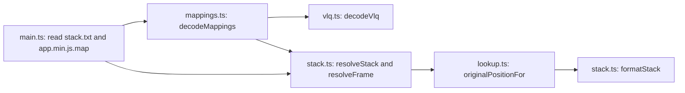

# Mini project 01 — Resolve a minified stack trace with its source map

Time: about 2.5 hours · Guidance: guided

## The real use case

A shop ships a minified bundle called `app.min.js`. A customer reports a crash, and the support engineer receives this error: `at total (app.min.js:1:125)`. Line 1, column 125 of a one-line bundle tells nobody which source file broke. The engineer needs the original file and line, and needs React internals out of the way so the app's own frames stand out. You will build the small tool that does this from a source map, the same data that DevTools reads.

## What this proves

A source map stores positions as relative base64 VLQ numbers. You decode them, look up a position, and hide third-party frames with `ignoreList`. This serves the plan outcome "Debug async code with breakpoints, the async call stack and source maps". It covers the concepts source maps, source map VLQ mappings, and ignore-listing frames.

## How it works



`main.ts` reads the stack text and the map. `decodeMappings` splits the `mappings` string into lines and segments, and calls `decodeVlq` for each segment. `resolveStack` parses each stack line, and `resolveFrame` calls `originalPositionFor` to find the original file and line. `formatStack` prints the result and folds frames from `ignoreList` files into one line.

## Prerequisites

- Node.js 22.18 or newer (`node --version`). Node runs `.ts` files directly in that version, so there is no build step.
- No services, no account, no network.
- Lesson page "Source maps and local overrides" gives the background.

## How to run

```bash
cd starter
npm install
npm test          # 9 tests fail and 2 test files cannot load at the start; that is expected
npm start         # prints the resolved stack once your TODOs work
```

`sample/app.min.js.map` is a small source map built by hand for this project. `sample/stack.txt` is the stack trace to resolve. Both files are complete.

## Your tasks

1. **Decode VLQ.** In `src/vlq.ts`, implement `decodeVlq` at `TODO(1)`. Turn letters such as `iB` into numbers. Done when the four tests in `tests/vlq.test.ts` pass, including the spec values `A` is 0, `C` is 1, `V` is -10, `iB` is 17.
2. **Decode the mappings string.** In `src/mappings.ts`, implement `decodeMappings` at `TODO(2)`. Split on `;` and `,`, then add each field to the previous values. Done when the five tests in `tests/mappings.test.ts` pass.
3. **Look up a position.** In `src/lookup.ts`, implement `originalPositionFor` at `TODO(3)`. Find the last segment that starts at or before the column, and set `ignored` from `ignoreList`. Done when `tests/lookup.test.ts` passes.
4. **Resolve one frame.** In `src/stack.ts`, implement `resolveFrame` at `TODO(4)`. Convert between the stack's 1-based numbers and the map's 0-based numbers. Done when the test "converts 1-based stack positions to the original 1-based position" passes.
5. **Hide ignore-listed frames.** In `src/stack.ts`, implement `formatStack` at `TODO(5)`. A run of ignored frames becomes one summary line. Done when the test "collapses a run of ignore-listed frames into one line" passes.

## How to check your work

```bash
npm test
```

Expected: `4 passed` test files and `20 passed` tests. Then check it by hand with `npm start`. The output must be:

```text
TypeError: Cannot read properties of undefined (reading 'price')
    at total (../src/cart.js:5:3)
    at checkout (../src/cart.js:13:5)
    ... 2 ignore-listed frames hidden
    at render (../src/cart.js:21:1)
    at <anonymous> (https://cdn.example.com/other.js:1:1)
```

Open `sample/app.min.js.map` and remove the `"ignoreList": [1]` line. Run `npm start` again. The two react-dom frames come back, which is what DevTools does when you turn off ignore listing.

## Stretch goals

- Add a fourth argument that prints the original source line, using `sourcesContent` from the map.
- Handle an index map (a `sections` array) by finding the section whose `offset` contains the position.
- Read the `//# sourceMappingURL=` comment from a bundle file instead of taking the map path as an argument.

## Hints

Read a hint only after you have tried the task for ten minutes.

### Hint for task 1

Each letter is a number from 0 to 63. Bit 6 (value 32) means "more letters follow". The low 5 bits are payload, and the first group is the least significant. Shift each new group left by 5 more bits than the one before.

### Hint for task 2

Keep four running totals outside the `map` over lines: source, original line, original column, name. Keep the generated column inside, so it restarts at 0 on each line. Test your code with the string `AAAA,CAAC;AACD`.

### Hint for task 3

A loop that remembers the latest segment and stops when `generatedColumn > column` is enough. Binary search also works, but it is not needed for a small map.

### Hint for task 4

Subtract 1 before the lookup and add 1 after it. Mixing these up gives an answer that is off by one line, and the test tells you which side you missed.

### Hint for task 5

Count hidden frames in a variable. When you meet a visible frame, or reach the end, print the summary line if the counter is above 0 and reset it.

## Implementation walkthrough

Read this only after you finish, or when you are stuck after the hints.

1. `src/vlq.ts`, `decodeVlq` (TODO 1): for each letter, look up its value in `BASE64`, add its low 5 bits shifted by `shift`, and keep reading while the continuation bit is set. At the last letter, the lowest bit is the sign and `accumulated >> 1` is the size. `0 - magnitude` avoids a negative zero.
2. `src/mappings.ts`, `decodeMappings` (TODO 2): split on `;`, then on `,`, and decode each segment. Add the first field to `generatedColumn` (reset per line) and the others to totals shared by every line. A one-field segment has no source.
3. `src/lookup.ts`, `originalPositionFor` (TODO 3): walk `decoded[line]` and keep the last segment whose column is at or before the wanted column. Return `null` if there is none. Look up the file in `map.sources` and set `ignored` with `map.ignoreList.includes(source)`.
4. `src/stack.ts`, `resolveFrame` (TODO 4): call `originalPositionFor(map, decoded, frame.line - 1, frame.column - 1)`, then add 1 to the answer's line and column. Editors count from 1, and the map counts from 0.
5. `src/stack.ts`, `formatStack` (TODO 5): loop over the frames. Count frames where `original?.ignored` is true, and print one summary line before the next visible frame. Print the rest with `describeFrame`.

## Compare with the solution

The finished project is in `../solution/`. When you compare, look at how `decodeMappings` keeps the generated column inside the line loop and the other values outside it, how `originalPositionFor` returns `null` instead of guessing, and how `resolveStack` leaves frames from other files untouched.
