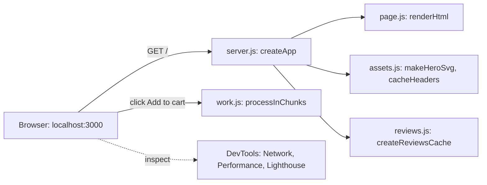

# Mini project 02 — Audit a slow product page

Time: about 2 to 3 hours · Guidance: less guided

## The real use case

A shop owner says the product page "feels slow". Customers see a blank space where the big photo should be. The Add to cart button freezes the page for a moment. A frontend developer cannot fix this by guessing. They need to read the Network waterfall, record a trace, and run Lighthouse, and then change only what the evidence points to. You will do this on a small local server that has four planted problems.

## What this proves

You can read the phases of a request in the waterfall and pick the right DevTools panel for a symptom. A late image points to the Network panel. A frozen click points to the Performance panel and a task over 50 ms. This serves the outcomes "Explain the phases of a network request shown in the waterfall" and "Decide which DevTools panel to open first for a given symptom".

## How it works



`server.js` answers each request. It builds the HTML in `page.js`, the hero image in `assets.js`, and the reviews in `reviews.js`. It adds fixed delays so the waterfall shows them. The click handler in `app.js` calls `processInChunks` from `work.js` in the browser. The lesson page on the Network waterfall shows the phases that you will read here.

The four planted problems:

| Symptom | File | Panel to open first |
|---------|------|---------------------|
| Hero image appears late | `page.js` | Network |
| A script delays the first paint | `page.js` | Network, then Performance |
| Click freezes the page | `work.js` | Performance |
| Reviews take over a second | `reviews.js` | Network |

## Prerequisites

- Node.js 20 or newer (`node --version`). Tests use the built-in `node:test`, so there is nothing to install.
- Google Chrome with DevTools (press F12 or Cmd+Option+I).
- You have read the lesson pages on the Network panel and the Performance panel.

## How to run

```bash
cd starter
npm test          # 7 tests, 5 or more fail at the start; that is expected
npm start         # then open http://localhost:3000
```

The starter works but is slow on purpose. Audit first, before you change any code.

**Audit A, read the waterfall.** Open DevTools, go to Network, tick Disable cache, set throttling to Fast 4G, and reload. Write down for `hero.svg`, `analytics.js` and `/api/reviews` which phase is longest: Queueing, Stalled, Waiting for server response, or Content Download. Be ready to say why for each file.

**Audit B, record a trace.** In Performance, click Record, click Add to cart, and stop. Find the task in the Main track with a red part. Write down its duration. It is over 50 ms.

**Audit C, run Lighthouse.** In the Lighthouse panel, run a Navigation report for Mobile. Write down the LCP value and the LCP element. You will run it again after your fixes.

## Your tasks

Each task matches one `TODO(n)` in the starter. The audit notes from "How to run" tell you which task to start with.

1. **Late hero.** In `src/page.js` (`TODO(1)`), put the hero `` directly in the HTML and preload it. Done when the test "task 1" passes.
2. **Blocking script.** In `src/page.js` (`TODO(2)`), stop `analytics.js` from blocking rendering. Done when "task 2" passes.
3. **Heavy hero.** In `src/assets.js` (`TODO(3)`), make the hero small and cacheable. Done when "task 3" passes.
4. **Long task.** In `src/work.js` (`TODO(4)`), make `processInChunks` yield to the main thread. Done when "task 4" passes.
5. **Slow API.** In `src/reviews.js` (`TODO(5)`), cache the reviews. Done when "task 5" passes.

## How to check your work

```bash
npm test
```

Expected: `7 passed`. Then check by hand. Reload with the Network panel open: the hero should start right after the HTML, and `hero.svg` should show `Cache-Control` in its headers. Record the click again: no single task should have a red part, because each slice is under 50 ms. Run Lighthouse again and compare LCP with your first number.

## Stretch goals

- Add a `Cache-Control` rule for `/api/reviews` and watch what Disable cache changes.
- Replace `setTimeout` in `yieldToMain` with `scheduler.yield()` when it exists, and keep `setTimeout` as the fallback.
- Add CPU throttling (4x slowdown) in the Performance panel and find out which slice is now over 50 ms.

## Hints

Read a hint only after you have tried the task for ten minutes.

### Hint for task 1

A browser finds an `` in the HTML while it parses. It finds an image that a script adds only after that script runs. The preload link tells it about the file even earlier. Check the Priority column in the Network panel (right-click the header to show it).

### Hint for task 2

A normal `<script src>` in the head stops the parser until it is downloaded and run. The attributes `defer` and `async` remove that wait. Look for the red triangle in the Network track of your trace.

### Hint for task 3

The hero is made of `HERO_SHAPES` circles. Fewer circles make a smaller file. `cacheHeaders("static")` returns an object with one key, `Cache-Control`.

### Hint for task 4

Check the clock after each step. When `now() - sliceStart` reaches `budgetMs`, wait for `yieldFn()` and start a new slice. Do not forget to reset `sliceStart` after the yield.

### Hint for task 5

Keep two variables in the closure: the last value and the time it expires. The first call fills them. Later calls inside the time limit return the stored value.

## Implementation walkthrough

Read this only after you finish, or when you are stuck after the hints.

1. `src/page.js`, `renderHtml` (TODO 1): add a `<link rel="preload" as="image" href="/hero.svg" fetchpriority="high">` in the head. Replace the empty slot and its timer script with the real ``. The browser now starts the download while it parses, so LCP is no longer waiting for a script.
2. `src/page.js`, `renderHtml` (TODO 2): add `defer` to the `analytics.js` tag. The parser no longer stops for the 800 ms response.
3. `src/assets.js` (TODO 3): set `HERO_SHAPES` to 60, and return `{ "Cache-Control": "public, max-age=86400" }` for `"static"`. A smaller body shortens Content Download, and a repeat visit skips the request.
4. `src/work.js`, `processInChunks` (TODO 4): loop over the items, push `step(item)`, and when `now() - sliceStart >= budgetMs` await `yieldFn()` and reset `sliceStart`. Each slice is now a separate short task, so clicks and paint can run between them.
5. `src/reviews.js`, `createReviewsCache` (TODO 5): return the stored value while `now() < expiresAt`. Otherwise await the loader, store the value, and set the new expiry. Only the first visitor pays the 1.2 s wait in the Waiting phase.

## Compare with the solution

The finished project is in `../solution/`. When you compare, look at:

- How small each fix is. The audit took longer than the changes.
- How `processInChunks` accepts `now` and `yieldFn`. That makes it testable without a browser.
- That the tests check page properties (preload tag, headers, defer), not the load time. Real timing always needs DevTools.
