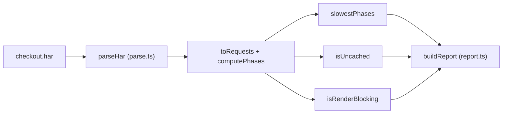

# Mini project 02 — A report from a HAR file

Time: about 2 hours · Guidance: less guided

## The real use case

A frontend team says "the checkout page feels slow". A developer opens the Network panel, exports the session as a HAR file, and then scrolls through 80 rows by eye. Nobody agrees on which request is the worst, which files the browser fetched again although they could be cached, or which files hold back the first paint. You will write a small Node.js tool that reads the HAR file and prints the three lists the team needs, so the same file always gives the same answer.

## What this proves

You read the timing phases of each request the way the Network waterfall defines them, and you keep `-1` as "not applicable" instead of counting it as zero. This serves the plan outcome "explain each timing phase of a request in the network waterfall".

## How it works



`main.ts` reads the file and passes the text to `parseHar`, which checks that it is a HAR file. `toRequests` turns each entry into a `Request` and calls `computePhases` for the seven timing phases of the waterfall: blocked, DNS, connect, SSL, send, wait and receive. Three small functions answer the team's three questions, and `buildReport` prints the answers. The lesson page on the network waterfall shows the same phases as a bar.

## Prerequisites

- Node.js 20 or newer (`node --version`)
- You have read the lesson pages on the Network panel and the waterfall
- No service to start and no account needed. The sample file `sample/checkout.har` is made up by `sample/gen.mjs`; it holds no real data.

## How to run

```bash
cd starter
npm install
npm test          # 19 tests fail at the start; that is expected
npm start         # prints the report once the TODOs are done
```

Try your own file: export one from the Network panel (right-click a row, Copy, Save all as HAR) and run `npm start -- path/to/file.har`. By default, DevTools leaves out the `Cookie`, `Set-Cookie` and `Authorization` headers. This tool never reads headers, so it never prints them.

## Your tasks

1. **Parse the file safely.** In `src/parse.ts`, implement `parseHar`. Done when the four tests under "parseHar (task 1)" pass: bad JSON and a missing `log.entries` raise `HarError`, bad entries are skipped and counted.
2. **Compute the phases.** In `src/phases.ts`, implement `computePhases`. Done when the four "computePhases (task 2)" tests pass. A phase value of `-1` means "did not happen", and it must not be added to the total.
3. **Find uncached requests.** In `src/analyze.ts`, implement `isUncached`. Done when the three "isUncached (task 3)" tests pass.
4. **Flag render-blocking candidates.** In `src/analyze.ts`, implement `isRenderBlocking`. Done when the four "isRenderBlocking (task 4)" tests pass.
5. **Rank the slowest phases.** In `src/analyze.ts`, implement `slowestPhases`. Done when the three "slowestPhases (task 5)" tests pass.

## How to check your work

```bash
npm test
```

Expected: `19 passed`. Then check by hand with `npm start`. The first line under "Slowest phases" must be `610 ms  receive  https://shop.example/app.js`. Open the same request in your own HAR file in the Network panel and compare the numbers.

## Stretch goals

- Add a fourth list: requests whose `wait` phase is over a budget you pass on the command line.
- Print the total transfer time per resource type (script, image, font).
- Accept `--json` and print the report as JSON for a CI job.

## Hints

Read a hint only after you have tried the task for ten minutes.

### Hint for task 1

`JSON.parse` throws on bad text. Wrap it in `try` and throw `HarError` instead. Optional chaining (`data?.log?.entries`) is safe on any JSON value.

### Hint for task 2

Write a small helper that turns a missing, negative or `NaN` value into `-1`. Check `status === 0` before you sum. In a HAR file, the `ssl` time is already inside `connect`.

### Hint for task 3

The browser sets `_fromCache` only for a cache hit. A 304 answer means the browser asked the server and got "not modified", so a network round trip happened.

### Hint for task 4

Ignore every type except `stylesheet` and `script`. When `contentLoadedMs` is below zero, you do not know the time, so the type alone decides. Otherwise compare `startMs` with it.

### Hint for task 5

Collect one `{ url, phase, ms }` object per phase per request, skip the ones below zero, then sort by `ms` and use `slice`.

## Implementation walkthrough

Read this only after you finish, or when you are stuck after the hints.

1. `src/parse.ts`, `parseHar` (TODO 1): `JSON.parse` inside `try`, then check `data?.log?.entries` is an array, else throw `HarError`. Filter with `isReadableEntry`, and set `skipped` to the difference. A broken file stops with a clear message, and one bad entry does not stop the report.
2. `src/phases.ts`, `computePhases` (TODO 2): copy each of the seven phases through `clean`, which keeps `-1`. For status 0, return all the time as `blocked`. Otherwise sum the non-negative phases except `ssl`. A `-1` is never counted as fast.
3. `src/analyze.ts`, `isUncached` (TODO 3): return `!request.fromCache`. A 304 still costs a round trip, so it counts as uncached.
4. `src/analyze.ts`, `isRenderBlocking` (TODO 4): return `false` unless the type is `stylesheet` or `script`. Then return `contentLoadedMs < 0 || request.startMs < contentLoadedMs`. This is a heuristic, because a HAR file has no render-blocking flag.
5. `src/analyze.ts`, `slowestPhases` (TODO 5): loop over requests and the seven phase names, push each value that is at least zero, sort descending (ties by URL, so the output is stable), and `slice(0, count)`.

## Compare with the solution

The finished project is in `../solution/`. Look at how `computePhases` handles a request with no response, how `guessType` falls back from `_resourceType` to the MIME type and the file extension, and why `report.ts` never touches headers.
