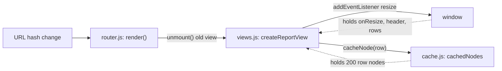

# Mini project 03 — Find the memory leak

Time: about 2 hours · Guidance: independent

## The real use case

A team ships a single-page app with a hash router. Support reports that the tab gets slow after an hour of clicking between views. The developer sees no error, only a heap that grows on every route change. Without heap snapshots the developer can only guess. With them, the developer can see which DOM nodes stay in memory and which code holds them.

## What this proves

A detached DOM node is a node removed from the page that some JavaScript still references. You will find such nodes with the Memory panel, read what retains them, and fix the cause. This serves the plan outcome "find a memory leak by comparing heap snapshots and reading retainers".

## How it works



The router builds a view for each hash and calls `unmount()` on the old one. The report view creates 200 rows. It stores them in `cachedNodes` and registers an `onResize` listener on `window`. The starter's `unmount()` does nothing, so the dotted arrows stay. After the router clears the page, the rows are detached but still reachable from `window` and from `cachedNodes`. The lesson pages on the Memory panel show the same snapshot workflow.

## Prerequisites

- Node.js 20 or newer (`node --version`)
- Chrome with DevTools (any current version)
- No packages to install: the project has no dependencies

## How to run

```bash
cd starter
npm test          # 6 tests fail at the start; that is expected
npm start         # serves the app on http://localhost:4173
```

## Your tasks

You get requirements and acceptance checks. You choose how to meet them.

1. **Measure the leak.** Open `http://localhost:4173` in Chrome and follow the steps below. Write your findings in `FINDINGS.md` (`TODO(1)`). Do this before you change any code. Done when every line in the file is filled.
2. **Make the cache releasable.** In `src/cache.js`, make `clearCache` empty the cache (`TODO(2)`). Done when the test "clearCache empties the cache" passes.
3. **Release the listener.** In `src/views.js`, make the report view's `unmount` take its `resize` listener off `window` (`TODO(3)`). Done when the test "leaving the report view removes the resize listener" passes.
4. **Release the nodes.** In the same `unmount`, empty the cache and drop what the view holds (`TODO(4)`). Done when the other leak tests pass.

Steps for task 1:

1. Open `http://localhost:4173`. Open DevTools and select the **Memory** panel.
2. Select the **Heap snapshot** radio button and press **Take snapshot**. This is snapshot 1.
3. Press **Visit Report and Home 5 times** and wait one second. The page shows how many nodes the cache holds.
4. Take snapshot 2.
5. Select snapshot 2 in the left pane. Change the view from **Summary** to **Comparison** and pick snapshot 1 as the base. Look for classes whose count grew.
6. Type `Detached` in the **Class filter** box. Expand a detached tree.
7. Click one detached node and read the **Retainers** pane (the Chrome guide calls the similar pane Objects). Follow the chain from the node up to the root.

## How to check your work

```bash
npm test
```

Expected: `8 passed`. Then check it by hand:

1. Restart `npm start` and reload the page in Chrome.
2. Take snapshot 1, press **Visit Report and Home 5 times**, then take snapshot 2.
3. Filter snapshot 2 with `Detached`. The page text should say `cached nodes: 0`, and the detached count should be far lower than before your fix.

## Stretch goals

- Replace the `removeEventListener` call with an `AbortController` signal passed to `addEventListener`.
- Add a test that fails if any new view adds a `window` listener without removing it.
- Find a leak in a real app you work on, and write its retainers path in your own notes.

## Hints

Read a hint only after you have tried the task for ten minutes.

### Hint for task 1

The Chrome guide defines a detached node as a node removed from the DOM tree that JavaScript still references. The retainers path ends at something that is still alive. Expect it to mention `cachedNodes` or `onResize`.

### Hint for task 2

An array keeps its items until you remove them. Setting its length to zero removes all of them.

### Hint for task 3

`removeEventListener` needs the same function you passed to `addEventListener`. `onResize` is declared once per view, so it is the same function.

### Hint for task 4

The view keeps `header` and `rows` in variables. Fixing the listener alone does not release the cached nodes. Fix both holders, because either one keeps the tree alive.

## Implementation walkthrough

Read this only after you finish, or when you are stuck after the hints.

1. `FINDINGS.md` (`TODO(1)`): snapshot 2 shows many more detached nodes than snapshot 1. Their retainers lead to `cachedNodes` in `src/cache.js` and to `onResize` registered on `window`.
2. `src/cache.js`, `clearCache` (`TODO(2)`): set `cachedNodes.length = 0`. The module-level array is no longer a root for the old rows.
3. `src/views.js`, `createReportView().unmount` (`TODO(3)`): call `win.removeEventListener("resize", onResize)`. The window stops referencing the closure that holds `header` and `rows`.
4. `src/views.js`, same `unmount` (`TODO(4)`): call `clearCache()`, set `rows = []` and `header = null`. Nothing reachable from a root points at the old tree, so the browser can free it.

## Compare with the solution

The finished project is in `../solution/`. When you compare, look at:

- That `unmount` undoes everything `mount` did: one `addEventListener` has one `removeEventListener`.
- That `tests/fake-dom.js` counts listeners on a fake `window`, so a leak is a failing test without a browser.
- That `router.js` already calls `unmount()`. The router was correct, and the leak lived in the view.
