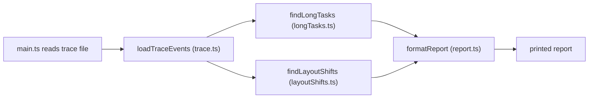

# Mini project 03 — Trace long task finder

About 2 hours. Guidance level: independent (the tests define the behavior; you design the code).

## The real use case

A developer records a page load in the Performance panel and saves the trace as a JSON file. The trace holds thousands of events. Without a tool, the developer scrolls the flame chart by eye to find slow work. A long task (main-thread work longer than 50 ms) blocks clicks and typing. A layout shift is content that jumps while the page loads. This project reads the saved file and lists both kinds of problem with their times, so the developer can choose what to fix first.

## What this proves

You read a Performance trace as data. You turn the raw events into the two lists the Performance panel highlights: long tasks and layout shifts. This serves the plan outcome "Find a long task and a memory leak from traces and heap snapshots". It also shows why the live Core Web Vitals numbers (layout shift score) can be rebuilt from a recording.

## How it works



`main.ts` reads the file and passes its text to `loadTraceEvents`, which returns clean events. Two finders read the same events: one keeps `RunTask` events longer than 50 ms, the other keeps `LayoutShift` events that did not follow user input. `formatReport` joins both lists into text. Reading and judging stay in separate files, the same split Lighthouse uses.

## Prerequisites

- Node.js 20 or newer (`node --version`).
- npm (it comes with Node.js).
- No services and no browser are needed. The trace is a small synthetic file in `sample/checkout-trace.json`.

A trace file holds events. Each event has a `name`, a phase `ph`, a start time `ts` and, for a complete event (`"X"`), a length `dur`. Both times are in microseconds (1000 microseconds is 1 ms).

## How to run

```bash
cd starter
npm install
npm test        # fails at first: this is your starting line
npm start       # prints the report once you finish the tasks
```

## Your tasks

Each task is one file with a file-level `TODO(n)`. Read `tests/trace.test.ts` first. It names every export you need.

1. `src/trace.ts`: export `loadTraceEvents(text)` and `traceStart(events)`. Accept a bare array or an object with `traceEvents`. Drop metadata events (`ph` is `"M"`) and events without a numeric `ts`. Throw a clear error for bad JSON or a missing array. `traceStart` returns the earliest `ts`.
2. `src/longTasks.ts`: export `findLongTasks(events, thresholdMs = 50)`. Keep `RunTask` events of phase `"X"` that run longer than the threshold. Return `{ startMs, durationMs }` measured from the trace start, longest first.
3. `src/layoutShifts.ts`: export `findLayoutShifts(events)` and `totalShiftScore(shifts)`. Skip shifts whose `args.data.had_recent_input` is true. Return `{ timeMs, score }` in time order. Round the total to three decimals.
4. `src/report.ts`: export `formatReport(tasks, shifts)`. Print a count line and one line per item, with the exact words the report test checks.

## How to check your work

```bash
npm test
```

Expected: `Tests  7 passed (7)`. Then run `npm start`. For the sample file you should see two long tasks (180.0 ms at 1000.0 ms and 75.5 ms at 300.0 ms) and two layout shifts with a total score of 0.25. The task of exactly 50 ms must not appear.

Manual check: record a real trace in the Performance panel, save it with the download button, and run `npm start -- path/to/trace.json`. Compare the longest task with the red-cornered tasks in the flame chart.

## Stretch goals

- Read the file in chunks, as Lighthouse does, so a very large trace does not fill memory.
- Group layout shifts into session windows and report the worst window, the way the Cumulative Layout Shift metric does.
- Add a `--budget` flag that exits with code 1 when any task is longer than a limit you choose.

## Hints

### Hint for task 1

`JSON.parse` can return an array or an object. Check `Array.isArray` on the result and on `data.traceEvents`. Metadata events have `ts: 0`, which would make the trace start look far too early.

### Hint for task 2

`dur` is in microseconds. Divide by 1000 before you compare with 50. Use "greater than", not "greater than or equal". Subtract `traceStart(events)` from `ts`, then divide by 1000.

### Hint for task 3

Use optional chaining (`e.args?.data?.score`). A missing `had_recent_input` means the shift counts. Floating-point sums can drift, so round the total.

### Hint for task 4

Build an array of lines and join it with `"\n"`. Use `toFixed(1)` for times and `toFixed(3)` for scores.

## Implementation walkthrough

1. `src/trace.ts`, `loadTraceEvents`: parse the text, pick the array, and filter out metadata and events without `ts`. `traceStart` takes the minimum `ts`. All later times use that origin.
2. `src/longTasks.ts`, `findLongTasks`: filter by name, phase and duration, map microseconds to milliseconds, and sort by `durationMs` descending, so the biggest block is first.
3. `src/layoutShifts.ts`, `findLayoutShifts`: filter `LayoutShift` events that had no recent input, map to `{ timeMs, score }`, sort by time. `totalShiftScore` sums and rounds.
4. `src/report.ts`, `formatReport`: one header line per list, then one indented line per entry.

## Compare with the solution

The finished code is in `solution/`. Look for these things:

- `loadTraceEvents` is the only function that touches raw JSON. The finders trust its output.
- The 50 ms rule is one default argument, so a budget check can change it later.
- Metadata events are dropped at load time, so no finder needs to know about them.
