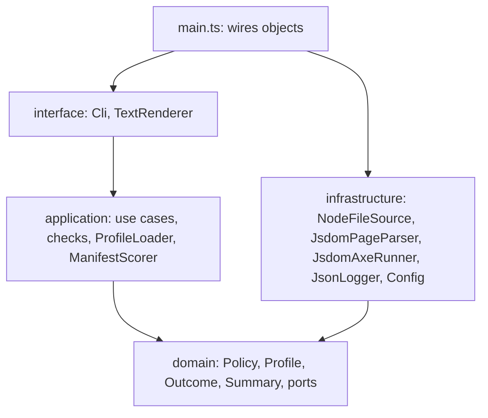
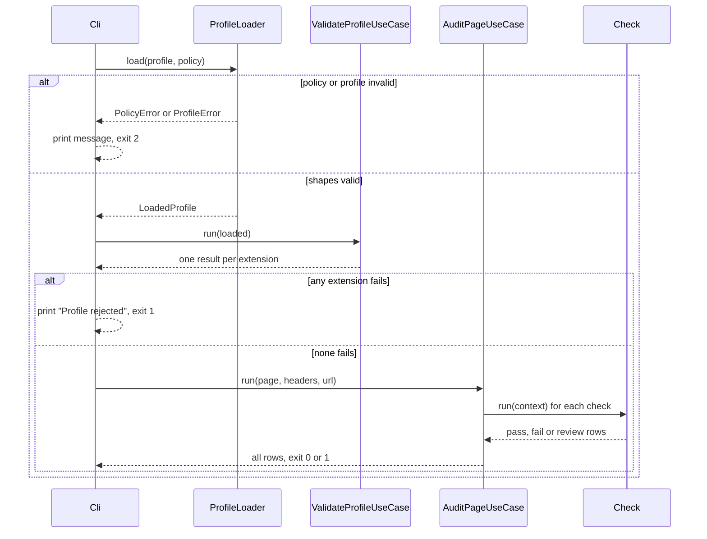
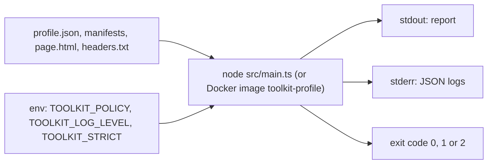

# Architecture

## Overview

The toolkit-profile CLI is a Node.js command line tool for a frontend team that shares one vetted set of browser extensions. A team lead keeps two kinds of files: a **profile** (the list of approved extensions, each with its manifest) and a **policy** (JSON rules that score risky permissions). The tool does three jobs in a fixed order:

1. It validates the profile against the policy. This always happens first.
2. It prints a setup checklist, one block per phase (build, performance, accessibility, SEO, security).
3. It runs accessibility (axe-core inside jsdom), SEO (title, meta description, canonical link, JSON-LD) and security-header checks (CSP, HSTS, X-Content-Type-Options) on a saved page and its saved response headers.

Every check ends in one of three outcomes: **pass**, **fail**, or **review** (a person must look). The idea comes from axe-core, the repository analyzed for this topic: `axe-core-takeaways.md` lists the practices used below.

No real browser starts. jsdom (a DOM written in JavaScript) reads saved HTML, so the tool runs the same way on a laptop, in CI, and in a locked-down sandbox. The cost is that jsdom has no layout, so color contrast comes back as "review". That is the three-outcome design doing its job.

It builds on the mini projects. The permission scoring and the JSON policy come from `mini-01-extension-permission-audit`. The axe-core run in jsdom and the SEO reads come from `mini-02-release-a11y-seo-check`.

## Layers

Dependencies point inward. The domain imports nothing from the other layers.



## Classes and their responsibilities

| Class | File | One job |
|---|---|---|
| `Policy` | `src/domain/Policy.ts` | Holds the permission rules, checks the JSON shape, turns a score into an outcome |
| `Profile` | `src/domain/Profile.ts` | Holds the extension list, rejects a bad phase or a repeated id |
| `ResponseHeaders` | `src/domain/ResponseHeaders.ts` | Reads saved headers, finds a name in any case |
| `Summary` | `src/domain/Summary.ts` | Counts outcomes and picks the exit code |
| `PolicyError`, `ProfileError`, `InputError`, `UsageError` | `src/domain/errors.ts` | Name the expected failures |
| `ProfileLoader` | `src/application/ProfileLoader.ts` | Reads the policy and the profile, checks both before anything else |
| `ManifestScorer` | `src/application/ManifestScorer.ts` | Turns one manifest into points and reasons |
| `ValidateProfileUseCase` | `src/application/ValidateProfileUseCase.ts` | Judges every extension of the profile |
| `ChecklistBuilder` | `src/application/ChecklistBuilder.ts` | Groups install steps by phase |
| `AuditPageUseCase` | `src/application/AuditPageUseCase.ts` | Reads the page once and runs every check on the same context |
| `AccessibilityCheck` | `src/application/AccessibilityCheck.ts` | Maps axe-core violations to fail and incomplete rules to review |
| `SeoCheck` | `src/application/SeoCheck.ts` | Judges title, description, canonical and JSON-LD |
| `SecurityHeaderCheck` | `src/application/SecurityHeaderCheck.ts` | Judges CSP, HSTS and X-Content-Type-Options |
| `NodeFileSource` | `src/infrastructure/NodeFileSource.ts` | Reads files, turns read errors into `InputError` |
| `JsdomPageParser` | `src/infrastructure/JsdomPageParser.ts` | Parses HTML once into plain facts (`ParsedPage`) |
| `JsdomAxeRunner` | `src/infrastructure/JsdomAxeRunner.ts` | Runs axe-core inside jsdom, closes the window on every exit |
| `JsonLogger` | `src/infrastructure/JsonLogger.ts` | Writes JSON log lines with a run id |
| `Config` | `src/infrastructure/Config.ts` | Reads and checks environment variables |
| `Cli` | `src/interface/Cli.ts` | Parses flags, calls use cases, maps errors to exit codes |
| `TextRenderer` | `src/interface/TextRenderer.ts` | Formats results and the checklist as text |

`src/main.ts` is the composition root. It creates every object and passes dependencies through constructors. There is no injection framework.

## Request flow

The command `run` is the main operation. The profile is checked first. If one extension fails, the page checks never start. A check that throws becomes a review row that names the check and the page.



## Deployment

There is no server. The tool runs as one Node.js process, or as one container built from the `Dockerfile`. Mount your saved files into the container.



## Interactive walkthrough

This spec is ready to paste into a lesson page. It uses `FlowAnimation` from `site/COMPONENTS.md`. The learner can break `SecurityHeaderCheck` and see that the other checks still report.

```mdx
<FlowAnimation
  title="One toolkit-profile run"
  nodes={[
    { id: "cli", label: "Cli", kind: "pill" },
    { id: "validate", label: "ValidateProfileUseCase" },
    { id: "audit", label: "AuditPageUseCase" },
    { id: "headers", label: "SecurityHeaderCheck" },
    { id: "summary", label: "Summary" }
  ]}
  edges={[
    { from: "cli", to: "validate" },
    { from: "cli", to: "audit" },
    { from: "audit", to: "headers" },
    { from: "cli", to: "summary" }
  ]}
  steps={[
    { from: "cli", to: "validate", packet: "profile", caption: "The CLI validates the profile against the policy first." },
    { from: "cli", to: "audit", packet: "page + headers", caption: "No extension failed, so the page audit starts." },
    {
      from: "audit", to: "headers", packet: "context",
      caption: "The header check reads CSP, HSTS and X-Content-Type-Options.",
      fallback: { from: "audit", to: "cli", packet: "review", caption: "The check threw. The audit records one review row and goes on." }
    },
    { from: "cli", to: "summary", packet: "results", caption: "Summary counts pass, fail and review and picks the exit code." }
  ]}
  breakable={["headers"]}
  brokenCaptions={{ headers: "The header check is off. The audit adds a review row naming the check, and the SEO and accessibility rows are still printed." }}
/>
```

## Object-oriented ideas and where they are used

| Idea | Where | Why |
|---|---|---|
| Single responsibility | `ManifestScorer` only scores; `ValidateProfileUseCase` only runs it over files; `TextRenderer` only prints | A new scoring rule never touches printing |
| Dependency inversion | `FileSource`, `PageParser`, `AxeRunner`, `Logger` in `src/domain/ports.ts` | Use cases do not know about disks or jsdom, so unit tests use a `Map` and a fake runner |
| Open for extension | The `checks` array in `src/main.ts` | A new check is a new class and one line |
| Composition over inheritance | `AuditPageUseCase` receives its checks | No class extends another |
| Encapsulation | `Policy.fromJson` and `Profile.fromJson`, private constructors | An invalid policy or profile cannot exist |
| Interface segregation | `Check` has one method, `AxeRunner` has one | Each fake in a test is a few lines |
| Liskov substitution | Any `Check` can replace another in the array | `AuditPageUseCase` treats them the same |

TypeScript here uses only syntax that Node runs directly: no parameter properties and no enums. Fields are declared and set in the constructor.

## Borrowed from production

| Practice | Source note | Where it is applied |
|---|---|---|
| Give every check three outcomes: pass, fail, needs review | axe-core-takeaways.md (1) | `src/domain/Outcome.ts`, `AccessibilityCheck.ts`, `SecurityHeaderCheck.ts` |
| Write the policy as data and validate it first | axe-core-takeaways.md (2) | `src/domain/Policy.ts`, `ProfileLoader.ts`, `policy/permission-policy.json` |
| Compute once, reuse many times | axe-core-takeaways.md (8) | `JsdomPageParser`, used once in `AuditPageUseCase.run` |
| Reset shared state on every exit path | axe-core-takeaways.md (4) | `finally` blocks in `JsdomAxeRunner.ts` and `JsdomPageParser.ts`; exit codes in `Cli.ts` |
| Tag each error with the check and the target | axe-core-takeaways.md (5) | `AuditPageUseCase.run` (the `check on target: reason` message) |
| Name tests after the rule | axe-core-takeaways.md (7) | `tests/unit/application.test.ts` |

Not copied: the Node 6 to 24 test matrix, the two-stage `runPartial` route for iframes, and the full color-blending model. This tool calls axe-core and reports its "incomplete" list.

## Error handling, configuration, logging

- **Errors.** `PolicyError` and `ProfileError` mean a rule file is wrong. `InputError` means a file cannot be read. `UsageError` means a bad flag or variable. `Cli` prints the message and exits 2 for all four. Any other error is logged with its stack and rethrown.
- **Exit codes.** 0 for a clean run, 1 when a check fails (or needs review in strict mode), 2 for bad usage or unreadable input.
- **Configuration.** `TOOLKIT_POLICY` (path of the policy file), `TOOLKIT_LOG_LEVEL` (`debug`, `info`, `warn`, `error`) and `TOOLKIT_STRICT` (`true` or `false`). `Config.fromEnv` checks them at startup.
- **Logging.** `JsonLogger` writes one JSON line per event to stderr, each with a `runId`. The report goes to stdout, so the two never mix.

## How to extend it

1. Add a check, for example `RobotsMetaCheck`: write a class with `id` and `run(context)`, add a test per outcome, and add it to the `checks` array in `src/main.ts`.
2. Add a policy rule: add a key in `Policy.fromJson`, the policy file and `ManifestScorer`, with a test.
3. Add a phase: add its name to `phases` in the policy file. No code changes.
4. Add an output format such as JSON: write a class like `TextRenderer` and choose it in `Cli`.
5. Fetch live pages: write a `LivePageSource` adapter. Keep the checks the same, and see ADR 0002 for how "could not fetch" maps to review.
