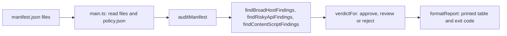

# Mini project 01 — Extension permission audit

Time: about 2 hours · Guidance: guided

## The real use case

A team lead must approve browser extensions for the company profile. Each extension asks for permissions in its `manifest.json`, and nobody reads them all. One extension that can read every site, every cookie and every request can leak customer data. You will build a script that reads each manifest, scores it against a JSON policy, and prints approve, review or reject.

## What this proves

The manifest is the table of contents of an extension, and its permissions decide what each part can reach. You will turn that rule into code: broad host access, risky APIs and content scripts on all sites each get points. This serves the plan outcome "judge an extension by its permissions before you install it".

## How it works



`main.ts` reads the manifest files and `policy.json`, then calls `auditManifest` for each one. `auditManifest` collects findings from three rule functions, adds their points, and asks `verdictFor` for the verdict. `formatReport` prints the table. The process exits with 1 when any extension is rejected, so a CI job can block it.

## Prerequisites

- Node.js 22 or newer (`node --version`)
- npm (comes with Node.js)
- No services to start
- You have read the lesson pages about extension parts and permissions

## How to run

```bash
cd starter
npm install
npm test        # fails on purpose: 13 tests wait for your code
npm start       # stops with "TODO(2): findBroadHostFindings is not implemented yet"
```

The sample manifests are in `sample/manifests/`. The policy is `policy.json`. Both are complete.

## Your tasks

Edit only `src/audit.ts`. Each task matches a `TODO(n)` comment there.

1. **`isBroadHost`**: return true when the pattern is in `policy.broadHostPatterns`. Done when `<all_urls>` is true and `https://*.example.com/*` is false.
2. **`findBroadHostFindings`**: use `collectHosts` and `isBroadHost`, and return one `broad-host` finding per broad host with `policy.broadHostPoints`.
3. **`findRiskyApiFindings`**: look each permission name up in `policy.apiPoints`. Add one more finding when `scripting` appears together with a broad host. Done when `declarativeNetRequestWithHostAccess` scores more than `declarativeNetRequest`.
4. **`findContentScriptFindings`**: return one finding per content script match that is a broad pattern.
5. **`verdictFor`**: return `reject`, `review` or `approve` from the score and the two thresholds in the policy.

## How to check your work

```bash
npm test
npm start
```

Expected: `Tests 14 passed (14)`. `npm start` then prints three extensions: `APPROVE 0 Color Picker`, `REJECT 185 Super Helper` and `REVIEW 45 Tab Helper`, each with its findings, and exits with 1 because one is rejected.

Manual check: open `policy.json`, change `rejectAt` to `200`, and run `npm start`. Super Helper should become REVIEW. Put it back after.

## Stretch goals

- Read `optional_permissions` and score it at half points.
- Add a `--json` flag that prints the results as JSON.
- Flag a `web_accessible_resources` entry that matches `<all_urls>`.

## Hints

### Hint for task 1

Arrays have an `includes` method. The function body is one line.

### Hint for task 2

`collectHosts(manifest).filter(...).map(...)` gives the shape. Each mapped object has `rule`, `detail` and `points`.

### Hint for task 3

Use a `for` loop over `collectApis(manifest)`. `policy.apiPoints[api]` is `undefined` for names the policy does not list, so check for `undefined` and not for zero. Call `findBroadHostFindings` to learn whether a broad host exists.

### Hint for task 4

Two nested loops: scripts, then matches. Use `?? []` because both lists can be missing.

### Hint for task 5

Check `rejectAt` first, then `reviewAt`. The order matters, because a reject score is also above the review threshold.

## Implementation walkthrough

1. `src/audit.ts`, `isBroadHost`: return `policy.broadHostPatterns.includes(pattern)`. The policy owns the list, so a team changes it without touching code.
2. `src/audit.ts`, `findBroadHostFindings`: filter `collectHosts(manifest)` with `isBroadHost`, then map each host to a `broad-host` finding. `collectHosts` already merges Manifest V2 and V3 hosts.
3. `src/audit.ts`, `findRiskyApiFindings`: loop over the API names and push a finding for each name with points. Then add the combo finding, because `scripting` can inject code only on hosts the extension may access, and a broad host makes that every site.
4. `src/audit.ts`, `findContentScriptFindings`: loop over `content_scripts` and `matches`. A content script runs inside the page, so a broad match means it runs inside every page you open.
5. `src/audit.ts`, `verdictFor`: compare the score with `rejectAt`, then `reviewAt`. `auditManifest` already sums the points and calls it.

## Compare with the solution

The finished code is in `solution/`. Look for three things: `src/audit.ts` has no thresholds or point values of its own, because they all come from `policy.json`; `collectHosts` hides the Manifest V2 and V3 difference from the rules; and `main.ts` turns a rejection into exit code 1, which is what makes the script useful in CI.
