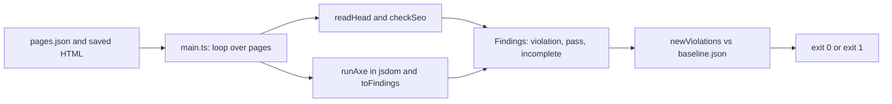

# Mini project 02 — Release page accessibility and SEO check

Time: about 2.5 hours · Guidance: less guided

## The real use case

A content site ships a release every week. Each release changes hundreds of pages. Nobody opens them all, so a missing image description, an empty link or a lost canonical tag goes live unseen. The old pages already have known problems, so a check that fails on every problem would fail forever, and the team would switch it off. You will build a check that runs on saved release pages, shows all three outcomes, and fails CI only on problems that are new.

## What this proves

An automated check sees only part of a page. axe-core gives three outcomes: violation, pass and "incomplete" (a person must review it). Search engines index the rendered HTML, not the raw source. You will keep all three outcomes, read the rendered head tags, and treat redirects and script shells as "needs review". This serves the plan outcome "know what automated accessibility and SEO checks can and cannot tell you".

## How it works



`main.ts` reads `pages.json` and loops over the pages. For each page, `readHead` and `checkSeo` judge the head tags. `runAxe` runs axe-core inside jsdom, and `toFindings` keeps its three outcomes. `newViolations` compares the violations with `baseline.json` and decides the exit code. Redirect entries skip axe.

jsdom is a JavaScript model of a browser page. It has no layout engine, so axe cannot measure colours or sizes. Those rules come back as "incomplete". That is the limit this project shows on purpose.

## Prerequisites

- Node.js 22 or newer (`node --version`)
- npm (comes with Node.js)
- No browser and no services to start
- You have read the lesson pages about axe results and rendered HTML

## How to run

```bash
cd starter
npm install
npm test        # fails on purpose: 16 tests wait for your code
npm start       # stops with "TODO(1): readHead is not implemented yet"
```

Run the solution with `cd solution && npm install && npm start`. To save today's violations as the baseline, add `--update-baseline` after the two file paths.

## Your tasks

Each task matches a `TODO(n)` in `starter/src`. The files in `sample/` are saved pages and a crawl log (`pages.json`).

1. **Read the head** (`seo.ts`, `readHead`). Return the title, meta description, canonical link, parsed JSON-LD blocks, the count of blocks that are not valid JSON, and the body text length. Done when the 3 `readHead` tests pass.
2. **Judge the head** (`seo.ts`, `checkSeo`). Return one finding per check with the right outcome. A missing tag is a violation. A canonical that points elsewhere, missing JSON-LD, a near-empty body and a redirect are "incomplete". Done when the 6 `checkSeo` tests pass.
3. **Run axe without a browser** (`axe.ts`, `runAxe`). Run axe-core on the HTML inside jsdom and return its results with the incomplete list. Done when the 3 tests in `axe.test.ts` run.
4. **Keep three outcomes** (`axe.ts`, `toFindings`). Turn axe results into findings, one per element, with the selector as the target. Done when `image-alt` is a violation and `color-contrast` is "incomplete".
5. **Compare with the baseline** (`baseline.ts`, `newViolations`). Return only violations whose key is not in the baseline. Done when the 4 baseline tests pass and `npm start` exits 0.

## How to check your work

```bash
npm test        # Tests  16 passed (16)
npm start       # last lines: "4 violation, 54 pass, 12 needs review" then "OK: no new problems"
```

Manual check: open `sample/baseline.json`, delete one line, and run `npm start`. The output ends with `FAIL: 1 new problem(s)` and the exit code is 1 (`echo $?`).

## Stretch goals

- Report a page whose canonical differs from its own URL only once, and compare titles across pages to find duplicates.
- Add a `--fail-on-incomplete` flag, and write down when your team should use it.
- Check that `@type` exists in each JSON-LD block, and report the missing ones as "incomplete".

## Hints

### Hint for task 1

Build the page with `new JSDOM(html)` and use `document.querySelector`. Select JSON-LD with `script[type="application/ld+json"]`. Wrap `JSON.parse` in `try/catch` so one bad block does not stop the run.

### Hint for task 2

Check the redirect first and return early. Compare `head.canonical` with `entry.url` as plain strings.

### Hint for task 3

axe must run in the page's own window. Create the JSDOM with `runScripts: "outside-only"`, call `dom.window.eval(axe.source)`, then call `dom.window.axe.run(dom.window.document, options)`. Pass `new VirtualConsole()` to hide jsdom's canvas warnings.

### Hint for task 4

axe results have `violations`, `passes` and `incomplete`. Each rule has `nodes`, and each node has a `target` array of selectors. Join it with a space.

### Hint for task 5

Put the baseline keys in a `Set`. Filter on `outcome === "violation"` and `!known.has(keyOf(f))`.

## Implementation walkthrough

1. `src/seo.ts`, `readHead`: parse the HTML with jsdom, read each tag with `querySelector`, and parse every JSON-LD script inside `try/catch`, counting failures. The function reads the saved rendered HTML, which is what a search engine indexes.
2. `src/seo.ts`, `checkSeo`: return early for a 3xx status, because a redirect has no content. Then push one finding per check. A missing tag is a violation. A value that needs human judgment is "incomplete".
3. `src/axe.ts`, `runAxe`: create the JSDOM, evaluate `axe.source` in its window, run `axe.run`, close the window. No real browser is needed, but layout rules cannot be measured.
4. `src/axe.ts`, `toFindings`: loop over the three result lists and emit one finding per node. Keeping "incomplete" is the point: those are the checks axe could not decide.
5. `src/baseline.ts`, `newViolations`: keep violations whose `page|rule|target` key is not known. `main.ts` then exits 1 only when this list is not empty.

## Compare with the solution

The solution is in `solution/`. Look for three things:

- `color-contrast`, `landmark-one-main` and `page-has-heading-one` come back as "incomplete" in the output. Ask why a real browser would decide them and jsdom cannot.
- `pages.json` holds `status` and `location` because the saved HTML cannot tell you about a redirect.
- Passes and "incomplete" findings never change the exit code. Think about what that choice risks.
