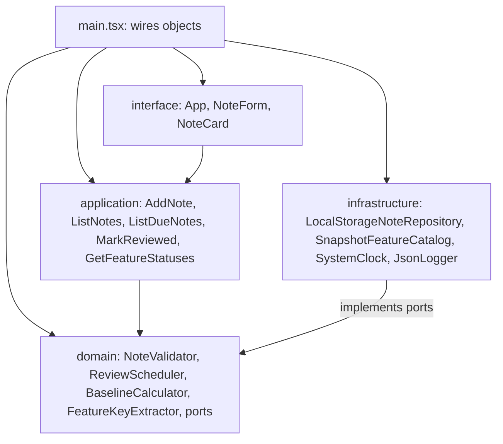
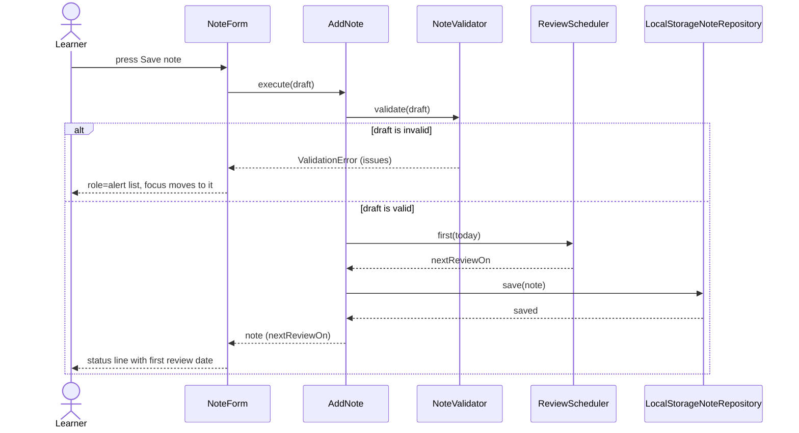
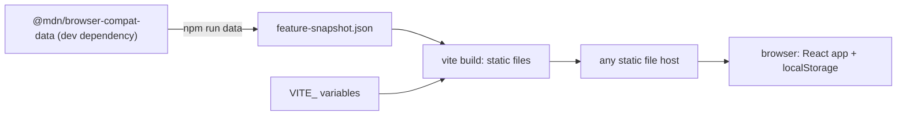

# Architecture

## Overview

TIL learning journal is a React app that runs only in the browser. A learner logs one note per roadmap item, adds primary source links, sees the Baseline status of web features the note names, and gets a list of notes due for review. There is no server. Notes live in browser local storage. Baseline data comes from a small JSON file built from `@mdn/browser-compat-data`.

The code has four layers. Dependencies point inward: `interface` calls `application`, `application` calls `domain`, and `infrastructure` implements the ports that `domain` declares. Only `src/main.tsx` knows every class. The playbook says React components are functions, so the UI uses function components and the logic uses classes with one job each.

## Layers



- `src/domain`: rules and ports. It imports nothing from React, the browser, or the data package.
- `src/application`: one class per use case.
- `src/infrastructure`: local storage, the snapshot, the clock, the logger, the configuration.
- `src/interface`: React components and helpers that turn input into use-case calls.

## Classes and their responsibilities

| Class | File | One job |
|-------|------|---------|
| `NoteValidator` | `src/domain/note-validator.ts` | Check a draft and say how to fix each problem |
| `FeatureKeyExtractor` | `src/domain/feature-key-extractor.ts` | Find feature keys in backticks in a note |
| `ReviewScheduler` | `src/domain/review-scheduler.ts` | Compute the next review date and say if a note is due |
| `BaselineCalculator` | `src/domain/baseline-calculator.ts` | Compute Limited, Newly, Widely, or Unknown for one feature |
| `DomainError`, `ValidationError`, `NoteNotFoundError`, `UnknownFeatureError` | `src/domain/errors.ts` | Name each failure |
| `AddNote` | `src/application/add-note.ts` | Validate, schedule, and save a new note |
| `ListNotes` | `src/application/list-notes.ts` | Return all notes, newest first |
| `ListDueNotes` | `src/application/list-due-notes.ts` | Return notes due today, most overdue first |
| `MarkReviewed` | `src/application/mark-reviewed.ts` | Move a note to its next review step |
| `GetFeatureStatuses` | `src/application/get-feature-statuses.ts` | Turn note text into one status per feature key |
| `Config` | `src/infrastructure/config.ts` | Read and check environment variables once |
| `JsonLogger` | `src/infrastructure/json-logger.ts` | Write one JSON line per event with a session id |
| `SystemClock`, `RandomIdGenerator` | `src/infrastructure/system-clock.ts` | Give today's local date and new ids |
| `LocalStorageNoteRepository` | `src/infrastructure/local-storage-note-repository.ts` | Store notes as one JSON list in local storage |
| `InMemoryNoteRepository` | `src/infrastructure/in-memory-note-repository.ts` | Store notes in a map for tests |
| `SnapshotFeatureCatalog` | `src/infrastructure/snapshot-feature-catalog.ts` | Look up a feature in the snapshot file |
| `CompatTreeReader` | `src/infrastructure/compat-tree-reader.ts` | Walk the compat data by a dotted path (snapshot script only) |

The interface layer has the function components `App`, `NoteForm`, `NoteCard`, and `FeatureBadges`, plus `describeError` and `parseSourceLines`.

## Request flow

The most important operation is saving a note.



After a save, `App` reads the repository again. `NoteCard` then calls `GetFeatureStatuses`, which extracts keys from the note text, looks each up in the catalog, and asks `BaselineCalculator` for a status. A key that is not in the snapshot gets the badge "not in the local data". The calculator never turns missing data into "not supported": it returns `unknown`.

## Deployment



The build output is plain static files, so any static host works. No port, database, or secret is involved. The two `VITE_` variables are public by design.

## Interactive walkthrough

Paste this into a lesson page. It uses only props documented in `site/COMPONENTS.md`.

```mdx
<FlowAnimation
  title="Saving one note in the TIL learning journal"
  nodes={[
    { id: "learner", label: "Learner", kind: "pill" },
    { id: "form", label: "NoteForm" },
    { id: "usecase", label: "AddNote" },
    { id: "validator", label: "NoteValidator" },
    { id: "store", label: "localStorage", kind: "store" }
  ]}
  steps={[
    { from: "learner", to: "form", packet: "Save", caption: "The learner presses Save note." },
    { from: "form", to: "usecase", packet: "draft", caption: "NoteForm calls AddNote.execute with the draft." },
    { from: "usecase", to: "validator", packet: "validate", caption: "AddNote asks NoteValidator to check the draft." },
    { from: "usecase", to: "store", packet: "note", caption: "A valid note is saved by LocalStorageNoteRepository." },
    { from: "usecase", to: "form", packet: "saved", caption: "The form shows the first review date in the status line." }
  ]}
  breakable={["validator", "store"]}
  brokenCaptions={{
    validator: "No validation: a note with no source or a javascript: link could be saved.",
    store: "Storage fails: the note is lost, so the error is logged and shown, never swallowed."
  }}
/>
```

## Object-oriented ideas and where they are used

- **Single responsibility.** `ReviewScheduler` only does dates; `NoteValidator` only checks drafts (`src/domain`).
- **Dependency inversion.** `AddNote` receives a `NoteRepository` port, not local storage (`src/application/add-note.ts`, `src/domain/ports.ts`).
- **Interface substitution.** `InMemoryNoteRepository` and `LocalStorageNoteRepository` are interchangeable (`src/infrastructure`, `tests/unit/use-cases.test.ts`).
- **Composition over inheritance.** No class extends another except the error classes; everything else is passed in through constructors (`src/main.tsx`).
- **Encapsulation.** `Config` has a private constructor and one checked factory (`src/infrastructure/config.ts`).
- **Open/closed.** Add a browser to `CORE_BROWSERS` or an interval to `REVIEW_INTERVAL_DAYS` without changing the logic (`src/domain/baseline-calculator.ts`, `src/domain/review-scheduler.ts`).
- Components are functions on purpose. Classes would add nothing there.

## Borrowed from production

| Practice | Source note | Where it lives |
|----------|-------------|----------------|
| Compute the Baseline-style status in one function with the browser set as data | browser-compat-data-takeaways.md (item 1) | `src/domain/baseline-calculator.ts` |
| Walk the tree by dotted path and name the failing part in the error | browser-compat-data-takeaways.md (item 2) | `src/infrastructure/compat-tree-reader.ts` |
| Treat missing data as "unknown", never "no"; show "maybe earlier" for `≤N` | browser-compat-data-takeaways.md (items 4 and 5) | `src/domain/baseline-calculator.ts`, `src/interface/FeatureBadges.tsx` |
| Validate a note with one schema and messages that say how to fix it | browser-compat-data-takeaways.md (item 7) | `src/domain/note-validator.ts` |
| Derive, do not copy: feature keys come from the note text | browser-compat-data-takeaways.md (item 4, derive don't copy) | `src/domain/feature-key-extractor.ts` |
| One tiny test per edge case on a made-up tree | browser-compat-data-takeaways.md (item 8) | `tests/unit/baseline-calculator.test.ts` |

## Error handling, configuration, logging

- Domain failures are classes (`ValidationError`, `NoteNotFoundError`). `describeError` turns them into sentences for a `role="alert"` box, and focus moves to it.
- An unexpected error shows a generic line and is logged by `ui.unexpected` with its message. Corrupt stored data logs `storage.corrupt` and shows an empty journal.
- `Config.fromEnv` reads `VITE_STORAGE_KEY` and `VITE_LOG_LEVEL` and fails at startup on a bad value. Both are public; no secret exists.
- `JsonLogger` writes one JSON line per event with a `sessionId` that ties one page load together, plus the `noteId` where one applies.

## How to extend it

- **A new feature in the snapshot:** add its key to `scripts/feature-keys.ts`, run `npm run data`.
- **A new use case** (for example delete a note): add a class in `src/application`, add a method to the port if needed, wire it in `src/main.tsx`, and add it to `Services`.
- **Another storage:** write a class that implements `NoteRepository` and swap it in `src/main.tsx`.
- **Feature detection in the app:** the journal teaches it but does not need it. Add a small check around any browser API you add.
