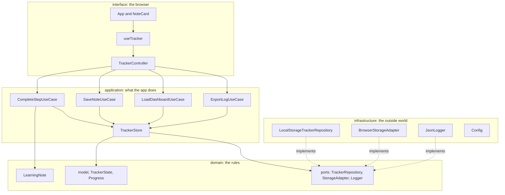
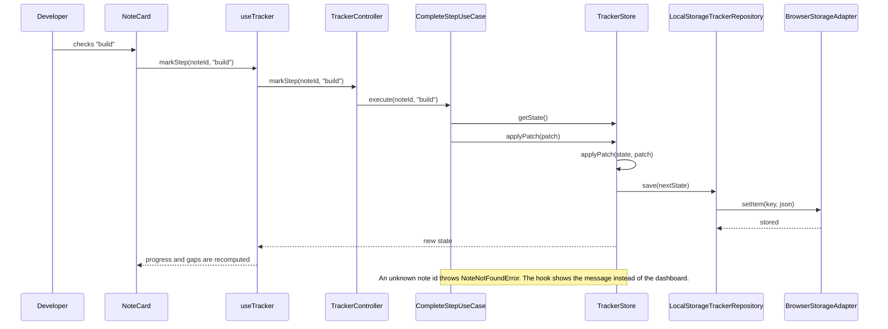
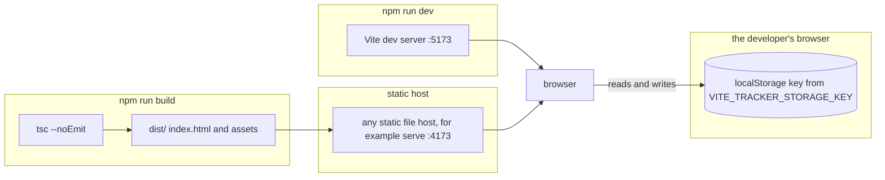

# Architecture

## Overview

Learning tracker is a static web app. A developer adds one note per frontend
roadmap item. Each note holds the four steps of the learning loop: read, build,
measure, explain. A dashboard shows how far the roadmap has come and names the
steps that are still missing.

The app never sends the log anywhere. The log lives in the browser's local
storage, and the developer can export it as Markdown at any time.

The code has four layers. Read them from the inside out: `domain` first, then
`application`. Those two hold every rule of the app and run without a browser.

## Layers



Arrows show who depends on whom. Nothing in `domain` points outward. The
React parts live in `interface`; the rules live in `domain`.

## Classes and their responsibilities

| Class | Layer | File | Single responsibility |
|-------|-------|------|-----------------------|
| `LearningNote` | domain | `src/domain/LearningNote.ts` | Holds one roadmap item and refuses to build a note that breaks its rules. |
| `TrackerStore` | application | `src/application/TrackerStore.ts` | Keeps the current state, applies patches to it, saves it, and tells subscribers. |
| `CompleteStepUseCase` | application | `src/application/CompleteStepUseCase.ts` | Turns "the developer finished the build step" into one patch. |
| `SaveNoteUseCase` | application | `src/application/SaveNoteUseCase.ts` | Turns a new or edited roadmap item into one patch. |
| `LoadDashboardUseCase` | application | `src/application/LoadDashboardUseCase.ts` | Loads the log and builds the dashboard view of it. |
| `ExportLogUseCase` | application | `src/application/ExportLogUseCase.ts` | Renders the whole log as Markdown. |
| `LocalStorageTrackerRepository` | infrastructure | `src/infrastructure/LocalStorageTrackerRepository.ts` | Saves the log in the browser under a version number and migrates an old version. |
| `BrowserStorageAdapter` | infrastructure | `src/infrastructure/BrowserStorageAdapter.ts` | Reads and writes one key in `window.localStorage`. |
| `JsonLogger` | infrastructure | `src/infrastructure/JsonLogger.ts` | Writes one structured log line per event. |
| `Config` | infrastructure | `src/infrastructure/Config.ts` | Reads and checks the environment variables at startup. |
| `TrackerController` | interface | `src/interface/TrackerController.ts` | Gives the React parts one small set of commands to call. |
| `AppErrorBoundary` | interface | `src/interface/components/AppErrorBoundary.tsx` | Catches a broken render and shows a message instead of a blank page. |

Twelve classes, each with one job. `src/main.tsx` is the composition root: it
builds `Config`, the adapters, the use cases, the store, the controller, and
mounts React.

The domain also holds plain functions, because they hold no state:
`createEmptySteps` and `isStepId` in `src/domain/model.ts`, `initialState` and
`applyPatch` in `src/domain/TrackerState.ts`, and `computeProgress`,
`findGaps`, `buildDashboard` and `renderLog` in `src/domain/Progress.ts`.

## Request flow

The most important operation: the developer checks one step of one note.



## Deployment

The app ships as static files. There is no server and no database.



The build reads `VITE_TRACKER_STORAGE_KEY`, `VITE_TRACKER_SCHEMA_VERSION` and
`VITE_TRACKER_LOG_LEVEL` at build time. Every one of them is public: the
bundle ships to the browser. No variable in this project holds a secret.

## Interactive walkthrough

The path of one checked step, as a lesson component. Paste it into a lesson
page to let the learner switch the storage off and watch the change stop.

```mdx
<FlowAnimation
  title="Learning tracker: one checked step"
  nodes={[
    { id: "developer", label: "Developer", kind: "pill" },
    { id: "hook", label: "useTracker" },
    { id: "controller", label: "TrackerController" },
    { id: "usecase", label: "CompleteStepUseCase" },
    { id: "store", label: "TrackerStore", kind: "store" },
    { id: "repository", label: "LocalStorageTrackerRepository", kind: "store" }
  ]}
  steps={[
    { from: "developer", to: "hook", packet: "build", caption: "The developer checks the build step of one roadmap item." },
    { from: "hook", to: "controller", packet: "markStep", caption: "The hook hands the command to the controller." },
    { from: "controller", to: "usecase", packet: "execute", caption: "The controller calls one use case and nothing else." },
    { from: "usecase", to: "store", packet: "patch", caption: "The use case returns a patch that changes one step of one note." },
    { from: "store", to: "repository", packet: "save", caption: "The store applies the patch, saves the log, and tells its subscribers." },
    { from: "repository", to: "hook", packet: "stored", caption: "The saved log comes back and the dashboard shows the new progress.", fallback: { from: "repository", to: "hook", packet: "no storage", caption: "Without the browser storage the change stays in memory for this session only." } }
  ]}
  breakable={["repository"]}
  brokenCaptions={{ repository: "Without storage nothing is written, so the change is lost when the tab closes." }}
/>
```

## Object-oriented ideas and where they are used

- **Encapsulation** — `LearningNote` keeps its fields private and builds a new
  note through `withPatch` and `completeStep`. A note with an empty title or an
  unknown step cannot be created, so `src/domain/LearningNote.ts` holds the
  rules.
- **Abstraction** — the ports in `src/domain/ports.ts` describe what the app
  needs (save, load, read a key, write a log line), not how a browser works.
- **Dependency inversion** — `src/application/TrackerStore.ts` depends on the
  `TrackerRepository` port. The browser adapter sits outside and is chosen
  once, in `src/main.tsx`.
- **Polymorphism** — `LocalStorageTrackerRepository` and
  `InMemoryTrackerRepository` in `tests/fakes/` both implement
  `TrackerRepository`. The unit tests use the second one.
- **Composition** — `CompleteStepUseCase` receives the store and a clock in its
  constructor. No base class, no inherited behaviour.
- **Single responsibility** — one class per use case in
  `src/application/`. Adding a "reset the tracker" button does not touch the
  path that checks a step.
- **Open/closed** — a second storage, such as a file on disk, is a new class
  that implements `TrackerRepository`. No existing class changes.
- **Where classes do not fit** — React components are functions, not classes,
  because React calls them and keeps their state between renders. The pure
  rules in `src/domain/` are functions because they hold no state. Only the
  three things with real state and a contract — `LearningNote`,
  `TrackerStore` and the adapters — are classes. The one exception is
  `AppErrorBoundary`, because React only calls a class component for that
  job.

## Borrowed from production

| Practice | Source note | Applied in |
|----------|-------------|------------|
| Write a change as a patch, so the other notes keep their identity | `zustand-takeaways.md`, `zustand-findings.md` finding 1 | `src/domain/TrackerState.ts` (`applyPatch`), `src/application/TrackerStore.ts` |
| Save the log under a version number and migrate an old version | `zustand-takeaways.md`, `zustand-findings.md` finding 2 | `src/infrastructure/LocalStorageTrackerRepository.ts` |
| Let the type checker hold the contract of the four steps | `zustand-takeaways.md`, `zustand-findings.md` finding 6 | `src/domain/model.ts` (`StepId`), `tests/unit/typeContract.test.ts` |
| Run the tests against the built artefact, not only against the source | `zustand-takeaways.md`, `zustand-findings.md` finding 10 | `tests/integration/builtArtefact.test.ts` |

## Error handling, configuration, logging

- The errors in `src/domain/errors.ts` are classes: `LearningTrackerError`
  and its children `InvalidNoteError`, `NoteNotFoundError`, `InvalidStepError`,
  `StorageVersionError` and `ConfigError`.
- The use cases throw them. The hook in `src/interface/useTracker.ts` catches
  them and shows the message. The `AppErrorBoundary` in
  `src/interface/components/AppErrorBoundary.tsx` catches a broken render and
  logs it.
- `Config` reads `VITE_TRACKER_STORAGE_KEY`, `VITE_TRACKER_SCHEMA_VERSION` and
  `VITE_TRACKER_LOG_LEVEL`. A missing or wrong value stops the app at startup
  with the name of the variable.
- `JsonLogger` writes one JSON object per line with `level`, `msg`, `time` and
  a `requestId`.

## How to extend it

- Add a fifth step to the loop: change `STEP_IDS` in `src/domain/model.ts`.
  The compiler then names every place that still uses four steps.
- Save the log on a server: write a `HttpTrackerRepository` that implements
  `TrackerRepository` and register it in `src/main.tsx`. No use case changes.
- Show a streak: add a function to `src/domain/Progress.ts` and one column to
  the dashboard table.
- Keep the log on two devices: make the repository write to both storages by
  giving it two ports.
