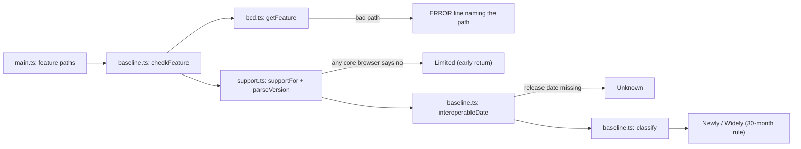

# Mini project 01 — Baseline checker for a feature list

Time: about 2 hours · Guidance: guided

## The real use case

A frontend team lead plans a new page. The design uses CSS `gap` and a Share button built on `navigator.share`. The lead asks: "Can we ship this without fallbacks?" Reading seven browser columns on a support table for every feature is slow, and people judge the same table differently. You will build a command line tool. It takes feature paths, reads support from MDN browser-compat-data (BCD), and prints one label per feature: Limited, Newly, or Widely.

## What this proves

Baseline is a rule you can compute. A feature is Limited until all core browsers ship it, Newly for 30 months after the last one does, and Widely after that. This serves the plan outcome "read a Baseline status and decide whether a feature needs a fallback".

**Note.** BCD has no Baseline field. This tool computes an approximation from browser release dates. The official status (web.dev, MDN) can differ, because Baseline also tracks sub-features and uses its own data. Use the tool to learn the rule, and check the official page before a real decision.

## How it works



`main.ts` passes each path to `checkFeature`. That function finds the feature in the BCD tree (`getFeature`) and reads each core browser's support (`supportFor`, which uses `parseVersion`). If any core browser has no support, the status is Limited. Otherwise it looks up each browser's release date, takes the latest one (`interoperableDate`), and `classify` compares it with today.

## Prerequisites

- Node.js 22.12 or newer (Vitest 5 and Vite 8 require it) (`node --version`)
- npm (comes with Node.js)
- You know what Baseline and its three labels mean (the Baseline lesson pages)

No service and no account. The only network use is `npm install`.

## How to run

```bash
cd starter
npm install
npm test          # 18 tests fail at the start; that is expected
npm start -- css.properties.gap api.Navigator.share
```

Before the tasks are done, `npm start` runs and prints an ERROR line that names the first unfinished TODO. The solution runs the same way from `solution/`.


**Note.** `npm audit` reports a high-severity advisory for `picomatch` (all versions; no fixed release exists on 2026-11-17). It comes only through the dev tooling (Vite and Vitest file globbing) and never reaches the code you ship, so the project's security check audits runtime dependencies with `npm audit --omit=dev --audit-level=high`. Dev tools are pinned to Vitest 5.1.0. Do not run `npm audit fix --force`; it downgrades the pinned Vitest.

## Your tasks

Open the files named below. Each task starts at a `TODO(n)` comment that lists the steps.

1. **Find a feature.** In `src/bcd.ts`, write `getFeature`. Walk the dotted path through the tree and return the `__compat` object. Done when the three `getFeature` tests pass.
2. **Parse a version.** In `src/support.ts`, write `parseVersion`. Map `false` and `"preview"` to "no", a string to "yes" (with `≤` marking "at most"), and everything else to "unknown". Done when the four `parseVersion` tests pass.
3. **Read one browser.** In `src/support.ts`, write `supportFor`. Wrap a single statement in an array, skip flagged and prefixed ones, and use the newest. Done when the three `supportFor` tests pass.
4. **Find the interoperable date.** In `src/baseline.ts`, write `interoperableDate`. It returns the latest release date. Done when its test passes.
5. **Classify.** In `src/baseline.ts`, write `classify`. Use the 30-month rule through `addMonths`. Done when the four `classify` tests pass.

## How to check your work

```bash
npm test
```

Expected: `18 passed`. Then check by hand:

```bash
npm start -- css.properties.gap css.properties.nope
```

Expected: `css.properties.gap` prints `WIDELY` with a per-browser line, and `css.properties.nope` prints an `ERROR` that names the part `nope`. The last line reminds you that the status is an approximation.

## Stretch goals

- Read feature paths from a file, one per line, and print a summary count per status.
- Print the date when a Newly feature becomes Widely.
- Add a `--target 2024` option that checks whether all core browsers shipped the feature by the end of that year.

## Hints

Read a hint only after you have tried the task for ten minutes.

### Hint for task 1

A `for` loop over `path.split(".")` works. Keep a variable `node` and replace it with `node[part]` each time. Check for `undefined` before you step on.

### Hint for task 2

`value.startsWith("≤")` tells you the version is an upper bound. `value.slice(1)` removes the first character.

### Hint for task 3

`Array.isArray(raw) ? raw : [raw]` gives you one shape to loop over. `filter` keeps the statements where `flags`, `prefix`, and `alternative_name` are all missing.

### Hint for task 4

`[...releaseDates].sort()` makes a sorted copy. The last item is the latest date, because ISO dates sort as text.

### Hint for task 5

Test the limited case first, then compare `now` with `addMonths(interopDate, WIDELY_AFTER_MONTHS)`. The helper `toDate` turns the ISO text into a `Date`.

## Implementation walkthrough

Read this only after you finish, or when you are stuck after the hints.

1. `src/bcd.ts`, `getFeature` (TODO 1): loop over the path parts and step into the tree. A missing part throws an error that names it, so the learner knows which word is wrong. A node without `__compat` is a group such as `css.properties`, so the function throws a second, different error.
2. `src/support.ts`, `parseVersion` (TODO 2): `false` and `"preview"` become `no`, because neither means "shipped". A string becomes `yes`. The `≤` sign is removed and recorded in `atMost`, so the tool does not show a false precise number. `true` and `null` become `unknown`, because they give no version to look up.
3. `src/support.ts`, `supportFor` (TODO 3): turn the statement into an array, drop flagged, prefixed, and renamed statements, and take the first (newest) one. A missing browser entry or a `version_removed` means `no`.
4. `src/baseline.ts`, `interoperableDate` (TODO 4): sort a copy of the dates and return the last. Baseline says the interoperable date is the day the last core browser shipped.
5. `src/baseline.ts`, `classify` (TODO 5): no date, or a date in the future, is `limited`. Once 30 months have passed it is `widely`. In between it is `newly`.

`checkFeature` (already written) ties the steps together. It returns `unknown` when a release date is missing, because "we do not know" is not the same as "not supported".

## Compare with the solution

The finished project is in `../solution/`. When you compare, look at how `checkFeature` returns early with `limited` as soon as one core browser says `no`, how `unknown` stays separate from `no`, and how the tests use a small made-up tree and a fixed `now` so that they do not depend on today's date.
