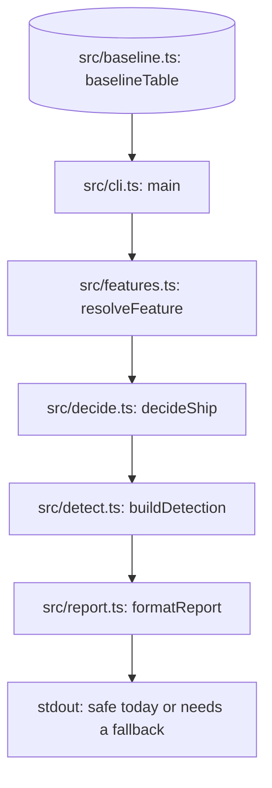

# Mini project 01 — Ship-It Checker: is this feature safe to ship today?

Time: about 90 minutes · Guidance: guided

## The real use case

A frontend team is ready to ship. The new CSS uses `:has()`, and the new menu uses
the Popover API. Someone asks the question that blocks every release: is this safe
for the browsers our users actually have? The team answers it by hand, one browser
page at a time, and forgets one feature. Then a user on an older Safari gets a
broken menu.

You will build a small command-line checker. It holds a snapshot of Baseline
statuses and reads a list of feature ids. For each one, it prints whether the
feature is safe to ship today or needs a fallback. When a feature needs a
fallback, the checker also prints the runtime check to use. Nobody has to
remember the syntax.

## What this proves

Baseline gives every web feature a status: limited, newly available, or widely
available. A team uses that status to decide whether a feature is safe, without
checking browser versions by hand. Feature detection gives the runtime half of
the same decision. The browser answers whether it has the feature, and the page
takes the enhanced path or the fallback path.

This serves two plan outcomes: "decide whether a feature is safe to ship today"
and "decide when to polyfill or progressively enhance".

## How it works



`src/cli.ts` reads the command line and picks the target. `src/features.ts` looks
each id up in `src/baseline.ts`, which holds the Baseline snapshot.
`src/decide.ts` compares the feature's status with the team's target.
`src/detect.ts` writes the runtime check that goes with the verdict. Finally
`src/report.ts` prints one block per feature. The lesson page "Know what you can
ship: Baseline & caniuse" animates this path with a `FlowAnimation`.

## Prerequisites

- Node.js 20 or newer. Check with `node --version`.
- npm, which comes with Node.
- One hour of free time and a text editor.

The project runs offline after `npm install`. It needs no account, no cloud
service, and no paid tool. It uses no third-party images, fonts, or icons, so
there is no asset licence to record.

## How to run

```bash
cd starter
npm install
npm test          # 11 tests fail at the start; that is expected
npm start         # prints a report for every feature in the table
npm start -- --target 2024 popover css-nesting
```

`npm start` with no arguments checks every row in the table. Add `--target 2024`
to check against the Baseline 2024 target, and add feature ids to check only
those.

## Your tasks

1. **Look up a feature.** In `starter/src/features.ts`, implement `resolveFeature`
   at `TODO(1)`. Find the record whose `id` matches the given id, ignore case, and
   return it. When no record matches, throw an error that names the known ids.
   Done when the test "finds a feature by id and ignores case" passes.
2. **Decide whether a feature is safe.** In `starter/src/decide.ts`, implement
   `decideShip` at `TODO(2)`. Use the Baseline status of the feature and the
   team's target to return the verdict. Return the reason in one sentence, plus
   the advice that follows from the failure mode of the feature. Done when the
   tests in "decideShip" pass.
3. **Write the runtime check.** In `starter/src/detect.ts`, implement
   `buildDetection` at `TODO(3)`. A CSS feature gets an `@supports` test, and a
   JavaScript feature gets the boolean expression from the table. When a feature
   fails critically, no test can rescue it, so the team needs a polyfill. Done
   when the tests in "buildDetection" pass.
4. **Print the report.** In `starter/src/report.ts`, implement `formatReport` at
   `TODO(4)`. Print the target, then one block per feature. Show the verdict and
   the reason. When a feature needs a fallback, show the advice and the runtime
   check.
   End with a summary line that counts the safe features. Done when the test
   "names the target and every feature" passes.

## How to check your work

```bash
npm test
```

Expected: `12 passed`. Then check it by hand. Run `npm start -- --target 2024
popover css-nesting`. The report must say that the Popover API needs a fallback
under the 2024 target. It must also say that the feature is safe today under the
2025 target, with the runtime check `"popover" in HTMLElement.prototype`.

## Stretch goals

- Add a feature you use in your own project to `src/baseline.ts`, with its
  status, its failure mode and its runtime check.
- Write the report as a Markdown table. Then you can paste it into a pull
  request.
- Print a warning when a feature is safe under the `widely` target but not under
  the team's year target. Teams argue most about that case.

## Hints

Read a hint only after you have tried the task for ten minutes.

### Hint for task 1

`Array.prototype.find` gives you the first record that matches. Compare
`feature.id.toLowerCase()` with `id.trim().toLowerCase()`.

### Hint for task 2

A feature is safe today when its status is `widely`. It is also safe when its
status is `newly` and the target year is not older than the year in
`newlyAvailable`. Take that year from `feature.newlyAvailable.slice(0, 4)`.

### Hint for task 3

The table stores the test condition for every feature. Wrap a CSS condition in
`@supports ` and leave a JavaScript condition as it is.

### Hint for task 4

Build an array of lines and join it with `"\n"`. The summary counts the
decisions whose `verdict` is `safe today`.

## Implementation walkthrough

Read this only after you finish, or when you are stuck after the hints.

1. `starter/src/features.ts`, `resolveFeature` (TODO 1): compare the trimmed id
   with every id in `baselineTable`, ignoring case, and return the first match.
   When there is no match, throw an error that lists `knownFeatureIds()`. That
   error tells the reader which ids the tool accepts.
2. `starter/src/decide.ts`, `decideShip` (TODO 2): treat `widely` as safe for
   every target. Treat `limited` as always needing a fallback. Treat `newly` as
   safe only when the target year is not older than the year the feature became
   newly available. The failure mode picks the advice: `enhancement` gives
   progressive enhancement, `additive` gives fallback content, and `critical`
   gives a polyfill.
3. `starter/src/detect.ts`, `buildDetection` (TODO 3): wrap a CSS condition in
   `@supports `. Keep a JavaScript condition as it is. Set `needsPolyfill` when
   the failure mode is `critical`. A test cannot rescue a feature that breaks
   the page.
4. `starter/src/report.ts`, `formatReport` (TODO 4): print the target, then one
   block per decision, then the summary. The report prints the detection snippet
   only when the feature does not need a polyfill, because a polyfill is not a
   runtime check.

## Compare with the solution

The finished project is in `../solution/`. When you compare, look at how
`decideShip` reads the target year. Look at how `buildDetection` separates a CSS
check from a JavaScript check. Then look at how `formatReport` leaves out the
runtime check for a feature that needs a polyfill.
