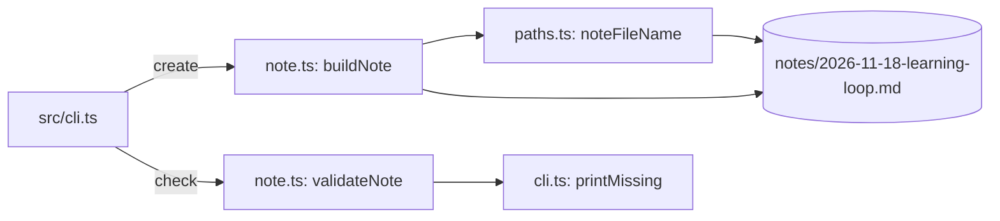

# Mini project 02 — A learning log that keeps the read-build-measure-explain loop

Time: about 2 hours · Guidance: less guided

## The real use case

You work through a frontend roadmap one item at a time. Three weeks later you
cannot tell which items you understand and which ones you only skimmed, because
your notes are a list of browser tabs. A learning log fixes this. Every roadmap
item gets one note, and every note holds the same four sections: read, build,
measure, explain. A small generator script writes the empty note for you, and a
check command names the steps you have not written yet. Without that structure,
a passive learner finishes the roadmap and forgets most of it.

## What this proves

The learning loop only works when you keep all four steps. This project turns
the loop into an artifact you can check: the generator scaffolds the four
sections, and the validator refuses to call a note complete while one section
stays empty. It serves the plan outcome "build a personal learning log that
records each roadmap item's four steps".

## How it works



`src/cli.ts` runs one of two commands. `createNote` calls `buildNote` in
`src/note.ts` for the four step sections, and `noteFileName` in `src/paths.ts`
for the file name. `checkNote` calls `validateNote` and then `printMissing`,
which names every step whose section holds no text yet. The lesson page
"The learning loop: read, build, measure, explain" animates the same four steps
with the `OrderSteps` component.

## Prerequisites

- Node.js 22.12 or newer (`node --version`)
- npm 10 or newer (`npm --version`)
- You have read the lesson page "The learning loop: read, build, measure, explain"

The project needs no account, no database, and no service. Everything runs on
your machine.

## How to run

```bash
cd starter
npm install
npm test          # 12 tests fail at the start; that is expected
npm start -- --topic "learning-loop" --date 2026-11-18 --out notes
```

The last command writes `notes/2026-11-18-learning-loop.md` with four empty
sections. Before you finish task 1 it stops with the message
`TODO(1): buildNote is not implemented yet`. Fill the sections in, then check
the note:

```bash
npm run check -- --file notes/2026-11-18-learning-loop.md
```

## Your tasks

1. **Write the note skeleton.** Goal: `buildNote` returns a markdown note that
   holds the topic, the date, and one `##` section for each of the four steps.
   Done when the test "gives every step its own section" passes.
2. **Find the empty steps.** Goal: `validateNote` returns the ids of the steps
   whose section holds no text. Done when the test "reports only the step that
   has no content" passes.
3. **Make a file-safe slug.** Goal: `toSlug` turns any roadmap item name into
   lowercase words joined by dashes. Done when the test "turns a roadmap item
   name into a file-safe slug" passes.
4. **Name the file.** Goal: `noteFileName` joins the date and the slug into
   `YYYY-MM-DD-topic.md`. Done when the test "joins the date and the slug"
   passes.

## How to check your work

```bash
npm test
```

Expected: `13 passed`. Then check the note by hand. Run
`npm start -- --topic "learning-loop" --date 2026-11-18 --out notes`, open the
new note, and write one line under each of the four headings. Run
`npm run check -- --file notes/2026-11-18-learning-loop.md` again. It prints
`All four steps have content.` and exits with code 0. Delete one of the lines,
run the command once more, and it names that step and exits with code 1.

## Stretch goals

- Add a `--source` flag that writes the primary source URL into the header.
- Add a `summary` command that lists every note in the notes folder and prints
  the steps each note still misses.
- Let the learner pass the four section texts as flags, so one command writes a
  finished note.

## Hints

Read a hint only after you have tried the task for ten minutes.

### Hint for task 1

The note is a list of lines joined with `"\n"`. Each step of `STEPS` becomes one
heading line and one empty line after it.

### Hint for task 2

Find the heading line first, then read the lines after it until the next line
that starts with `## `. A section that holds only spaces counts as empty.

### Hint for task 3

Lower-case the text. Replace every run of characters that is not a letter or a
digit with one dash. Then remove the dashes at the start and at the end.

### Hint for task 4

The file name is the date, a dash, the slug from `toSlug`, and the extension
`.md`.

## Implementation walkthrough

Read this only after you finish, or when you are stuck after the hints.

1. `src/note.ts`, `buildNote` (TODO 1): build the header lines with the topic
   and the date, then loop over `STEPS` and push a heading and an empty line for
   each step. The loop keeps the four sections in the order of the loop.
2. `src/note.ts`, `validateNote` (TODO 2): split the markdown into lines, find
   the heading of each step, and read the lines under it until the next `## `
   heading. A missing heading counts as an empty step, so a broken note never
   looks done.
3. `src/paths.ts`, `toSlug` (TODO 3): lower-case the text, replace every run of
   characters that is not a letter or a digit with one dash, and trim the
   dashes at both ends.
4. `src/paths.ts`, `noteFileName` (TODO 4): return the date, a dash, the slug
   from `toSlug`, and the extension `.md`.

## Compare with the solution

The finished project is in `../solution/`. When you compare, look at how
`buildNote` keeps the four headings in the order of `STEPS`, how `validateNote`
treats a missing heading the same as an empty one, and how `toSlug` never
returns a leading or a trailing dash.
