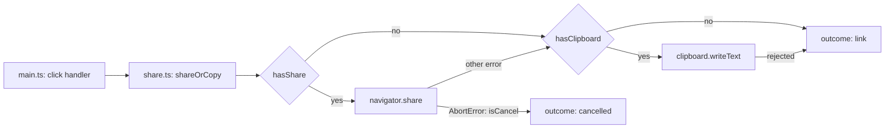

# Mini project 02 — Share button with a fallback

Time: about 2 hours · Guidance: less guided

## The real use case

A blog owner adds a Share button. On a phone, the button should open the system share sheet. Many desktop browsers have no Web Share API, and the button then does nothing or throws an error. A developer who checks the browser name ships a list that is wrong within a year. You will build the button with feature detection. It tests for the Web Share API, then for the Clipboard API, and last shows a selectable link. Every visitor gets a way to share.

## What this proves

Feature detection tests for a feature, not for the browser. The test is `"share" in navigator`, and the result picks enhanced or fallback code. This serves the plan outcome "pick a fallback only when a feature check says it is needed". The `navigator` object is passed into the logic, so tests run all three paths without a browser.

**Note.** `navigator.share` needs a secure context (HTTPS or `localhost`) and a click from the user. Its support differs between browsers, so check the official table before you ship.

## How it works



The click handler in `main.ts` passes the real `navigator` to `shareOrCopy`. That function runs the checks `hasShare` and `hasClipboard` in order. The first path that works wins, and `isCancel` stops the chain when a person closes the share sheet. The handler writes the returned message into a status line, and shows a selected link input for the `link` outcome.

## Prerequisites

- Node.js 22.12 or newer (Vitest 5 and Vite 8 require it) (`node --version`)
- npm (comes with Node.js)
- You know what feature detection is (the feature detection lesson page)

No service and no account. The only network use is `npm install`.

## How to run

```bash
cd starter
npm install
npm test          # 14 tests fail at the start; that is expected
npm start         # Vite prints a localhost address; open it
```

The page works only after you finish the tasks. The solution runs the same way from `solution/`.


**Note.** `npm audit` reports a high-severity advisory for `picomatch` (all versions; no fixed release exists on 2026-11-17). It comes only through the dev tooling (Vite and Vitest file globbing) and never reaches the code you ship, so the project's security check audits runtime dependencies with `npm audit --omit=dev --audit-level=high`. Dev tools are pinned to Vitest 5.1.0. Do not run `npm audit fix --force`; it downgrades the pinned Vitest.

## Your tasks

All four tasks are in `src/share.ts`. Each starts at a `TODO(n)` comment.

1. **Detect the Web Share API.** Write `hasShare`. Done when the three `hasShare` tests pass.
2. **Detect the Clipboard API.** Write `hasClipboard`. Done when the three `hasClipboard` tests pass.
3. **Tell a cancel from a failure.** Write `isCancel`. Done when the two `isCancel` tests pass.
4. **Choose the path.** Write `shareOrCopy`. It returns a `ShareResult` with an `outcome` and a `message`. Done when all tests in the three `shareOrCopy` groups pass.

The button is already a real `<button>` with a visible name and a `role="status"` message line. Tab to it and press Enter or Space to try it.

## How to check your work

```bash
npm test
```

Expected: `14 passed`. Then check by hand. Run `npm start` and open the address. Tab to the button and press Enter. On a desktop browser without the Web Share API you see "Link copied to the clipboard." in the status line. To see the last path, run `npm start -- --host` and open the printed Network address (a plain `http://` address), where the Clipboard API is missing. A selected link input then appears.

## Stretch goals

- Add a `text` field to `ShareData` and send it to `navigator.share`.
- Call `navigator.canShare(data)` before sharing, and treat a `false` answer as "no share".
- Hide the Share button until JavaScript runs, and show a plain `mailto:` link without it.

## Hints

Read a hint only after you have tried the task for ten minutes.

### Hint for task 1

`"share" in nav` checks that the member exists. It is also true when the member is a string, so add a `typeof` check.

### Hint for task 2

`nav.clipboard?.writeText` gives `undefined` when `clipboard` is missing, with no error. Compare its `typeof` to `"function"`.

### Hint for task 3

`error instanceof Error` first, then compare `error.name` to `"AbortError"`. A plain string is not a cancel.

### Hint for task 4

Use three blocks in order: `if (hasShare(nav))`, `if (hasClipboard(nav))`, then the final `return`. Put each `await` inside `try`/`catch`. In the share `catch`, return early only for `isCancel`; otherwise let the code reach the next block.

## Implementation walkthrough

1. `src/share.ts`, `hasShare`: return `"share" in nav && typeof nav.share === "function"`. The `in` test is the feature check from the MDN guide. The `typeof` guard rejects a wrong value.
2. `src/share.ts`, `hasClipboard`: return `"clipboard" in nav && typeof nav.clipboard?.writeText === "function"`. The optional chain keeps the check safe on insecure pages.
3. `src/share.ts`, `isCancel`: return `error instanceof Error && error.name === "AbortError"`. A closed share sheet is a choice, so it must not trigger the fallback.
4. `src/share.ts`, `shareOrCopy`: if `hasShare`, await `nav.share(data)` in a `try` and return `shared`; in `catch`, return `cancelled` when `isCancel`, else continue. If `hasClipboard`, await `writeText(data.url)` and return `copied`; on a rejection, continue. The last line returns the `link` outcome. The order puts the best experience first and always ends in a path that works.

## Compare with the solution

The solution is in `solution/`. Look for these points:

- `share.ts` never reads the global `navigator`. `main.ts` passes it in, which is why the tests need no browser.
- Each `catch` falls through to the next path instead of showing an error. The visitor always ends with a way to share.
- `NavigatorLike` lists only the two members the module uses, so a test fake stays short.
