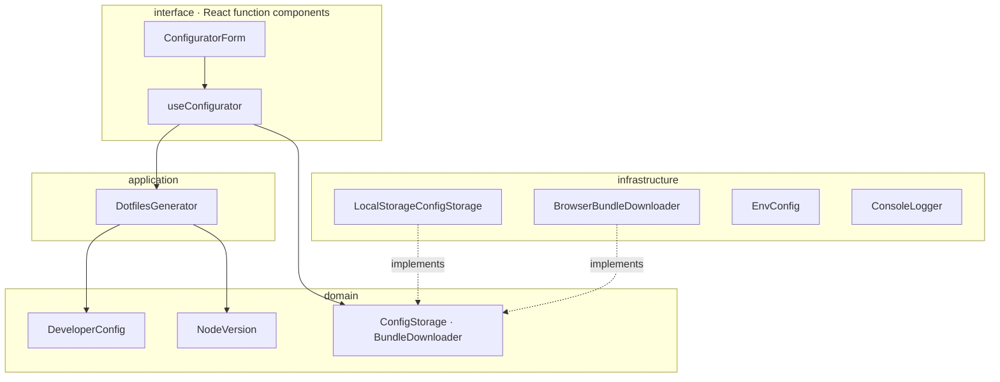
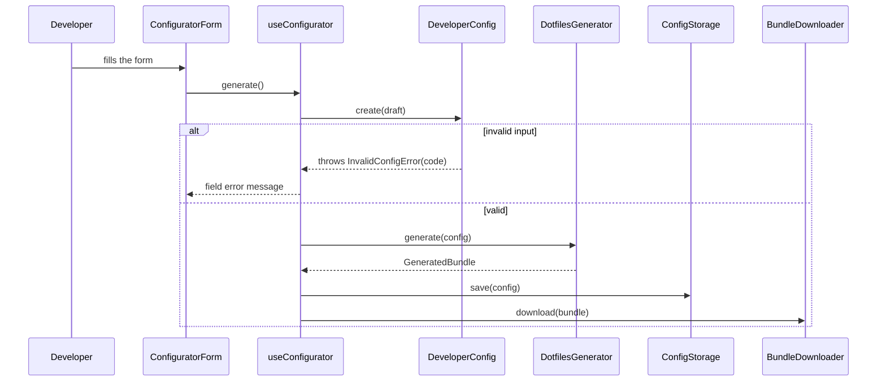
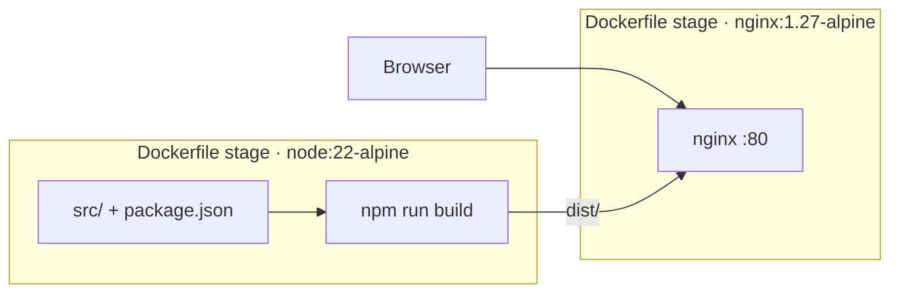

# Architecture

## Overview

The Dev environment configurator is a single-page React app. A developer picks
their shell, git identity, editor, and Node version in a form; the app
validates those choices, generates a ready dotfiles repository, remembers the
choice in the browser, and offers a single `install.sh` download that recreates
the whole setup on a new machine.

The code has four layers, read from the inside out. `domain` and `application`
contain every rule and run with no browser. `infrastructure` adapts them to the
browser. `interface` is the React view, which is made of function components
because React components are functions — with one class exception, the error
boundary, because React requires it.

## Layers



Arrows show who depends on whom. Every dependency points inward: nothing in
`domain` depends on `infrastructure` or `interface`, and the two adapters
implement the ports rather than the other way round.

## Classes and their responsibilities

| Class | Layer | File | Single responsibility |
|-------|-------|------|-----------------------|
| `DeveloperConfig` | domain | `src/features/configurator/model.ts` | Holds a valid shell, git identity, editor, and Node version; `create` validates untrusted input against allow-lists. |
| `NodeVersion` | domain | `src/features/configurator/model.ts` | A value object for a three-part version; only `parse` can build one. |
| `ConfigStorage` | domain (port) | `src/features/configurator/model.ts` | Describes saving, loading, and clearing a saved configuration. |
| `BundleDownloader` | domain (port) | `src/features/configurator/model.ts` | Describes triggering a download of the generated bundle. |
| `DotfilesGenerator` | application | `src/features/configurator/DotfilesGenerator.ts` | Turns a valid `DeveloperConfig` into files, an installer, and a checklist. |
| `GeneratedBundle` | domain | `src/features/configurator/model.ts` | Holds the generated files, the install script, and the checklist. |
| `LocalStorageConfigStorage` | infrastructure | `src/shared/lib/LocalStorageConfigStorage.ts` | Implements `ConfigStorage` on the browser's local storage. |
| `BrowserBundleDownloader` | infrastructure | `src/shared/lib/BrowserBundleDownloader.ts` | Implements `BundleDownloader` with a Blob and an anchor click. |
| `EnvConfig` | infrastructure | `src/shared/config.ts` | Reads and validates environment variables at startup. |
| `ConsoleLogger` | infrastructure | `src/shared/lib/Logger.ts` | Writes structured JSON log lines with a session id. |
| `ConfigError` | domain | `src/shared/lib/errors.ts` | The base error carrying a fixed `code`; `InvalidConfigError`, `StorageError`, and `GenerationError` specialise it. |
| `ErrorBoundary` | interface | `src/app/ErrorBoundary.tsx` | The one class in the view layer, required by React to catch render errors. |

`useConfigurator` (`src/features/configurator/hooks/useConfigurator.ts`) is the
orchestration hook: it is a function, not a class, and drives the flow through
the classes above. `src/app/main.tsx` is the composition root, the only place
that creates the adapters and wires them.

## Request flow



The failure path is the point of the design: `DeveloperConfig.create` rejects
bad input before anything is generated, saved, or downloaded, and it names the
failure with a fixed code so the form can put the message on the right field.

## Deployment



The `Dockerfile` has two stages. The `node:22-alpine` stage runs
`npm ci` and `npm run build` (which runs `tsc --noEmit` first, then Vite) and
produces the static `dist/`. The `nginx:1.27-alpine` stage copies that folder
and serves it on port 80. The `VITE_APP_TITLE` and `VITE_STORAGE_KEY`
variables are baked into the bundle at build time, so there are no secrets or
server-side environment to leak.

## Interactive walkthrough

The generate flow as a lesson component. Paste it into a lesson page (no import
needed) to let the learner switch the storage off and watch the flow continue
with the download:

```mdx
<FlowAnimation
  title="One configuration, from form to download"
  nodes={[
    { id: "form", label: "ConfiguratorForm" },
    { id: "config", label: "DeveloperConfig" },
    { id: "gen", label: "DotfilesGenerator" },
    { id: "store", label: "ConfigStorage", kind: "store" },
    { id: "dl", label: "BundleDownloader" }
  ]}
  steps={[
    { from: "form", to: "config", packet: "draft", caption: "The form values are validated into a DeveloperConfig; bad input throws with a code." },
    { from: "config", to: "gen", packet: "config", caption: "The generator turns the config into files, an installer, and a checklist." },
    { from: "gen", to: "store", packet: "save", caption: "The config is remembered so the developer can return to it.", fallback: { from: "gen", to: "dl", packet: "skip", caption: "Storage is unavailable, so the config is not remembered and the download still works." } },
    { from: "gen", to: "dl", packet: "download", caption: "The developer downloads install.sh and runs it on a new machine." }
  ]}
  breakable={["store"]}
/>
```

## Object-oriented ideas and where they are used

- **Encapsulation** — `DeveloperConfig` and `NodeVersion` have private
  constructors and private fields; an instance can only exist through
  `create`/`parse`, which enforce the rules. An invalid configuration cannot be
  built from outside (`src/features/configurator/model.ts`).
- **Abstraction and dependency inversion** — `useConfigurator` depends on the
  `ConfigStorage` and `BundleDownloader` ports, not on local storage or the
  DOM. The adapters depend on the domain, not the other way round.
- **Polymorphism** — `LocalStorageConfigStorage` (production) and
  `MemoryConfigStorage` (in `tests/fakes/`) both implement `ConfigStorage`;
  `main.tsx` chooses one and the hook cannot tell the difference.
- **Composition** — `useConfigurator` receives a `ConfiguratorServices` object
  holding the storage, downloader, and generator. There is no base class.
- **Single responsibility** — `DotfilesGenerator` is one class with one job;
  each adapter wraps one external system. A change has one place to go.
- **Open/closed** — a second storage backend is a new class implementing
  `ConfigStorage`; no existing class is edited to add it.
- **Where classes do not fit** — the view is function components and a hook,
  because React components are functions. The only class there is
  `ErrorBoundary`, which React requires for `componentDidCatch`.

## Borrowed from production

Practices taken from the nvm-sh/nvm deep dive, named by the note they come from
and the file they live in here.

| Practice | Source note | Applied in |
|----------|-------------|------------|
| Treat every input as untrusted: validate against an allow-list before it reaches a generated script | `nvm-findings.md` (finding 1), `nvm-takeaways.md` | `src/features/configurator/model.ts` (`DeveloperConfig.create`) |
| A fixed error code per failure class, and "missing" split from "misconfigured" | `nvm-findings.md` (finding 3), `nvm-takeaways.md` (items 1, 4) | `src/shared/lib/errors.ts`, `src/features/configurator/model.ts` |
| Verify before you publish, then rename once: write to a temp file and `mv` | `nvm-findings.md` (finding 2), `nvm-takeaways.md` (item 2) | `src/features/configurator/DotfilesGenerator.ts` (`write_file` in the installer) |
| Idempotent re-runs converge: append only when the line is absent | `nvm-findings.md` (finding 7), `nvm-takeaways.md` (item 5) | `src/features/configurator/DotfilesGenerator.ts` (`append_once`) |
| Test the trust boundary by attacking it | `nvm-findings.md` (finding 8), `nvm-takeaways.md` (item 6) | `tests/unit/DeveloperConfig.test.ts` (hostile-input cases) |
| One self-contained installer, never a stream piped into a shell | `nvm-findings.md` (finding 6) | `src/features/configurator/DotfilesGenerator.ts` (`install.sh` is a complete downloaded file) |

## Error handling, configuration, logging

- Domain errors are the `ConfigError` subclasses in `src/shared/lib/errors.ts`,
  each with a fixed `code`. `useConfigurator` maps an `InvalidConfigError` to a
  field message and logs it; anything unexpected is logged with the session id.
  `ErrorBoundary` turns an uncaught render error into a `role="alert"` message.
- `EnvConfig` (`src/shared/config.ts`) reads `VITE_APP_TITLE` and
  `VITE_STORAGE_KEY`, falls back to defaults, and fails fast on a value that
  contains a newline or is too long. `.env.example` lists both.
- `ConsoleLogger` (`src/shared/lib/Logger.ts`) writes one JSON object per line
  with `level`, `message`, and `sessionId`; the browser console is the transport
  in development.

## How to extend it

- Add a shell: add its id to `ShellId`, add it to `SHELLS`, and teach
  `DotfilesGenerator.shellRcPath` and `shellRcContent` where to write it.
- Add an editor: the same path, plus an entry in `EDITOR_COMMAND` and
  `editorSettingsContent`.
- Add a storage backend: write a class implementing `ConfigStorage` and swap it
  in `src/app/main.tsx`.
- Add linting: the project deliberately ships no ESLint or Prettier; add both as
  a `lint` script that runs in the same CI as `npm test`.
