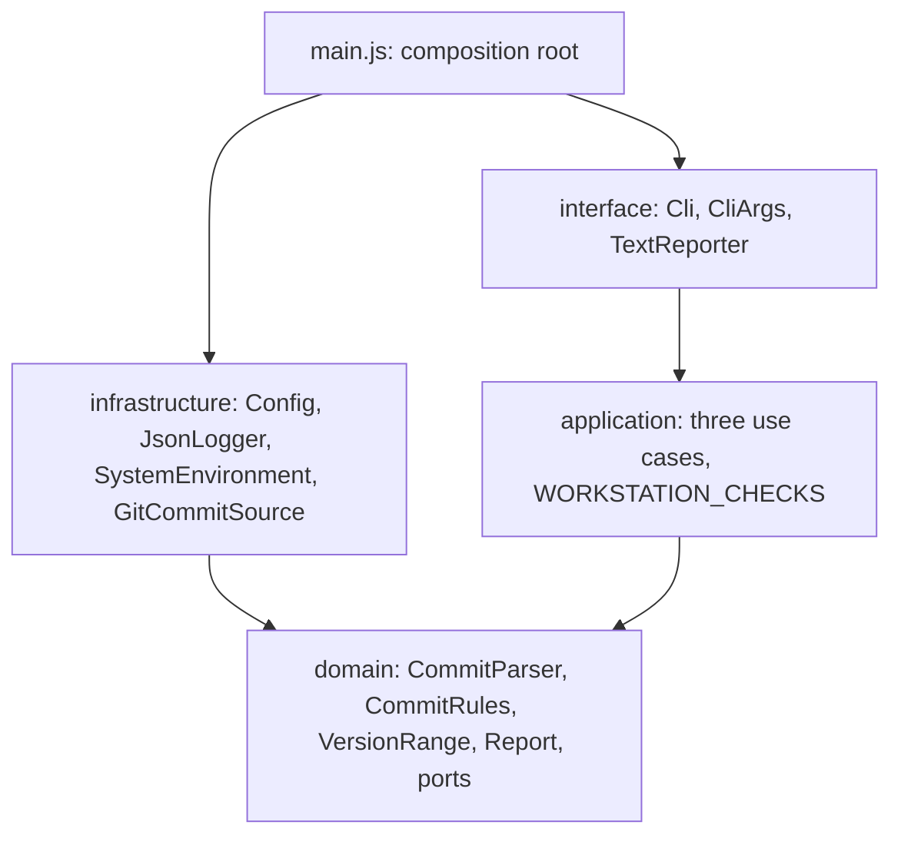
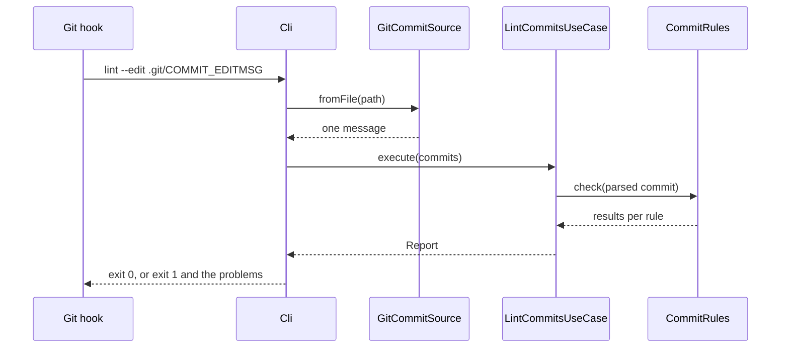
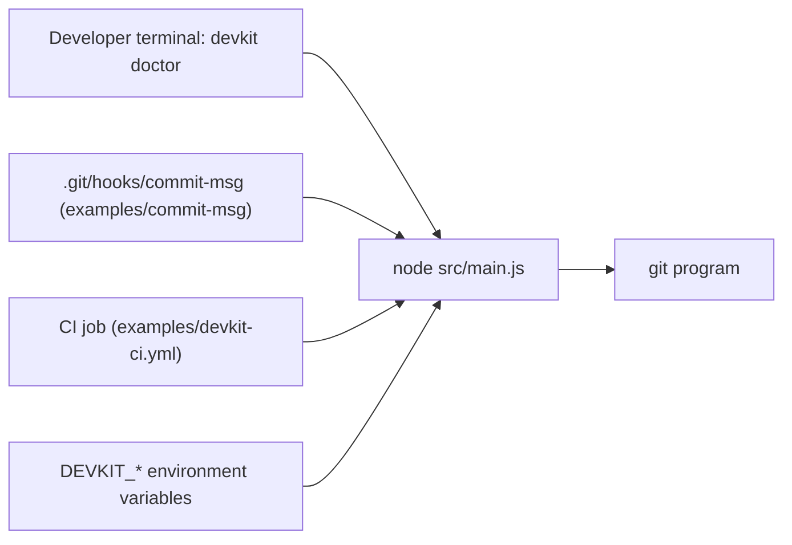

# Architecture

## Overview

`devkit` is a small Node.js command line tool for a frontend team that onboards new developers. It does three jobs. `doctor` checks the workstation: the Node.js version against `.nvmrc` and `engines`, the Git identity, and the tools on `PATH`. `lint` checks commit messages against the Conventional Commits format. `notes` writes release notes from those commits.

The code has four layers. Read them from the inside out: `domain` first, then `application`, then `infrastructure` and `interface`. The tool has no npm dependencies. It uses ES modules only (see ADR 0002) and the built-in test runner.

No repository was cloned for this project; the borrowed practices come from the analysis of commitlint in the repo-intel notes.

## Layers



Arrows point toward the code that is depended on. `domain` imports nothing from the other layers. `infrastructure` implements the ports that `domain` defines. Only `main.js` knows both sides.

## Classes and their responsibilities

| Class or module | Layer | One job |
|---|---|---|
| `CheckResult` | domain | One immutable result: id, level (`ok`, `warn`, `error`) and message. |
| `Report` | domain | Collects results and decides the exit code. |
| `ExitCode` | domain | The one list of exit codes: 0, 1, 9. |
| `errors.js` (`UsageError`, `ConfigError`, `HistoryError`) | domain | Named failures that the interface turns into exit codes. |
| `VersionRange` | domain | Answers "does this Node version satisfy `>=22.12.0 \|\| ^20.19.0`?". |
| `CommitParser` | domain | Cleans a message like Git does, then splits `type(scope)!: subject`. |
| `CommitRules` | domain | Runs the configured rules, and refuses an empty or unknown rule set. |
| `EnvironmentPort`, `CommitSourcePort` | domain | Describe what the domain needs from the machine and from Git. |
| `WORKSTATION_CHECKS` | application | A table of six check functions with one shape. |
| `CheckWorkstationUseCase` | application | Runs the checks and builds the doctor report. |
| `LintCommitsUseCase` | application | Lints a list of commits from any source. |
| `WriteReleaseNotesUseCase` | application | Groups commits into Markdown release notes. |
| `SystemEnvironment` | infrastructure | Implements `EnvironmentPort`: Node version, `git config`, `PATH` walk, project files. |
| `GitCommitSource` | infrastructure | Implements `CommitSourcePort`: message file, `git log`, shallow-clone guard. |
| `Config` | infrastructure | Reads `DEVKIT_*` variables and fails at startup when one is wrong. |
| `JsonLogger` | infrastructure | Writes JSON lines with a run id. |
| `Cli`, `CliArgs` | interface | Parse arguments, call one use case, return the exit code. |
| `TextReporter` | interface | Formats a report as plain text. |

## Request flow

The most important operation is the `commit-msg` hook: `devkit lint --edit <file>`.



Failure paths: a missing message file raises `HistoryError` and the exit code is 1. A wrong command line raises `UsageError` and the exit code is 9. A rule with level `error` that fails makes `Report.exitCode()` return 1; a failing `warn` rule only prints.

## Deployment

The tool is not a server. It runs as a short process in three places.



Every place runs the same command, so the same rules apply on a laptop and in CI. CI uses `fetch-depth: 0` because `GitCommitSource.range` stops on a shallow clone. The only configuration is the `DEVKIT_*` variables in `.env.example`.

## Interactive walkthrough

Paste this into a lesson page to let a learner break the Git step and see the exit code change:

```mdx
<FlowAnimation
  title="devkit lint runs in the commit-msg hook"
  nodes={[
    { id: "hook", label: "commit-msg hook", kind: "pill" },
    { id: "cli", label: "Cli" },
    { id: "source", label: "GitCommitSource" },
    { id: "lint", label: "LintCommitsUseCase" },
    { id: "rules", label: "CommitRules", kind: "store" }
  ]}
  steps={[
    { from: "hook", to: "cli", packet: "--edit file", caption: "Git starts devkit and passes the message file." },
    { from: "cli", to: "source", packet: "fromFile", caption: "The source reads the file. Git comment lines are removed later by the parser.", fallback: { from: "source", to: "cli", packet: "HistoryError", caption: "The file cannot be read: exit code 1." } },
    { from: "cli", to: "lint", packet: "execute", caption: "The use case parses each message." },
    { from: "lint", to: "rules", packet: "check", caption: "Each rule returns passed or failed. The report decides exit 0 or 1." }
  ]}
  breakable={["source"]}
/>
```

## Object-oriented ideas and where they are used

| Idea | Where | Problem it removes |
|---|---|---|
| Encapsulation | `src/domain/Report.js` keeps results in a private field and exposes `add`, `count`, `exitCode`. | Nobody can change a result list behind the exit-code logic. |
| Immutability | `CheckResult` and `ParsedCommit` call `Object.freeze`. | A rule cannot change a commit that another rule reads next. |
| Abstraction and dependency inversion | `src/domain/ports.js`; use cases receive `EnvironmentPort` objects. | The doctor logic does not know whether it runs on a real machine. |
| Polymorphism | `SystemEnvironment` and `FakeEnvironment` (`tests/support/fakes.js`) behind one port. | Unit tests run without Git, without a real `PATH`. |
| Composition | `src/main.js` passes every collaborator through constructors. | No inheritance chains, no global state, no injection framework. |
| Single responsibility | One class per file, one use case per command. | A change to release notes never touches linting. |
| Open/closed | A new commit rule is one entry in `RULES`; a new workstation check is one function in `WORKSTATION_CHECKS`. | Features are added without editing tested code. |
| Liskov substitution | Both ports have a fake and a real class that follow the same return shapes. | Swapping an adapter never changes a use case. |

Inheritance is used only to mark errors (`DevkitError`) and to implement ports. Rules and checks are plain functions in a table, because a table is easier for a beginner to read than a class tree.

## Borrowed from production

| Practice | Note it comes from | Where it lives |
|---|---|---|
| Rules and checks are small functions with one shape, listed in one table; config is data. | `commitlint-takeaways.md` (takeaway 1) | `src/domain/CommitRules.js`, `src/application/WorkstationChecks.js` |
| Levels: a warning prints but passes; only errors fail; `--strict` fails on warnings. | `commitlint-takeaways.md` (takeaway 2) | `src/domain/Report.js`, `src/domain/CheckResult.js` |
| Exit codes are one contract: 0, 1, 9. | `commitlint-takeaways.md` (takeaway 3) | `src/domain/ExitCode.js`, `src/interface/Cli.js` |
| An empty or broken rule set fails loud. | `commitlint-takeaways.md` (takeaway 4) | `src/domain/CommitRules.js`, `src/application/CheckWorkstationUseCase.js` |
| Read a message like Git: drop comments and the scissors section, skip merge and revert. | `commitlint-takeaways.md` (takeaway 5) | `src/domain/CommitParser.js` |
| Three message sources and a shallow-clone stop. | `commitlint-takeaways.md` (takeaway 6) | `src/infrastructure/GitCommitSource.js`, `examples/devkit-ci.yml` |
| Check Node and the package manager against the files the project pins. | `commitlint-takeaways.md` (takeaway 7) | `src/application/WorkstationChecks.js` |

## Error handling, configuration, logging

- **Errors.** Domain code throws `UsageError`, `ConfigError` or `HistoryError`. `Cli.#translate` maps them: usage and config to exit 9, history to exit 1. Any other error is logged with its name, message and stack, printed once, and returns exit 1. Nothing is swallowed.
- **Configuration.** Environment variables only, read once by `Config` (see `.env.example`). A bad value stops the tool before any work starts, with exit 9.
- **Logging.** `JsonLogger` writes one JSON object per line to stderr, with `time`, `level`, `runId` and `message`. The default level is `warn`, so normal runs print only the report on stdout. Set `DEVKIT_LOG_LEVEL=debug` to see each check and each linted commit.

## How to extend it

- **A new commit rule.** Add a function to `RULES` in `src/domain/CommitRules.js`, add its tuple to `conventionalPreset`, and add a test in `tests/unit/domain.test.js`.
- **A new workstation check.** Write a function `(context) => CheckResult` in `src/application/WorkstationChecks.js` and add it to `WORKSTATION_CHECKS`. Test it with `FakeEnvironment`.
- **A new release-notes section.** Add a `[type, title]` pair to `SECTIONS` in `WriteReleaseNotesUseCase.js`.
- **A new command.** Add a use case, add the name to `CliArgs.js`, add one method to `Cli`, and wire it in `main.js`.
