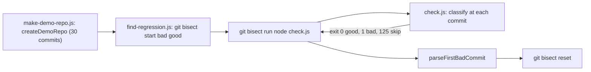

# Mini project 01 - Bisect the regression

Time: about 2 hours · Guidance: guided

## The real use case

A shop's price formatter printed `$19.05` last month. Today it prints `$19.5`. The module changed many times in the last 30 commits, and nobody knows which change broke it. You will write a test script and let `git bisect run` find the commit that introduced the bug.

## What this proves

`git bisect run` does a binary search over the commit history and reads the exit code of your script at each step. This serves the plan outcome "find the commit that broke a feature". You also practice the commit graph (a chain of commits) and shell exit codes.

## Why not read the log by hand

Reading 30 diffs takes a long time, and you can miss the one that matters. Binary search halves the range at each step, so 30 commits need about 5 tests. A script runs those tests for you and gives the same answer every time.

## How it works



`createDemoRepo` builds a throwaway repo in a temp folder. One commit plants the bug, and one earlier commit has a syntax error. `find-regression.js` starts bisect, and Git checks out a middle commit and runs `check.js`. The exit code tells Git to go earlier or later. At the end, the code reads the first bad commit and resets the repo.

## Exit codes of the script

An exit code is the number a program returns to the shell. `git bisect run` reads it like this:

| Exit code | Meaning for Git |
|-----------|-----------------|
| 0 | good commit |
| 1 to 127, except 125 | bad commit |
| 125 | skip: this commit cannot be tested |
| 128 and above | abort the whole bisect |

## Prerequisites

- Node.js 22 or newer (`node --version`)
- Git (`git --version`)
- No `npm install` is needed. The project has no dependencies.

## How to run

```bash
cd starter
npm test          # 8 tests fail at the start; that is expected
npm start         # prints a TODO message until you finish task 2
```

The demo repo is created in your system temp folder and removed at the end. The code sets `user.name` and `user.email` only inside that repo. Your global Git settings are not touched.

## Your tasks

1. **Classify a commit.** In `src/check.js`, implement `classify` at `TODO(1)`. Return `GOOD`, `BAD` or `SKIP`. Done when the four `classify` tests pass.
2. **Start bisect.** In `src/find-regression.js`, implement `startBisect` at `TODO(2)`. Done when `npm start` no longer prints the TODO(2) message.
3. **Run bisect.** Implement `runBisect` at `TODO(3)`. It must call `git bisect run` with your script and return the output.
4. **Parse the answer.** Implement `parseFirstBadCommit` at `TODO(4)`. Done when the parse test passes.
5. **Clean up.** Implement `resetBisect` at `TODO(5)`. Done when the test "resets the repo afterwards" passes.

## How to check your work

```bash
npm test
```

Expected: `8 passed`. Then run `npm start`. It prints `Match.` when the SHA that bisect found equals the planted commit.

## Stretch goals

- Run `git bisect log` before the reset and print how many steps Git took.
- Change `badCommit` and `skipCommit` in `createDemoRepo` and check that the answer still matches.
- Run the same bisect by hand in the demo repo with `git bisect good` and `git bisect bad`.

## Hints

Read a hint only after you have tried the task for ten minutes.

### Hint for task 1

Use `import()` inside `try`. A syntax error makes `import()` throw, and that case is a skip, not a bad commit.

### Hint for task 2

Use `spawnSync("git", [...], { cwd })`. A non-zero `result.status` means failure; the message is in `result.stderr`.

### Hint for task 3

Pass `process.execPath` as the program, so Git runs the same Node that runs your code.

### Hint for task 4

Git prints a line like `<sha> is the first bad commit`. A regular expression with the `m` flag matches a whole line.

### Hint for task 5

`git bisect reset` returns you to the commit you started from. Without it, the repo stays on a detached HEAD.

## Implementation walkthrough

Read this only after you finish, or when you are stuck after the hints.

1. `src/check.js`, `classify` (TODO 1): import `price.js` with a unique query string. Return `SKIP` if the import throws. Return `GOOD` only when `formatPrice(1905)` is `$19.05` and `formatPrice(5)` is `$0.05`; anything else is `BAD`.
2. `src/find-regression.js`, `startBisect` (TODO 2): run `git bisect start <bad> <good>` and throw with stderr on failure.
3. `src/find-regression.js`, `runBisect` (TODO 3): run `git bisect run node check.js` and return stdout.
4. `src/find-regression.js`, `parseFirstBadCommit` (TODO 4): match `^<sha> is the first 'bad' commit$` and return the SHA.
5. `src/find-regression.js`, `resetBisect` (TODO 5): run `git bisect reset`. `findRegression` calls it in a `finally` block, so the repo is restored even on error.

## Compare with the solution

The finished project is in `../solution/`. When you compare, look at how `classify` separates a skip from a bad commit, and why `findRegression` resets in `finally`.
