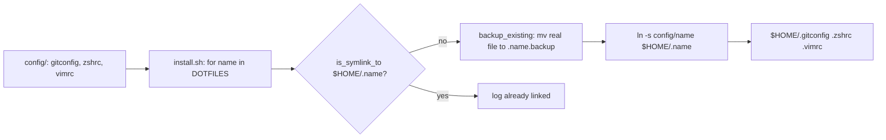

# Mini project 01 — Reproduce your workstation from one dotfiles repo

Time: about 2 hours · Guidance: guided

## The real use case

A developer gets a new laptop or starts at a new team. Without versioned
configuration, they rebuild their shell aliases, git identity and aliases, and
editor settings by hand, and their setup drifts from their teammates. You will
build a dotfiles repository that holds these settings as plain files, plus an
install script that links them into the home directory. Running that one script
reproduces the whole shell, git, and editor setup on any new machine.

## What this proves

A symlink, not a copy, keeps the repository the single source of truth: edit
the file once and every machine sees it. An install script that is safe to run
twice turns "set up by hand" into "reproduced in seconds". This serves the plan
outcome "build a dotfiles repository that reproduces your setup on a new
machine".

## How it works



`install.sh` loops over each name in `DOTFILES`. For each one it checks whether
the home file is already a symlink to the repo file; if so it skips it. A real
file that already exists is moved to `<name>.backup`, then the repo file is
linked into place with `ln -s`. The same flow is the dotfiles pattern that MIT's
Missing Semester teaches.

## Prerequisites

- bash 3.2 or newer (`bash --version`; macOS ships it)
- git, to commit the repository when you are done
- comfort editing a small shell script

## How to run

```bash
cd starter
./run-tests.sh
```

Expected at the start: `4 failed`, one per test, each naming `TODO(4)`. The
tests need no install step and no network. To see the install script run by
hand, try `HOME=$(mktemp -d) bash install.sh` and list the result.

## Your tasks

1. **Log progress.** In `install.sh`, implement `log` at `TODO(1)` so it prints
   `[dotfiles] <message>`. Done when you can read a clear line per action.
2. **Detect an existing link.** Implement `is_symlink_to` at `TODO(2)` so it
   returns 0 only when the target is already a symlink pointing at the source.
3. **Back up a real file.** Implement `backup_existing` at `TODO(3)` so a real
   file is moved to `<name>.backup` before it is replaced, and a symlink is
   left alone.
4. **Link one file.** Implement `link_file` at `TODO(4)` so it skips an existing
   link, backs up a real file, then creates the symlink with `ln -s`.

## How to check your work

```bash
./run-tests.sh
```

Expected: `8 passed, 0 failed`, and the script exits with status 0. Then check
it by hand: run `HOME=$(mktemp -d) bash install.sh`, then
`ls -l "$HOME"/.gitconfig` — the listing shows an arrow to the `config/` file
in the repository, which is how you know it is a symlink, not a copy.

## Stretch goals

- Add a fourth dotfile, such as a git ignore template, to `config/` and to the
  `DOTFILES` array, then confirm the tests still pass.
- Add an `--unlink` mode that removes the symlinks it created and restores the
  `.backup` files.
- Print a one-line summary at the end of `install.sh`: the number of files
  linked, skipped, and backed up.

## Hints

Read a hint only after you have tried the task for ten minutes.

### Hint for task 1

`printf` takes a format string and values: `printf '[dotfiles] %s\n' "$1"`.

### Hint for task 2

A symlink is detected with `[[ -L "$TARGET" ]]`. `readlink "$TARGET"` prints the
path the link points to, so compare that string with `$SOURCE`.

### Hint for task 3

Use `[[ -e "$TARGET" && ! -L "$TARGET" ]]` so a real file is backed up but an
existing symlink is not. Move it with `mv "$TARGET" "$TARGET.backup"`.

### Hint for task 4

`is_symlink_to` returning 0 means "already done": log it and `return 0`. If it
returns 1, call `backup_existing`, then `ln -s "$SOURCE" "$TARGET"`.

## Implementation walkthrough

Read this only after you finish, or when you are stuck after the hints.

1. `install.sh`, `log` (TODO 1): `printf '[dotfiles] %s\n' "$1"`. The prefix
   makes every action line easy to grep out of the output.
2. `install.sh`, `is_symlink_to` (TODO 2): return
   `[[ -L "$target" ]] && [[ "$(readlink "$target")" == "$source" ]]`. This is
   the idempotency test: a link that is already right must not be created again.
3. `install.sh`, `backup_existing` (TODO 3): when the target is a real file,
   `mv "$target" "$target.backup"` and log it. The `! -L` guard means a
   pre-existing symlink is never moved.
4. `install.sh`, `link_file` (TODO 4): `if is_symlink_to ...` then log and
   `return 0`; otherwise `backup_existing "$target"` then
   `ln -s "$source" "$target"`. The symlink is what makes edits in the repo
   appear on the machine with no extra copy step.

## Compare with the solution

The finished project is in `../solution/`. When you compare, look at how
`is_symlink_to` combines two `[[ ]]` tests, how `backup_existing` refuses to
touch a symlink, and how `link_file` orders the three steps so a second run is a
no-op.
