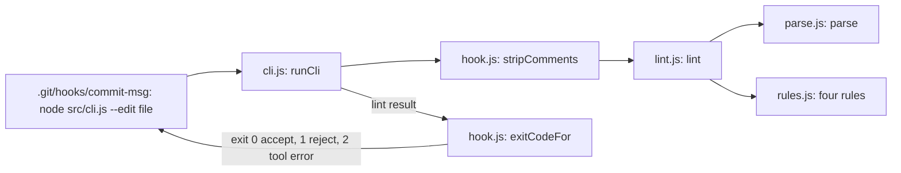

# Mini project 02 — Commit message linter

About 2 hours. Guidance level: less guided (the tasks name the goal and the shape of the result, not the steps).

## The real use case

A team wants a changelog and version numbers made from Git history. That only works when every commit message follows one format. Without a check, one person writes "fixed stuff", another writes "Feat - login", and the tool that reads history cannot sort them. The team runs a linter in a `commit-msg` Git hook, so a bad message is stopped on the developer's machine. The same linter runs in CI, so a message that skipped the hook is still caught.

## What this proves

You use three ideas from the topic. **Conventional Commits** is a format for the first line: `type(scope)!: description`. A **Git hook** is a script that Git runs at a fixed moment; the `commit-msg` hook gets the path of the message file. An **exit code** is the number a program returns: 0 means success, and any other number makes Git stop the commit. This serves the outcome "automate repeated workstation checks with Git and the shell".

## How it works



Git calls the hook with the message file. `runCli` reads the file, `stripComments` removes the lines that Git added, and `lint` parses the message and runs each configured rule from `config.js`. `exitCodeFor` turns the result into the exit code that Git reads. `bumpFor` in `bump.js` shows the version bump the message would cause.

## Prerequisites

- Node.js 24 or newer (`node --version`). The `.nvmrc` file says 24. No packages to install.
- Git, only for the manual hook check.

## How to run

```bash
cd starter
npm test        # fails at first: every failure names a TODO
npm start       # lints examples/good.txt through src/cli.js
```

## Your tasks

Each task matches a `TODO(n)` marker in `starter/src`.

1. In `src/parse.js`, write `parse(message)`. It splits a message into `header`, `type`, `scope`, `breaking`, `description`, `body`, and `footers`. A `!` before the colon or a `BREAKING CHANGE` footer sets `breaking`.
2. In `src/rules.js`, write the four rules. Each returns `[passed, message]`.
3. In `src/lint.js`, write `lint(message, config)`. It runs every rule, sorts problems into errors and warnings, and returns `{ valid, errors, warnings, parsed }`.
4. In `src/hook.js`, write `stripComments(text)`. It removes the `#` lines that Git adds to the message file.
5. In `src/hook.js`, write `exitCodeFor(result)`. Errors give 1. Warnings never block.
6. In `src/bump.js`, write `bumpFor(parsed)`. Breaking is major, `feat` is minor, `fix` is patch.

## How to check your work

```bash
npm test
```

Expected: `tests 34`, `pass 34`, `fail 0`. Then check the exit codes by hand:

```bash
node src/cli.js --edit examples/good.txt; echo "exit: $?"   # ok, exit: 0
node src/cli.js --edit examples/bad.txt;  echo "exit: $?"   # rejected, exit: 1
```

To try it as a real hook, make a throwaway repository, create `.git/hooks/commit-msg` with the line `node /full/path/to/src/cli.js --edit "$1"`, run `chmod +x` on it, and run `git commit --allow-empty -m "oops"`. Git should refuse.

## Stretch goals

- Add a `scope-enum` rule with a list of allowed scopes.
- Add a `body-leading-blank` warning for a body that follows the header without a blank line.
- Add a CI step that lints every message in `git log origin/main..HEAD`.

## Hints

### Hint for task 1

Use one regular expression for the header with three groups: type, optional scope in parentheses, optional `!`. Split the lines after the header into paragraphs at blank lines. Test the last paragraph's first line against a footer pattern like `Token: value`.

### Hint for task 2

Compute whether the message is fine, then return `[applyWhen(when, ok), text]`. `applyWhen` is already written and flips the answer for `"never"`.

### Hint for task 3

Loop over `Object.entries(config)`. Skip level 0. Level 2 goes to `errors`, level 1 to `warnings`.

### Hint for task 4

Split on newlines, drop lines that start with `#`, join, and `trim()`.

### Hint for task 5

One line: compare `result.errors.length` with 0.

### Hint for task 6

Check `parsed.breaking` first, because a breaking `fix` is still major.

## Implementation walkthrough

1. `src/parse.js`, `parse`: match the header with `HEADER`, group the remaining lines into paragraphs, and treat the last paragraph as footers when its first line matches `FOOTER`. A header that does not match gives `type` and `description` as `null`, so the rules can reject it.
2. `src/rules.js`: each rule computes a boolean `ok` and passes it through `applyWhen`. `breakingHasDescription` uses `isBreakingToken` to find a footer with text.
3. `src/lint.js`, `lint`: walk the config, call each rule, and push failures into `errors` or `warnings` by level. `valid` is true when `errors` is empty.
4. `src/hook.js`, `stripComments`: Git adds comment lines to the file, so the linter must ignore them or it would lint the template.
5. `src/hook.js`, `exitCodeFor`: return 1 for any error, else 0. `cli.js` sets `process.exitCode` to this value, and Git reads it.
6. `src/bump.js`, `bumpFor`: map the parsed message to a SemVer bump, the step that makes a changelog tool possible.

## Compare with the solution

The finished code is in `solution/`. Look for these:

- `cli.js` returns exit code 2 when the tool itself fails, so a crash never looks like a rejected message.
- `lint.js` throws on an unknown rule name instead of silently skipping it.
- The rule shape `rule(parsed, when, value)` follows commitlint, a tool teams use for this job.
