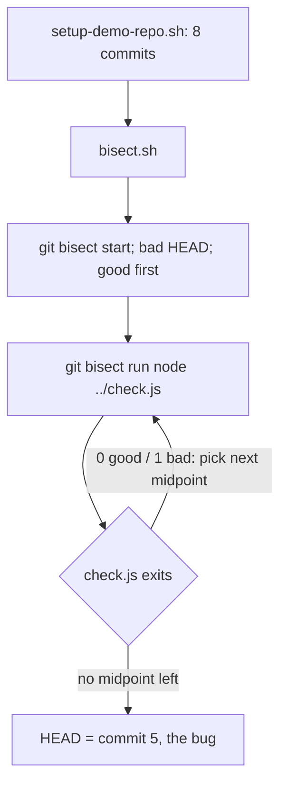

# Mini project 02 — Hunt the bug with git bisect

Time: about 1–2 hours · Guidance: less guided

## The real use case

A team ships a small helper library. A regression appears: `truncate("hello", 5)`
now returns `"hello..."` instead of `"hello"`. Nobody noticed which commit broke
it, because the change landed inside a refactor with an unrelated message. You
have a demo repository of eight commits. You will use `git bisect` to find the
exact commit that introduced the bug, without reading all eight diffs by hand.

## What this proves

`git bisect` turns a manual search into a binary search over the commit history.
You write one test, and git checks out the midpoint, runs the test, and halves
the remaining range until it lands on the first bad commit. This serves the plan
outcome "build a git bisect run that finds the commit that introduced a bug".

## How it works



`setup-demo-repo.sh` builds the eight-commit history, with the bug hidden at
commit 5. `bisect.sh` marks the current commit bad and the first commit good,
then hands control to `git bisect run`. At each midpoint git runs `check.js`,
which prints a verdict and exits 0 for good or 1 for bad. Git uses that verdict
to halve the range until only the bug commit remains.

## Prerequisites

- Node.js 20 or newer (`node --version`)
- git 2.30 or newer (`git --version`)

## How to run

```bash
cd starter
npm test          # recreates the demo repo and runs the hunt
```

There are no dependencies, so there is nothing to install.

## Your tasks

1. **Make the test detect the bug.** In `check.js`, set `expected` at `TODO(1)`
   to the correct result of `truncate("hello", 5)`. Done when the script reports
   `good` on the first commit and `bad` on the last commit.
2. **Return the right exit code.** In `check.js`, implement `TODO(2)` so it
   prints a one-line verdict and exits 0 for good and 1 for bad. Done when
   `echo $?` after a good run is 0 and after a bad run is 1.
3. **Mark the ends of the range.** In `bisect.sh`, implement `TODO(3)` to start
   the bisect with `HEAD` marked bad and the first commit marked good.
4. **Run the search automatically.** In `bisect.sh`, implement `TODO(4)` to run
   `git bisect run node ../check.js`, then print the commit git lands on.

To check tasks 1 and 2 on their own, build the demo and run `check.js` at two
known commits:

```bash
bash setup-demo-repo.sh
cd demo
node ../check.js                                      # the tip: expect "bad"
git checkout "$(git rev-list --max-parents=0 HEAD)"   # first commit
node ../check.js                                      # expect "good"
git checkout -                                        # back to the tip
cd ..
```

## How to check your work

```bash
npm test
```

Expected output ends with:

```text
first bad commit: Fix the truncate boundary
PASS: bisect landed on the bug commit.
```

Then check by hand: run `git -C demo log --oneline` and confirm commit 5 has
the message "Fix the truncate boundary".

## Stretch goals

- Make `check.js` exit 125 (skip) when `src/truncate.js` is missing, so a broken
  midpoint does not stop the hunt.
- Change the demo to 16 commits and time how many steps the bisect takes.
- Rebuild the hunt with a second bug on a different branch, and bisect that too.

## Hints

Read a hint only after you have tried the task for ten minutes.

### Hint for task 1

The buggy commit appends `"..."` to a string that is already exactly 5
characters long.

### Hint for task 2

git reads exit code 0 as "good" and 1 as "bad". Use `process.exit(0)` and
`process.exit(1)`.

### Hint for task 3

`git rev-list --max-parents=0 HEAD` prints the hash of the very first commit.

### Hint for task 4

`git bisect run` takes a command. After it finishes, `git log -1 --pretty=%s`
prints the message of the commit git left you on.

## Implementation walkthrough

Read this only after you finish, or when you are stuck after the hints.

1. `check.js`, `expected` (TODO 1): set `const expected = "hello";`. A correct
   `truncate("hello", 5)` returns the input unchanged, because 5 is not longer
   than 5.
2. `check.js`, verdict (TODO 2): compare `out` to `expected`, print `good` or
   `bad`, and call `process.exit(0)` or `process.exit(1)`. These codes are what
   git bisect reads.
3. `bisect.sh` (TODO 3): capture the first commit with
   `git rev-list --max-parents=0 HEAD`, then run `git bisect start`,
   `git bisect bad HEAD`, and `git bisect good "$first"`.
4. `bisect.sh` (TODO 4): run `git bisect run node ../check.js`, then print
   `git log -1 --pretty=%s` so you see the commit it found.

## Compare with the solution

The finished project is in `../solution/`. When you compare, look at the exit
codes in `check.js`, the four `git bisect` commands in `bisect.sh`, and how
`test.sh` turns the result into an automated check.
