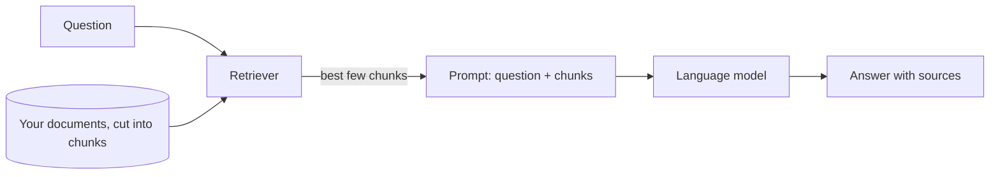

# Retrieval-Augmented Generation (RAG) in brief

## What it is

Retrieval-augmented generation, RAG for short, is a way to make a language model answer from documents it was never trained on. Before the model writes anything, your application searches your documents, picks the few passages that fit the question best, and pastes them into the prompt. The model then writes its answer from those passages.

## The problem it solves

Imagine a support chatbot for a shop. A customer asks about the refund rule that changed last week. The model has never seen that rule, so it answers from old knowledge and sounds sure while being wrong. The paper that introduced RAG names two weak points of a model on its own: its knowledge is hard to update, and it cannot show where an answer came from. With RAG the facts live in documents you can edit, and every answer can point to the passage it used.

## How it works in one picture

The picture follows one question from the user to the answer.

The retriever compares the question with every chunk, which is a short piece of a document, and keeps the best few. The application puts those chunks and the question into one prompt, and the model answers from them.

## Where it is used in the real world

- Customer support chatbots, which need knowledge about one specific business.
- Legal research assistants, which must search a very large set of past cases.
- Question answering over an encyclopedia: the first RAG system retrieved from an index of Wikipedia.

## What you need to know first

- [[Large language model]] — a program that continues text piece by piece; it only knows its training data.
- [[Context window]] — all the text a model can read in one call.
- [[Embedding]] — a list of numbers that stands for the meaning of a text.
- [[Python basics]] — functions, lists, dictionaries, and reading a text file.

## What you will be able to do

- Explain why a model alone cannot answer questions about private or recent documents.
- Explain how embeddings choose the best chunks for a question.
- Build a small RAG pipeline in Python whose answers cite their sources.
- Decide when to use RAG instead of retraining the model (fine-tuning) or pasting the whole document into the prompt.
- Diagnose a wrong answer as a retrieval failure or a generation failure.

## My insights
