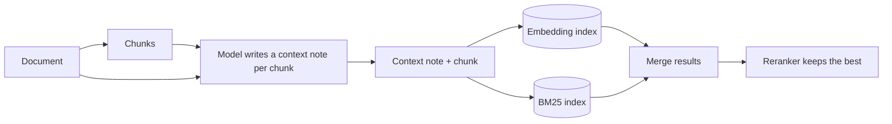

# Introducing Contextual Retrieval

Anthropic engineering team (research and writing by Daniel Ford), 2024, published on Anthropic's own site; an engineering blog post.

## The claim in one sentence

If a model writes a short note saying where each chunk comes from, and you index the chunk together with that note, the retriever misses 49% fewer relevant chunks, and 67% fewer when a reranking step is added (introduction).

## The problem before this

Standard RAG cuts documents into chunks, short pieces of a few hundred tokens, and searches those pieces one by one (section "A primer on RAG"). A chunk cut out of its document often no longer says what it is about. The post's example is the chunk "The company's revenue grew by 3% over the previous quarter." It names no company and no quarter, so a question about ACME Corp's revenue growth in Q2 2023 may never find it (section "The context conundrum in traditional RAG").

## Key ideas

### Write the missing context back, one chunk at a time

A language model reads the whole document and one chunk, and writes a short note that places the chunk in the document. The post calls this "prepending chunk-specific explanatory context to each chunk before embedding." The revenue chunk gets a first sentence saying it comes from an SEC filing on ACME Corp's performance in Q2 2023 (section "Introducing Contextual Retrieval").

### Two kinds of search, both on the enriched chunk

An embedding is a list of numbers that stands for the meaning of a text, so embedding search finds chunks with a similar meaning. BM25 is an older ranking method that matches exact words, which helps with identifiers such as the post's example "Error code TS-999" (section "A primer on RAG"). Both indexes are built from the chunk with its note; the post names the two parts Contextual Embeddings and Contextual BM25.

### Prompt caching keeps the one-time cost low

Writing a note for every chunk sends the whole document to the model once per chunk. Prompt caching stores the document after the first call, so later calls reuse it at a lower price (section "Using Prompt Caching to reduce the costs of Contextual Retrieval").

### Reranking is a second, more careful filter

A reranker is a model that scores how well each retrieved chunk fits the question. The pipeline retrieves 150 candidates and keeps the 20 best-scored for the prompt (section "Further boosting performance with Reranking").

## How it works

1. Split each document into chunks.
2. Send the whole document and one chunk to a small model (the post uses Claude 3 Haiku) and ask for a short context that situates the chunk (section "Implementing Contextual Retrieval").
3. Put the returned note, usually 50 to 100 tokens, in front of the chunk.
4. Build the embedding index and the BM25 index from the enriched chunks.
5. At question time, search both indexes and merge the two result lists with rank fusion, a way to combine ranked lists.
6. Optionally rerank the candidates, and put the top chunks into the prompt.

## Results and evidence

- The measure is the retrieval failure rate, 1 minus recall@20: the share of relevant passages that are not among the top 20 retrieved chunks (section "Methodology").
- Tests covered codebases, fiction, ArXiv papers, and science papers (section "Methodology").
- Failure rates (the two "Performance improvements" sections): baseline 5.7%; Contextual Embeddings 3.7% (35% lower); plus Contextual BM25 2.9% (49% lower); plus reranking 1.9% (67% lower).
- With prompt caching, writing the notes costs once $1.02 per million document tokens, assuming 800-token chunks and 8,000-token documents (prompt caching section).
- Passing 20 chunks to the model worked better than 10 or 5 (section "Implementation considerations").

## Limitations and criticisms

- The post measures only retrieval. It says the gains "directly translate to better performance in downstream tasks", but the result sections give no measurement of final answer quality.
- The numbers come from Anthropic's own evaluation, shown as averages for one embedding model; results per dataset stand only in the appendices (section "Methodology").
- The 67% figure combines context notes, BM25, and a reranker. No result is given for reranking alone, and only Cohere's reranker was tested (reranking section).
- It costs one model call per chunk at indexing time.

## What practitioners took from it

The post gives the recipe it says stacks best: embeddings plus BM25, context notes, a reranker, and 20 chunks in the prompt (section "Conclusion"), and it points to an Anthropic cookbook with code. Use in production systems outside Anthropic could not be verified from the sources recorded for this topic, so nothing more is claimed.

## How it connects to this topic

- [[01-brief-retrieval-augmented-generation|Retrieval-Augmented Generation (RAG) brief]] — the brief's retriever keeps the best few chunks; this post makes that step miss less.
- [[Chunking]] — the cut that causes the lost context.
- [[Embedding]] and [[BM25]] — the two indexes, both built from the enriched chunk.
- [[Reranking]] — the last filter before the prompt.
- [[Context window]] — below about 200,000 tokens the post advises putting the whole knowledge base into the prompt and skipping RAG (section "A note on simply using a longer prompt").

## Test yourself

1. Why can the chunk about 3% revenue growth fail to be found, and what does Contextual Retrieval add to fix it?
2. Which three steps together give the 67% reduction, and what does the failure rate measure?
3. When does the post advise against building RAG at all?

## My insights
