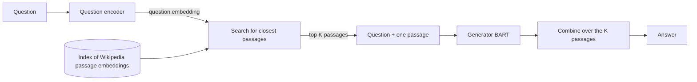

# Retrieval-Augmented Generation for Knowledge-Intensive NLP Tasks

Patrick Lewis, Ethan Perez, Aleksandra Piktus and nine co-authors, 2020, NeurIPS 2020, research paper.

## The claim in one sentence

A language model that looks up passages in a searchable index of Wikipedia before it writes, and is trained together with its search component, answers knowledge questions better and writes more factual text than the same kind of model working from memory alone.

## The problem before this

In 2020 a pre-trained language model kept everything it knew inside its parameters, the numbers it learned in training. The paper calls this parametric memory. Its introduction (Section 1) names the weak points: such models "cannot easily expand or revise their memory", they cannot show where a prediction came from, and they may hallucinate, which means state things that are not true. Earlier systems that paired a model with a retriever (a search component) had, according to the introduction, only been tried on extractive question answering, where the answer is copied out of a passage and never freely written.

## Key ideas

### Two kinds of memory

The generator's own weights are the parametric memory. A searchable index of text outside the model is the non-parametric memory. The generator knows how to write; the index holds the facts, here Wikipedia cut into about 21 million passages of 100 words (Section 3).

### Retrieval by meaning

The retriever is DPR (Dense Passage Retrieval). One encoder turns the question into an [[Embedding]], another does the same for every passage, and the passages whose embeddings match the question's best are returned (Section 2.2).

### Retriever and generator learn together

The model is trained only on pairs of input and expected output. Nobody tells it which passage it should have retrieved (Section 2.4). The retriever learns what to fetch because a helpful passage makes the right answer more likely.

### Two ways to use several passages

RAG-Sequence writes a whole answer from one passage at a time and then combines the candidates, weighted by how well each passage matched. RAG-Token can lean on a different passage for each token (word piece), so one answer can blend several passages (Section 2.1).

### Change the index to change the knowledge

Because the facts live in the index, the introduction says "the non-parametric memory can be replaced to update the models' knowledge as the world changes". No retraining is needed.

## How it works

1. Before training, a document encoder turns every passage into an embedding, stored in an index (Section 3).
2. The question encoder, a BERT model, turns the question into an embedding (Section 2.2).
3. The retriever returns the top K passages; training uses 5 or 10 (Section 3).
4. Each passage is joined to the question and given to the generator, BART-large, a pre-trained text-to-text model of about 400 million parameters (Section 2.3).
5. The generator's scores are combined across passages, per whole answer in RAG-Sequence and per token in RAG-Token (Section 2.1).
6. Training updates only the question encoder and the generator. The document encoder and the index stay fixed, because rebuilding the index is costly and the authors found it unnecessary (Section 2.4).

## Results and evidence

- Question answering, scored by exact match (the share of answers equal to a reference answer): RAG-Sequence reaches 44.5 on Natural Questions, against 41.5 for DPR, which copies its answer out of a passage, and 34.5 for T5-11B, a much larger model answering from memory alone (Table 1).
- RAG is right in 11.8% of the Natural Questions cases where the answer stands in no retrieved passage; a system that only copies would score 0% (Section 4.1).
- Writing Jeopardy questions: across 452 pairs of outputs, human judges found RAG more factual than BART alone in 42.7% of pairs and BART more factual in 7.1% (Table 4).
- Fact checking on FEVER with three labels: RAG-Token 72.5% correct, BART alone 64.0%, the best specialised system 76.8% (Table 2).
- Swapping the index: on questions about 82 world leaders, the model with the 2016 Wikipedia index was right for 70% of the 2016 leaders and 4% of the 2018 leaders; with the 2018 index it was right for 68% of the 2018 leaders (Section 4.5).

## Limitations and criticisms

- Learned retrieval is not always better. On FEVER the keyword method BM25 beat the learned retriever, which the authors explain by the claims being built around named entities (Section 4.5).
- The answer is only as good as the index. The Broader Impact section says Wikipedia, like any outside source, will probably never be fully factual or free of bias.
- Retrieval can stop mattering. Appendix H reports that on story generation the retriever collapsed into returning the same passages for every input, and the model then behaved like BART alone.
- Not tested: every experiment retrieves from Wikipedia, so the paper shows nothing about private or company documents. Section 6 leaves open how the two memories should best be combined.

## What practitioners took from it

Practice kept the core idea, retrieve first and then generate from the retrieved text, and the Anthropic engineering post recorded for this topic (`anthropic-contextual-retrieval-blog`, fetched 2026-11-14) shows what changed. Its standard pipeline cuts documents into chunks of a few hundred tokens, embeds them into a vector database, adds BM25 keyword search next to the embeddings, and pastes the top chunks into the prompt of a ready-made model; it describes no joint training of retriever and generator. It also names a weakness the paper does not discuss, that a chunk read alone often loses its context, and says a knowledge base under about 200,000 tokens can go into the prompt whole, without retrieval.

## How it connects to this topic

- [[01-brief-retrieval-augmented-generation|Retrieval-Augmented Generation (RAG) brief]] — this paper is the origin of the brief's "two weak points" and its Wikipedia example.
- [[Non-parametric memory]] — the paper's name for the index a model looks things up in.
- [[Dense retrieval]] — how the DPR retriever finds passages by meaning.
- [[Hallucination]] — the failure the paper wants to reduce by grounding answers in retrieved text.

## Test yourself

1. What is the difference between parametric and non-parametric memory, and which one do you change to update what a RAG model knows?
2. How does RAG-Sequence use the retrieved passages differently from RAG-Token?
3. Which parts of the original RAG model are updated in training, and what did later practice drop from this design?

## My insights
