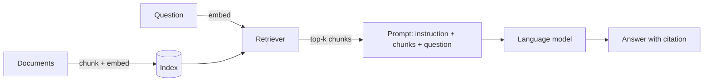

## In one sentence

RAG makes a language model answer from your own documents by first retrieving the few chunks that fit the question and pasting them into the prompt, which removes confident answers taken from stale training data.

## The mental model



The first arrow runs once per document change; everything else runs on every question. The model only ever sees the prompt, so an answer can be no better than the chunks that reached it.

## Key ideas

- Knowledge lives in documents, not in the model, because editing a file and indexing it again is far cheaper than retraining.
- Retrieval compares meaning: the question and every chunk become [[Embedding|embeddings]] and the k closest by cosine similarity are kept, because a question and its answer often share no words.
- Top-k always returns k chunks, even when none is relevant, because it ranks and has no idea of "close enough". A low score is the only warning.
- [[Chunking|Chunk]] size is a trade-off: large chunks fill the prompt with unrelated text, small chunks lose the context that says what they are about.
- A wrong answer is either a retrieval failure (the right chunk never reached the prompt) or a generation failure (it was there and the answer ignored it), and the fixes are in different places.
- The prompt must demand an answer from the chunks only, a citation, and a refusal when the chunks do not cover the question, because otherwise the model falls back to its training data ([[Hallucination]]).

## When to use it / when not to

Use it when the answer lives in private, recent, or often-changing documents, the collection is too large for one prompt, and readers must be able to check the source.

Do not use it when the whole knowledge base fits in the [[Context window|context window]] (under about 200,000 tokens: paste it whole), when you want to change the model's style or output format and not its facts (fine-tune), or when the question needs no outside facts (plain prompt).

## Trade-offs and failure modes

- You pay for an index that must be rebuilt when documents change, extra latency per question, and prompt tokens for every chunk.
- Lost context: a chunk cut from its section can be missed by retrieval. Symptom: the document has the answer, but the logged prompt does not.
- Exact identifiers: embeddings miss an error code or form number. Symptom: chunks about the general subject, not the one with the code.
- Generation failure. Symptom: the right chunk is in the logged prompt and the answer is still wrong. Changing the index does not help.

## Commands or code worth remembering

```python
chunks = chunk(document, size=400, overlap=40)      # tokens; a few hundred per chunk
index  = [(embed(c.text), c) for c in chunks]       # once per document change
qv     = embed(question)
top    = sorted(index, key=lambda e: cosine(qv, e[0]), reverse=True)[:k]
prompt = ("Answer only from the sources. Cite the section. "
          "If they do not cover the question, say so.\n"
          f"{format_sources(top)}\nQuestion: {question}")
answer = llm(prompt)
# Debug rule: read the logged prompt first.
# Right chunk missing -> fix retrieval. Right chunk present -> fix the prompt.
```

## What production systems do differently

No repository was analyzed for this topic; these points come from the digests.

- They put a short model-written context note in front of each chunk before indexing. In Anthropic's test, missed chunks fell from 5.7% to 3.7%, see [[anthropic-contextual-retrieval-blog-retrieval-augmented-generation|the Contextual Retrieval digest]].
- They run [[BM25]] keyword search next to the embedding index (2.9%), then use [[Reranking|reranking]] to cut 150 candidates to 20 (1.9%); same digest.
- They do not train retriever and generator together as the original paper did; they pair a ready-made retriever with a ready-made model, see [[lewis-2020-rag-retrieval-augmented-generation|the RAG paper digest]].

## Go deeper

- [[00-start-here-retrieval-augmented-generation|Start here: the topic map]]
- [[01-brief-retrieval-augmented-generation|Brief]]
- [[02-lesson-retrieval-augmented-generation|Interactive lesson]]
- [[03-mini-projects-retrieval-augmented-generation|Mini project]]
- [[00-digests-retrieval-augmented-generation|Digests]]
- [[08-recall-retrieval-augmented-generation|Recall cards]]
- [[09-resources-retrieval-augmented-generation|Resources]]

## My insights
