# Concept map of How browsers work

Generated from the research curriculum. A solid arrow points from a concept to the concept that refines it; a dotted arrow shows a prerequisite.

```mermaid
flowchart TD
  browser_architecture["Browser architecture"]
  multi_process_model["The multi-process model"]
  site_isolation["Site isolation"]
  browser_and_js_engines["Rendering engines and JavaScript engines"]
  navigation_and_lifecycle["Navigation and page lifecycle"]
  navigation_steps["From URL to first paint"]
  lifecycle_events["DOMContentLoaded, load, pagehide and visibilitychange"]
  bfcache_freeze_resume["Back/forward cache, freeze and resume"]
  critical_rendering_path["Critical rendering path"]
  dom_cssom_render_tree["DOM, CSSOM and the render tree"]
  parser_and_render_blocking["Parser-blocking and render-blocking resources"]
  preload_scanner["The preload scanner"]
  rendering_pipeline["Rendering pipeline and compositing"]
  layout_paint_composite["Layout, paint and composite triggers"]
  layers_and_will_change["Layers, will-change and layer explosion"]
  js_engine_internals["JavaScript engine internals"]
  parsing_bytecode_jit["Parsing, bytecode and JIT tiers"]
  hidden_classes_inline_caches["Hidden classes and stable object shapes"]
  garbage_collection["Generational garbage collection"]
  event_loop["The event loop"]
  tasks_and_microtasks["Tasks, microtasks and the call stack"]
  rendering_steps_and_raf["Rendering steps and requestAnimationFrame"]
  long_tasks_and_input["Long tasks and input delay"]
  browser_storage["Browser storage and quotas"]
  storage_apis_compared["Cookies, Web Storage, IndexedDB, Cache API and OPFS"]
  quotas_eviction_persistence["Quotas, eviction and persistent storage"]
  same_origin_policy["Same-origin policy"]
  what_sop_isolates["What the same-origin policy isolates and allows"]
  cors_coop_coep["CORS and cross-origin isolation"]
  browser_architecture --> multi_process_model
  browser_architecture --> site_isolation
  browser_architecture --> browser_and_js_engines
  multi_process_model -. needed for .-> navigation_and_lifecycle
  navigation_and_lifecycle --> navigation_steps
  navigation_and_lifecycle --> lifecycle_events
  navigation_and_lifecycle --> bfcache_freeze_resume
  navigation_steps -. needed for .-> critical_rendering_path
  critical_rendering_path --> dom_cssom_render_tree
  critical_rendering_path --> parser_and_render_blocking
  critical_rendering_path --> preload_scanner
  dom_cssom_render_tree -. needed for .-> rendering_pipeline
  rendering_pipeline --> layout_paint_composite
  rendering_pipeline --> layers_and_will_change
  js_engine_internals --> parsing_bytecode_jit
  js_engine_internals --> hidden_classes_inline_caches
  js_engine_internals --> garbage_collection
  event_loop --> tasks_and_microtasks
  event_loop --> rendering_steps_and_raf
  event_loop --> long_tasks_and_input
  browser_storage --> storage_apis_compared
  browser_storage --> quotas_eviction_persistence
  site_isolation -. needed for .-> same_origin_policy
  same_origin_policy --> what_sop_isolates
  same_origin_policy --> cors_coop_coep
```

Back to [[visuals-how-browsers-work|all visuals]].

## My insights
