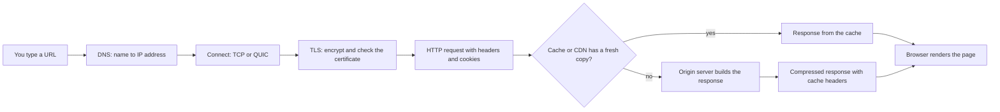

# Internet & networking in brief

## What it is

Every page load is a short conversation over the network. The browser finds the server, opens a secure connection, asks for a resource with HTTP, and gets a response. Caches, CDNs and compression make that conversation shorter.

## The problem it solves

A slow or broken page often has a network cause: a long DNS lookup, a missing cache header, an uncompressed script or a cookie the browser refuses to send. If you do not know the steps, you guess. If you know them, the Network panel tells you which step failed.

## How it works in one picture

DNS finds the server, TLS secures the connection, and HTTP carries the request. A fresh cached copy skips the trip to the origin. [[visual-how-it-works-internet-and-networking|explanation and sources]]

## Where it is used in the real world

- Teams give hashed static files a long `Cache-Control` lifetime, so repeat visits load them from the cache.
- Teams put a CDN in front of their site, so users get responses from a nearby server.
- Teams set `Secure`, `HttpOnly` and `SameSite` on session cookies, so scripts and other sites cannot misuse them.
- Teams pick WebSockets or Server-Sent Events for live updates instead of asking the server again and again.

## What you need to know first

- [[Browser developer tools]] — you studied this; the Network panel shows every step of this topic.
- [[HTTP request and response]] — the browser sends a request; the server returns status, headers and body.
- [[Client and server]] — a client asks for data; a server listens and answers.
- [[Network packet]] — a small block of data with a header that says where it goes.

## What you will be able to do

- Explain what happens on the network between typing a URL and the first byte of the page.
- Explain how DNS resolves a name and choose the right record type and TTL.
- Compare HTTP/1.1, HTTP/2 and HTTP/3 and explain head-of-line blocking at each layer.
- Explain the TLS 1.3 handshake and the certificate chain of trust.
- Configure HTTP caching, CDN caching and compression for a static site with hashed assets.
- Set cookies with safe attributes and explain origin versus site.
- Choose a realtime transport and an API style for a product feature.

## My insights
