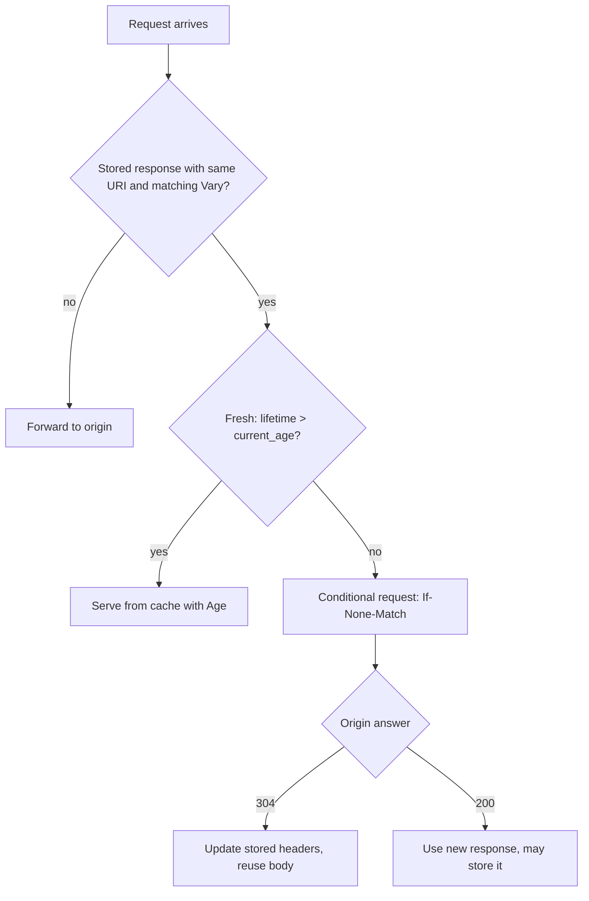

# RFC 9111: HTTP Caching

R. Fielding, M. Nottingham, J. Reschke (IETF), 2022, Internet Standard. It replaces RFC 7234. Read on 2026-11-18, mainly Sections 1–5.2.2 and 7.

## The claim in one sentence

A cache may reuse a stored response only while it is fresh or after the origin confirms it is still valid, and the server steers this with headers such as `Cache-Control`, `ETag` and `Vary`.

## The problem before this

Without shared rules, every browser, proxy and CDN guessed when a stored copy was safe to reuse. A guess that is too eager shows stale or wrong content. A guess that is too careful wastes time and bandwidth. The RFC fixes one set of rules, so a server author can predict what each cache on the path does (Section 1, Section 2).

## Key ideas

### A cache key picks the stored response

The key is at least the request method plus the target URI. Many caches store only GET, so the URI alone is the key (Section 2). Some browsers add more, such as the referring site, to avoid timing leaks (Section 2, Section 7.2).

### Fresh means lifetime is longer than age

A stored response is fresh while `freshness_lifetime > current_age` (Section 4.2). A fresh response is served with no trip to the origin. A stale one needs validation first.

### Validation is a cheap question

A stale copy with an `ETag` or `Last-Modified` can be checked with `If-None-Match` or `If-Modified-Since`. A 304 answer means "keep your copy", so only headers cross the network (Section 4.3).

### Cache-Control lets the server set the rules

Directives such as `max-age`, `no-cache`, `no-store`, `private`, `public`, `s-maxage` and `must-revalidate` say who may store a response and for how long (Section 5.2.2). Each has a precise meaning that differs from its name.

### Vary widens the key

If a response has `Vary: Accept-Encoding`, the cache reuses it only for requests whose `Accept-Encoding` matches the original request. `Vary: *` never matches (Section 4.1).

## How it works

In plain words: the cache looks for a saved copy of the URL. If the copy is young enough, it hands it over. If it is old, it asks the origin "has this changed?" and either keeps the copy or swaps it for a new one.

The diagram follows Sections 4, 4.1, 4.2 and 4.3.3–4.3.4. [[visual-rfc-9111-mechanism-internet-and-networking|explanation and sources]]

1. Storing (Section 3): a cache must not store a response with `no-store`. A shared cache must also skip `private` responses and requests with `Authorization`, unless a directive such as `public` or `s-maxage` allows it. The response needs an explicit lifetime (`max-age`, `Expires`, `s-maxage` for shared caches) or a status that is heuristically cacheable.
2. Lifetime (Section 4.2.1): use the first match of `s-maxage` (shared caches only), then `max-age`, then `Expires` minus `Date`. With none of these, a cache may guess from `Last-Modified`, typically about 10% of the time since that date (Section 4.2.2).
3. Age (Section 4.2.3): `current_age = corrected_initial_age + resident_time`. The `Age` header carries time spent in upstream caches.
4. Reuse (Section 4): the stored response also needs a matching `Vary` and no `no-cache`, unless it is validated first. The cache sends an `Age` header with the reply.
5. Validation (Section 4.3): a cache must send stored entity tags, and should also send `If-Modified-Since`. On 304 it updates stored headers; a full response replaces the copy.
6. Invalidation (Section 4.4): a successful `POST`, `PUT` or `DELETE` invalidates the cache entry for that URI.

**Interpretation.** For hashed assets, a long `max-age` means step 4 always ends at "serve from cache". For HTML, `no-cache` forces step 5 on every use, so the page stays cheap but never stale.

## Results and evidence

- A standard gives rules, not benchmarks. Its stated goal is lower latency and less network use through reuse of prior responses (Section 1).
- `no-cache` does not mean "do not store". It means "validate before every reuse". `no-store` is the directive that forbids storing (Sections 5.2.2.4, 5.2.2.5).
- `s-maxage` overrides `max-age` and `Expires` for shared caches, and also implies revalidation once stale (Section 5.2.2.10).
- `must-revalidate` forbids serving stale, even when the cache is disconnected; the cache must return an error, normally 504 (Section 5.2.2.2).

## Limitations and criticisms

- `no-store` is not a privacy guarantee. A compromised cache may ignore it (Section 5.2.2.5). `private` only controls where a response is stored, not who reads it (Section 5.2.2.7).
- The qualified forms of `no-cache` and `private` (with field names) are "not widely implemented" (Sections 5.2.2.4, 5.2.2.7).
- Caches create risks: cache poisoning, timing attacks that reveal visited sites, and caching of sensitive data. `Set-Cookie` does not stop caching (Sections 7.1–7.3).
- The RFC does not define a heuristic algorithm, only worst-case limits (Section 4.2.2). Behaviour for responses without explicit freshness can differ between caches.

## What practitioners took from it

Adoption by real systems could not be verified from the parts of this source that I read, and I did not read the other recorded sources closely enough to cite them here, so I claim nothing.

## How it connects to this topic

- [[01-brief-internet-and-networking|Internet & networking brief]]: the brief's "fresh copy?" step is the freshness check above.
- [[HTTP caching]]: the general idea this RFC makes exact.
- [[Cache-Control directives]]: the server's controls, Section 5.2.2.
- [[Conditional request validation]]: the `ETag` and 304 round trip, Section 4.3.
- [[Vary header]]: how one URL can hold several stored responses, Section 4.1.
- [[HTTP request and response]]: the headers this RFC reads.

## Test yourself

1. A response has `Cache-Control: max-age=60` and `Age: 50`. How long is it still fresh, and what happens after that?
2. What is the difference between `no-cache` and `no-store`, and which one would you put on an HTML page that must always be checked?
3. Why must a cache treat `Accept-Encoding: gzip` and `Accept-Encoding: br` as different requests when the response says `Vary: Accept-Encoding`?

## My insights
