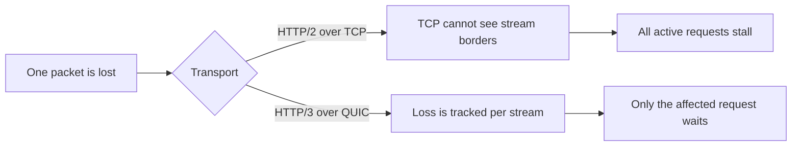

# RFC 9114: HTTP/3

M. Bishop (editor), IETF, 2022, Proposed Standard. Read on 2026-11-18 from rfc-editor.org (Sections 1–7, 10.9–10.10, Appendix A).

## The claim in one sentence

HTTP keeps its meaning (methods, status codes, headers) but HTTP/3 carries each request on its own QUIC stream, so one lost packet no longer stalls every other request on the connection.

## The problem before this

HTTP/1.1 is text, hard to parse, and has no multiplexing layer. Clients therefore open several TCP connections, and those connections compete badly because TCP does not share congestion state between them (Section 1.1). HTTP/2 fixed this with binary frames and many streams on one connection. But TCP does not know the streams are independent, so "a single lost or delayed packet" can stall all active transactions (Section 1.1).

## Key ideas

### One request, one QUIC stream

Each request and response pair uses one client-started bidirectional stream, and a client sends only one request per stream (Sections 2 and 4.1). Streams are independent, so a blocked stream does not stop the others. QUIC manages stream lifetime and flow control, which HTTP/2 did itself.

### QPACK replaces HPACK

HPACK assumes data arrives in order, and QUIC does not guarantee that across streams (Section 4.2.1). QPACK sends all table updates on separate unidirectional streams, in one total order. Frames that carry headers only refer to that table state (Appendix A.2.2). Field names must be lowercase (Section 4.2).

### Discovery and fallback

A client reaches HTTP/3 by opening a QUIC connection and selecting the ALPN token "h3" (Section 3.1). A server can advertise it with the Alt-Svc header, for example another UDP port on the same host (Section 3.1.1). If QUIC is blocked, for example by UDP filtering, clients should fall back to a TCP-based HTTP version (Section 3.1).

### Early data and migration carry risks

0-RTT early data "exposes" requests to replay attack, so the anti-replay rules of the HTTP replay RFC must be applied (Section 10.9). A QUIC client address "might change during a connection". Code that logs or checks the address must expect that (Section 10.10).

### Priorities were left out

HTTP/3 has no way to signal priority, yet the RFC says priority still matters for performance (Appendix A.2.1).

## How it works

In plain words: the browser opens one encrypted QUIC connection and sends each request on a fresh stream inside it. Streams share the connection but recover from loss alone. A lost packet delays only the request it belongs to.

The diagram follows Sections 1.1, 1.2 and 2. [[visual-rfc-9114-http3-mechanism-internet-and-networking|Explanation and sources of this diagram]]

Technical detail:

1. The client resolves the host, opens QUIC version 1 with TLS 1.3 and offers ALPN "h3" (Sections 3.1, 3.2).
2. Each side opens one control stream and sends SETTINGS first (Sections 3.2, 6.2.1).
3. The first request uses stream 0, later ones use streams 4, 8 and so on. Servers should allow at least 100 concurrent request streams (Section 6.1).
4. A message is a HEADERS frame, optional DATA frames, and an optional trailing HEADERS frame (Section 4.1).
5. QPACK table updates travel on their own unidirectional streams. Push streams carry a push ID (Sections 6.2, 4.6).
6. To close cleanly, an endpoint sends GOAWAY (Section 5.2).

**Interpretation.** For HTTP/1.1, HTTP/2 and HTTP/3 the semantics stay the same. Only the framing and the transport underneath change. A frontend developer sees the same headers and status codes in DevTools.

## Results and evidence

- This is a specification, not a benchmark. It reports no speed numbers.
- Section 1.1 states the reasoning: TCP loss recovery cannot see independent streams, QUIC can.
- Appendix A.2.3: in HTTP/3 all frames are flow controlled, not only DATA as in HTTP/2.
- Appendix A.2.4 and A.1: there is no END_STREAM flag, since QUIC ends streams. Stream IDs use QUIC's variable-length integers.

## Limitations and criticisms

- The RFC measures nothing. It does not show how much faster HTTP/3 is in practice.
- HTTP/3 cannot serve "http" URIs directly, because it does not use TCP (Section 3.1.2).
- Section 10.11 notes that using one connection lets a site correlate a user's activity, and reuse across origins allows cross-origin correlation.
- I did not read the full QUIC transport RFC, so details of 0-RTT and migration mechanics are outside this digest.

## What practitioners took from it

Adoption by practitioners could not be verified from the sources recorded for this topic, so nothing is claimed here.

## How it connects to this topic

- [[01-brief-internet-and-networking|Internet & networking brief]] — the brief's "connect: TCP or QUIC" step is the choice this RFC defines.
- [[QUIC]] — the transport HTTP/3 maps onto.
- [[Head-of-line blocking]] — the problem at the heart of HTTP/2 versus HTTP/3.
- [[Early data replay]] — the risk of 0-RTT in Section 10.9.
- [[HTTP request and response]] — the semantics stay the same across versions.

## Test yourself

1. Why can one lost packet stall every request on HTTP/2 over TCP but not on HTTP/3?
2. Why did HTTP/3 replace HPACK with QPACK, and how does QPACK keep table updates in order?
3. How does a browser learn that a server offers HTTP/3, and what should it do if UDP is blocked?

## My insights
