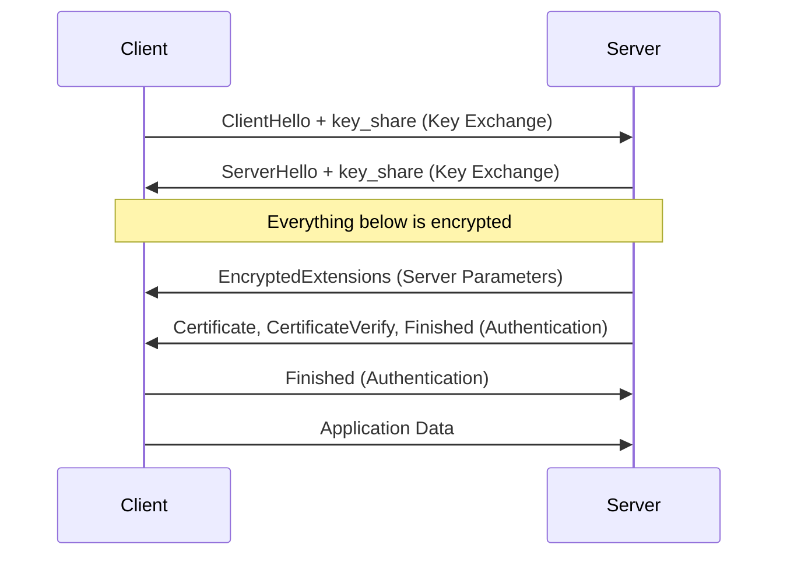

# RFC 9846: The Transport Layer Security (TLS) Protocol Version 1.3

E. Rescorla, IETF, 2026, Standards Track specification. It is a minor update of RFC 8446 and keeps the TLS 1.3 version number (Section 1.2). I read Sections 1, 2, 4.5 and 8.

## The claim in one sentence

TLS 1.3 gives two programs a secure channel over any reliable byte stream, with an authenticated server, hidden data and tamper detection, and it sets this up in one round trip.

## The problem before this

Earlier TLS versions carried many legacy options: old ciphers, static RSA key exchange, compression and custom Diffie-Hellman groups. Section 1.3 lists them as removed or pruned. Handshake messages after the first hello were sent in the clear. Resuming a session used two separate mechanisms, session IDs and session tickets. Version negotiation also broke on some servers.

## Key ideas

### Three promises: authentication, confidentiality, integrity

Section 1 says the server is always authenticated and the client only optionally. Data after setup is visible only to the two endpoints. Data cannot be changed without detection. These hold even if an attacker controls the whole network. TLS does not hide message length, though endpoints may pad records.

### Two parts: handshake protocol and record protocol

The handshake (Section 4) agrees on algorithms and keys. The record protocol (Section 5) then protects traffic in independent records using those keys. TLS does not say how an application starts TLS or how it checks the certificate name. The application protocol must say so (Section 1). HTTPS is that pairing for HTTP.

### Forward secrecy by default

Static RSA and static Diffie-Hellman suites are gone. Every public-key key exchange now gives forward secrecy (Section 1.3). Forward secrecy means that stealing a server's long-term key later does not reveal recorded past traffic. All handshake messages after ServerHello are encrypted.

### The certificate proves identity, the signature proves possession

The Certificate message carries a chain, with the server's own certificate first (Section 4.5.1). A certificate alone could be copied by anyone. So CertificateVerify is a signature over the handshake transcript made with the matching private key (Section 4.5.2). Finished is a MAC over the whole handshake (Section 4.5.3).

### Resumption and 0-RTT trade safety for speed

After one handshake the server can send a ticket. A later connection uses that pre-shared key (PSK) and skips the certificate messages (Section 2.2). With a PSK the client may also send early data in its first flight (Section 2.3). That early data is weaker, as the results section explains.

## How it works

In plain words: the client says hello and offers a key share. The server replies with its share, so both sides can compute the same secret keys without sending them. From then on everything is encrypted. The server shows its certificate, signs the conversation so far to prove it owns that certificate, and sends a final checksum. The client sends its own checksum, and then both sides send application data.

**Analogy.** A key share is like mixing paint colours. Each side adds a private colour to a public one and swaps the mixes. Both end with the same final colour, and a watcher cannot rebuild it.

The diagram follows Figure 1 and the three phases in Section 2. Optional messages (CertificateRequest, client Certificate) are left out. [[visual-rfc-9846-tls13-mechanism-internet-and-networking|explanation and sources]]

Step trace of a full handshake (Section 2, Figure 1):

1. Client sends ClientHello: random nonce, versions, cipher/hash pairs, `key_share`. State: nothing is encrypted yet.
2. Server sends ServerHello with its `key_share` in the same group as one of the client's. State: both sides derive handshake keys.
3. Server sends EncryptedExtensions. State: parameters agreed, messages now encrypted.
4. Server sends Certificate, CertificateVerify, Finished. State: client holds proof of identity and key confirmation.
5. Client checks them, then sends Finished (plus its Certificate and CertificateVerify only if requested). State: handshake complete.
6. Both send Application Data under application traffic keys.

If the client's key shares do not suit the server, the server sends a HelloRetryRequest and the client sends a new ClientHello (Section 2.1, Figure 2). That costs one extra round trip.

Technical detail (Section 4.5): CertificateVerify signs `Transcript-Hash(Handshake Context, Certificate)`, prefixed with 64 bytes of 0x20 and a context string. Finished is `HMAC(finished_key, Transcript-Hash(..., Certificate, CertificateVerify))`, and `finished_key` comes from HKDF-Expand-Label. A receiver must abort with `decrypt_error` if either check fails.

Animation candidate: rfc-9846-tls13 §2 Figure 1. A learner could change: full handshake or PSK resumption, early data on or off, client certificate requested or not.

## Results and evidence

- Section 1.3 states that all public-key key exchange has forward secrecy, and all handshake messages after ServerHello are encrypted.
- Section 2.3 says 0-RTT data has no forward secrecy guarantee and no guarantee of non-replay between connections. The server's Random protects normal 1-RTT data but not 0-RTT data. 0-RTT data cannot be duplicated within one connection.
- Section 8 requires a server to accept the same 0-RTT handshake at most once per server instance. This limits replays to the number of instances. Clients must send only early data that is safe to replay. Section 8.1 describes single-use tickets and Section 8.2 describes recording ClientHellos.
- Section 4.5.1.3 requires aborting on MD5-signed certificates and recommends aborting on SHA-1. Section 4.5.2 forbids SHA-1 in CertificateVerify.

## Limitations and criticisms

- Section 2.3 and Section 8 admit that TLS cannot stop replays of 0-RTT data caused by client retries. The application must handle duplicate requests, and the text cites RFC 8470 for HTTP guidance.
- Certificate validation is out of scope: Section 4.5.1.3 sends the reader to RFC 5280 for it. TLS 1.3 does not decide which authorities a browser trusts. This digest therefore cannot explain trust stores, revocation policy or certificate issuance.
- TLS does not hide message length (Section 1), so traffic analysis remains possible without padding.
- A PSK made from a password is open to brute force (Section 2.2).

## What practitioners took from it

Adoption by real systems could not be verified from the sources I read. The recorded sources `hpbn-book` and `cloudflare-docs` may cover deployment, but I did not read them for this note, so I claim nothing.

## How it connects to this topic

- [[01-brief-internet-and-networking|Internet & networking brief]] — this is the "TLS" box in the brief's request diagram.
- [[TLS and HTTPS]] — the guarantees HTTPS gets from this specification.
- [[TLS 1.3 handshake]] — the message flow in the diagram above.
- [[Certificate chain of trust]] — the Certificate message carries the chain; validation itself follows RFC 5280.
- [[HTTP request and response]] — the first request travels as Application Data after Finished.
- [[Browser developer tools]] — the tool you already know; this note gives you the handshake vocabulary to read what it shows.

## Test yourself

1. Which three messages prove who the server is and that the handshake was not altered, and what does each one do?
2. Why is early data from a resumed connection weaker than normal data, and who must defend against its replay?
3. In a full handshake, which messages are sent unencrypted, and why does that not leak the certificate?

## My insights
