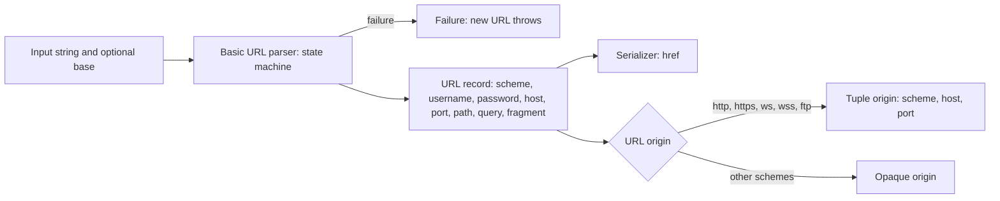

# URL Standard (WHATWG Living Standard)

WHATWG, living standard (page dated 14 November 2026), a web standard. I read the goals, section 1 (percent-encoding), sections 3 to 4 (hosts, URLs, parsing, serializing, origin), section 5 (form encoding) and section 6 (the URL API).

## The claim in one sentence

There is one exact algorithm for turning a URL string into a record of named parts, and every browser, script and spec should use it to parse, encode, compare and serialize URLs.

## The problem before this

Older URL rules (RFC 3986 and RFC 3987) left gaps. Spaces, illegal code points, query encoding and equality were not defined the same way in every program (Goals). Browsers filled the gaps in their own ways, so one string could mean different things in different places. The standard writes down what browsers should do and aims to make URL parsing as reliable as HTML parsing (Goals).

## Key ideas

### A URL is a record of eight parts

The URL record has a scheme, username, password, host, port, path, query and fragment (section 4.1). Six schemes are "special" and have default ports: ftp 21, http 80, https 443, ws 80, wss 443, and file with none (section 4.2). Think in parts, not in one long string.

### Each part has its own percent-encoding set

Percent-encoding turns an unsafe byte into a percent sign and two hex digits (section 1.3). The sets grow in layers: the fragment, query and path sets each add a few characters to the C0 control set. The userinfo set adds `/ : ; = @ [ ] |` and the component set adds more. This is why `?` is fine in a fragment but must be encoded in a path. Only the component and form sets encode `%` itself, so only they round-trip.

### The parser is a state machine, and it can fail

The basic URL parser walks the input through states such as scheme start, scheme, authority, host, port and file (section 4.4). With `new URL(url, base)`, a failure throws a TypeError. `URL.parse` returns null and `URL.canParse` returns a boolean (section 6.1).

### The origin comes from the record

The origin is (scheme, host, port) for http, https, ws, wss and ftp. Other schemes give an opaque origin. For `file`, the spec leaves it open: "When in doubt, return a new opaque origin." A `blob:` URL takes the origin of the URL inside it if that is http, https or file (section 4.7).

### Site is wider than origin, and not a hard boundary

A registrable domain is the public suffix plus one label before it (section 3.2). So `shop.example.com` and `blog.example.com` share a registrable domain but are different origins. The standard warns that the Public Suffix List differs between clients, so specifications should prefer the origin for security decisions (section 3.2). "Same site" itself is defined in HTML, not here.

## How it works

In plain words: the browser feeds your string, plus a base URL if the string is relative, into one parser. The parser either gives up or fills in a record of parts. Everything else, such as the text you read back, the origin check and the `searchParams` object, reads that same record.

The diagram follows sections 4.4, 4.5, 4.7 and 6.1. [[visual-whatwg-url-standard-mechanism-internet-and-networking|Explanation and sources of this diagram]]

1. The parser runs the input through its states and applies the right percent-encode set to each part (sections 1.3, 4.4).
2. The serializer writes the scheme and a colon. If the host is not null, it adds `//`, any credentials, the host and the port. Then it adds the path, `?` and the query if there is one, and `#` and the fragment (section 4.5).
3. A path-only URL whose first segment is empty gets `/.` in front, so it is not read as a host (section 4.5).
4. Setters on `URL` rerun the parser with a state override. Setting `search` to an empty string clears the query, and a leading `?` is dropped first. Setting `port` to an empty string clears it (section 6.1).
5. `URLSearchParams` is linked to the URL. `append`, `delete`, `set` and `sort` change its list and then write the serialized list back into the URL query, or set the query to null if the list is empty (section 6.2).
6. Form parsing splits on `&`, then on the first `=`, turns `+` into a space and percent-decodes as UTF-8. Serializing encodes with the form set, so a space becomes `+` (sections 5.1, 5.2).

**Analogy.** The parser is a customs desk. Every traveler (string) goes through the same checks and leaves with the same passport (record).

## Results and evidence

- This is a specification, so it has no benchmarks. Its guarantee is that parse, serialize and API operations are idempotent (Goals).
- Percent-encode sets are tabulated exactly in section 1.3, so a test can check each character.
- The tuple origin includes the port, so `https://a.example` and `https://a.example:8443` differ (section 4.7).
- `searchParams.sort()` orders pairs by name using code unit comparison (section 6.2).

## Limitations and criticisms

- The standard does not define "same site" and tells specs not to use registrable domain as a hard boundary, because Public Suffix List contents differ between clients (section 3.2).
- The origin of `file:` URLs is left open to the implementation (section 4.7).
- It is a living standard, so the text changes. Check the date when you quote a rule. I did not read the sections on IDNA host processing or the URL pattern parts in depth.

## What practitioners took from it

Adoption could not be verified from the sources recorded for this topic, so nothing is claimed here.

## How it connects to this topic

- [[01-brief-internet-and-networking|Internet and networking brief]] — the brief's goal "explain origin versus site" starts from this record.
- [[URL structure]] — the eight parts and the special schemes.
- [[Percent-encoding]] — why each URL part encodes different characters.
- [[Origin and site]] — tuple origin versus registrable domain.
- [[HTTP request and response]] — the parsed URL decides the host, port and path of the request line.

## Test yourself

1. Which fields of the URL record make up a tuple origin, and which special schemes give one?
2. Why is a space written `%20` in a path but `+` in a form body?
3. `a.example.com` and `b.example.com` share a registrable domain. Same site, same origin, or both? Why should security checks prefer one of them?

## My insights
