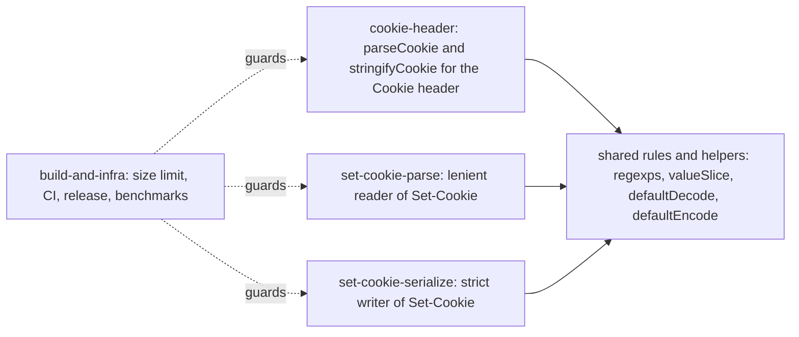
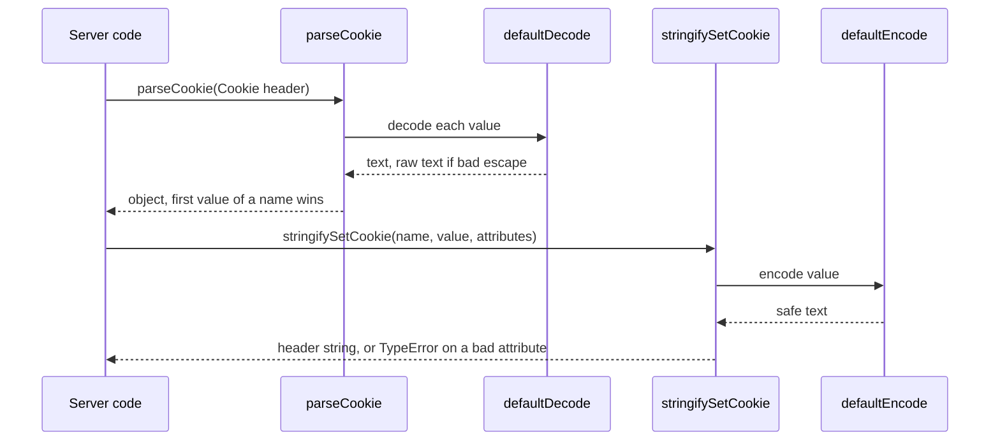

# jshttp/cookie — architecture

The library is one source file with four public functions. The "modules" below are line ranges of `src/index.ts` plus the build files around it.

## Module map

| Module | Responsibility | Note |
|--------|----------------|------|
| cookie-header | Reads and writes the `Cookie` request header | [[cookie-module-cookie-header\|cookie-header]] |
| set-cookie-parse | Reads a `Set-Cookie` string leniently | [[cookie-module-set-cookie-parse\|set-cookie-parse]] |
| set-cookie-serialize | Writes a `Set-Cookie` string and checks every attribute | [[cookie-module-set-cookie-serialize\|set-cookie-serialize]] |
| build-and-infra | Size limit, CI, release, benchmarks | [[cookie-module-build-and-infra\|build-and-infra]] |

## The picture

All three code modules use the same decode helper, trim helper and name and value rules: `parseCookie` takes the decoder at `src/index.ts:118 @ a437ef0`, `parseSetCookie` at `src/index.ts:400 @ a437ef0`, and `stringifySetCookie` takes the encoder and name rule at `src/index.ts:290-294 @ a437ef0`. The build slice guards the code with a byte limit and tests (`package.json:33 @ a437ef0`). [[visual-cookie-module-map-internet-and-networking|explanation and sources]]

## Main flow

In plain words: a browser sends `Cookie: a=1; b=2`. The server code turns it into an object, reads the cookies, and later writes a `Set-Cookie` header for the response.

1. `parseCookie` returns an empty object for a string shorter than 2 characters, then scans with `indexOf` (`src/index.ts:113-125 @ a437ef0`).
2. Each value goes through `defaultDecode`, which skips the native call without `%` and returns the raw text on error (`src/index.ts:518-526 @ a437ef0`).
3. The first value of a name is kept (`src/index.ts:135-138 @ a437ef0`).
4. `stringifySetCookie` checks the name, then encodes the value with `defaultEncode` (`src/index.ts:292-296 @ a437ef0`, `src/index.ts:531-533 @ a437ef0`).
5. It checks each attribute and appends it, or throws a `TypeError` (`src/index.ts:304-388 @ a437ef0`).

[[visual-cookie-request-flow-internet-and-networking|explanation and sources]]

The read side of a `Set-Cookie` string (`parseSetCookie`) uses the same helpers but never throws (`src/index.ts:439-468 @ a437ef0`).

## Module dependencies (when useful)

All three code modules share one decoder, one trimmer and one set of rules, and no module calls another. That is why the library is one file: the shared part is small and each function is a loop over the same helpers (`src/index.ts:480-533 @ a437ef0`). The build slice only wraps the code from outside and adds no runtime import (`package.json:35 @ a437ef0`).

## Worth exploring interactively

- Parse loop of `parseCookie`: two indexes move over a header and the result object grows. Lesson component: AlgorithmStepper (`src/index.ts:116-140 @ a437ef0`).
- Building a Set-Cookie header: the string grows one attribute at a time and a bad attribute stops it. Lesson component: FlowAnimation (`src/index.ts:292-390 @ a437ef0`).
- `parseSetCookie` segment loop with stored or skipped outcomes. Lesson component: StateMachine (`src/index.ts:423-471 @ a437ef0`).
- Release pipeline from tag to npm. Lesson component: FlowAnimation (`.github/workflows/release.yml:3-28 @ a437ef0`).

### For a guided walkthrough video

Animation candidate (main flow as hops):

1. Server code → parseCookie: parse the `Cookie` header (`src/index.ts:112 @ a437ef0`)
2. parseCookie → defaultDecode: decode a value (`src/index.ts:118 @ a437ef0`)
3. defaultDecode → parseCookie: text or raw text on bad escape (`src/index.ts:521-525 @ a437ef0`)
4. Server code → stringifySetCookie: build a header (`src/index.ts:286 @ a437ef0`)
5. stringifySetCookie → defaultEncode: encode the value (`src/index.ts:296 @ a437ef0`)
6. stringifySetCookie → Server code: header string or `TypeError` (`src/index.ts:390 @ a437ef0`)

Decision candidate: how to read a header (the alternatives come from the module notes).

- `split(";")` then `split("=")`: simple, but it makes many temporary strings.
- One pass with `indexOf` and index arithmetic: the choice here, for speed (`src/index.ts:121-141 @ a437ef0`).

Decision candidate: what to do with bad input.

- Throw on a bad `Set-Cookie` attribute when writing (`src/index.ts:305-307 @ a437ef0`).
- Ignore a bad attribute when reading (`src/index.ts:439-468 @ a437ef0`).
- Trade-off: strict writing stops a bug early; lenient reading keeps a server alive. See [[cookie-pattern-strict-write-lenient-read]].

## Design decisions worth noticing

One file and no runtime dependencies keep the package tiny, and a 1.4 KB limit in the test command enforces it (`package.json:35 @ a437ef0`, `package.json:48-53 @ a437ef0`). See [[cookie-pattern-measured-performance]].

The writer is strict and the reader is lenient. That choice protects both the output and the server. See [[cookie-pattern-strict-write-lenient-read]] and [[cookie-findings|finding 1]].

The scanner avoids `split` and native calls where it can. See [[cookie-pattern-single-pass-scan]].

## Not analyzed

- `src/__snapshots__/*.snap`: generated snapshot output.
- `scripts/top-cookie.json` and `scripts/top-set-cookie.json`: generated benchmark data from real sites.
- `package-lock.json`: generated lockfile.

## My insights
