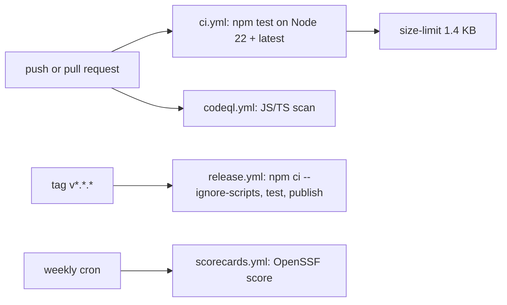

# jshttp/cookie — module: build-and-infra

## Responsibility

This slice holds everything around the cookie code: package metadata, the TypeScript setup, the four GitHub Actions workflows, and the benchmarks. It shows how a small, widely used library is built, checked, measured, and published. It has no cookie logic of its own.

## Key files

| File | Role |
|------|------|
| `package.json` | Package metadata, scripts, size budget, Node version, dev tools |
| `tsconfig.json`, `tsconfig.build.json` | Compiler settings; the build config drops specs and benchmarks |
| `.github/workflows/ci.yml` | Tests on two Node versions, then coverage upload |
| `.github/workflows/codeql.yml` | Static security scan |
| `.github/workflows/release.yml` | Publish to npm from a version tag |
| `.github/workflows/scorecards.yml` | OpenSSF supply-chain score |
| `src/*.bench.ts`, `benchmarks/value-slice.bench.ts` | Speed tests |
| `scripts/update-benchmark.ts` | Refreshes real-world benchmark data |

## How it works

1. A developer runs `npm test`. It runs the spec tests, then the size check (`package.json:33 @ a437ef0`).
2. The build uses `tsconfig.build.json`, which excludes specs and benchmarks, so only library code ships (`package.json:54-56 @ a437ef0`, `tsconfig.build.json:3 @ a437ef0`).
3. Only `dist/` is published, and the single entry point is `./dist/index.js` (`package.json:21-24 @ a437ef0`).
4. On every push and pull request, CI runs `npm ci` and `npm test` on Node 22 and the latest Node (`.github/workflows/ci.yml:3-5 @ a437ef0`, `.github/workflows/ci.yml:18-27 @ a437ef0`).
5. Pushing a tag like `v2.0.2` starts the release job: it installs without scripts, tests again, then publishes (`.github/workflows/release.yml:3-6 @ a437ef0`, `.github/workflows/release.yml:26-28 @ a437ef0`).

## Beyond the textbook

### A byte budget enforced in the test command

- Textbook version: tests check behaviour only; bundle size is looked at rarely.
- What they do: `npm test` also runs `size-limit`, and the limit for `dist/index.js` is 1.4 KB. A change that grows the library fails the test run.
- Why: a cookie parser is pulled into many apps, so every extra byte is paid by all of them. The code says it in config: the budget is a hard gate, not a note.
- Evidence: `package.json:33 @ a437ef0`, `package.json:48-53 @ a437ef0`

### Benchmarks as a design tool, including rejected designs

- Textbook version: write the obvious loop and move on.
- What they do: `benchmarks/value-slice.bench.ts` holds eight versions of the same "trim spaces and tabs around a value" function (two `while` loops, `do...while`, early exit, empty-string check, and plain `slice().trim()`). Each runs on six cases, including empty and whitespace-only values.
- Why: the team compares candidates under the same inputs before choosing one. The `expected` field in each case also records the right answer.
- Evidence: `benchmarks/value-slice.bench.ts:3-40 @ a437ef0`, `benchmarks/value-slice.bench.ts:42-177 @ a437ef0`, `benchmarks/value-slice.bench.ts:179-211 @ a437ef0`

### Worst-case input is benchmarked, not only typical input

- Textbook version: benchmark a few normal strings.
- What they do: both parsers are timed on 100,000 semicolons. The cookie-header parser is also timed on duplicates, 10 cookies, and 100 cookies.
- Why: a header parser faces hostile input, so a case that could cause slow behaviour is kept as a permanent test. The semicolon strings show the intent (my reading; no comment states it).
- Evidence: `src/parse-cookie.bench.ts:37-40 @ a437ef0`, `src/parse-set-cookie.bench.ts:14-17 @ a437ef0`, `src/parse-cookie.bench.ts:22-35 @ a437ef0`

### Real-world data, obfuscated before it is committed

- Textbook version: hand-written sample cookies.
- What they do: a script fetches the first 20 sites of a top-sites list over HTTP, follows redirects, reads their `Set-Cookie` headers, then rewrites letters and digits so no real values remain, keeping the shape (length, punctuation, percent signs). The result is saved as JSON for the benchmarks.
- Why: real headers have odd shapes that made-up ones miss, but real values could be private. Obfuscation keeps shape and drops content.
- Evidence: `scripts/update-benchmark.ts:12 @ a437ef0`, `scripts/update-benchmark.ts:33-41 @ a437ef0`, `scripts/update-benchmark.ts:62-66 @ a437ef0`, `scripts/update-benchmark.ts:72-89 @ a437ef0`, `src/parse-cookie.bench.ts:3 @ a437ef0`

### Supply-chain hardening in CI and release

- Textbook version: `uses: actions/checkout@v4` and a stored npm token.
- What they do: every action is pinned to a full commit hash with the version in a comment. Default permissions are `contents: read`. Release uses `id-token: write` for npm trusted publishing (no long-lived token), runs in a named `release` environment, and installs with `--ignore-scripts`. A separate workflow runs OpenSSF Scorecard weekly and uploads SARIF to code scanning. The `scorecards.yml` checkout sets `persist-credentials: false`.
- Why: a tag-triggered publish is the high-value target of an attack. Pinned hashes cannot be moved by an attacker retagging; `--ignore-scripts` blocks install scripts of dependencies; the comment in the release file names the trusted-publishing need.
- Evidence: `.github/workflows/ci.yml:22-28 @ a437ef0`, `.github/workflows/ci.yml:7-8 @ a437ef0`, `.github/workflows/release.yml:8-9 @ a437ef0`, `.github/workflows/release.yml:16-17 @ a437ef0`, `.github/workflows/release.yml:26 @ a437ef0`, `.github/workflows/scorecards.yml:13 @ a437ef0`, `.github/workflows/scorecards.yml:39-41 @ a437ef0`, `.github/workflows/scorecards.yml:18 @ a437ef0`

### Test on the minimum and the newest runtime

- Textbook version: test on one Node version.
- What they do: CI runs the suite on Node 22 (the declared minimum in `engines`) and on `latest`, so both ends of the support range are checked.
- Why: the package promises Node 22 and up; the newest release catches future breakage early.
- Evidence: `package.json:45-47 @ a437ef0`, `.github/workflows/ci.yml:18-20 @ a437ef0`

### Ship ES modules only, with side effects declared off

- Textbook version: ship CommonJS and ESM builds.
- What they do: `type: module`, a single `exports` path, and `sideEffects: false` so bundlers can drop unused code. The compile target is ES2025 with `nodenext` modules.
- Why: one output format keeps the package small and simple; `sideEffects: false` lets tree-shaking work.
- Evidence: `package.json:19-21 @ a437ef0`, `tsconfig.json:4-5 @ a437ef0`

## Tests and what they protect

The spec files are in other slices. Here, `npm test` calls `ts-scripts test` and then the size check (`package.json:33 @ a437ef0`). The test tooling is vitest with V8 coverage (`package.json:39 @ a437ef0`, `package.json:43 @ a437ef0`), and CI uploads coverage per Node version to Codecov (`.github/workflows/ci.yml:28-31 @ a437ef0`). The benchmarks run separately with `vitest bench` (`package.json:26 @ a437ef0`), so they do not slow the normal test run.

## Error handling, performance, and security

- Performance: size budget of 1.4 KB, benchmarks for every public function (`src/stringify-cookie.bench.ts:4-47 @ a437ef0`, `src/stringify-set-cookie.bench.ts:4-47 @ a437ef0`), and a value-trimming comparison (see above).
- Security: CodeQL scans JavaScript and TypeScript on pushes and pull requests to `master`, plus weekly on Mondays (`.github/workflows/codeql.yml:14-21 @ a437ef0`, `.github/workflows/codeql.yml:38 @ a437ef0`). Scorecard checks are run on a schedule and on pushes to `master`, with read-all default permissions (`.github/workflows/scorecards.yml:12-18 @ a437ef0`).
- Type safety: tests and benchmarks are compiled by `tsconfig.json` (`include: src/**/*`) but excluded from the published build (`tsconfig.json:11 @ a437ef0`, `tsconfig.build.json:3 @ a437ef0`).
- The benchmark script has no error handling: a failed fetch would stop it, and it calls `process.exit()` when done (`scripts/update-benchmark.ts:14-31 @ a437ef0`). That is acceptable for a maintainer-only tool.

## Technologies and services seen

- TypeScript 6 — source language, compiled to `dist/` (`package.json:42 @ a437ef0`)
- Node.js 22 or newer — runtime, set in `engines` (`package.json:45-47 @ a437ef0`)
- npm — install, `npm ci`, publish (`.github/workflows/release.yml:26-28 @ a437ef0`)
- `@borderless/ts-scripts` — wrapper for build, format, specs, test, and git hooks (`package.json:28-32 @ a437ef0`, `package.json:36 @ a437ef0`)
- Vitest and `@vitest/coverage-v8` — test, coverage, and benchmark runner (`package.json:26 @ a437ef0`, `package.json:39 @ a437ef0`, `package.json:43 @ a437ef0`)
- size-limit with `@size-limit/preset-small-lib` — byte budget check (`package.json:31 @ a437ef0`, `package.json:37 @ a437ef0`)
- `top-sites` — list of popular domains for benchmark data (`package.json:41 @ a437ef0`, `scripts/update-benchmark.ts:3 @ a437ef0`)
- GitHub Actions — CI host (`.github/workflows/ci.yml:1-13 @ a437ef0`)
- Codecov — coverage reports, via a secret token (`.github/workflows/ci.yml:28-31 @ a437ef0`)
- CodeQL (GitHub code scanning) — static security analysis (`.github/workflows/codeql.yml:47-50 @ a437ef0`)
- OpenSSF Scorecard — supply-chain health score (`.github/workflows/scorecards.yml:44 @ a437ef0`)
- npm trusted publishing (OIDC) — token-free publish (`.github/workflows/release.yml:9 @ a437ef0`)
- Open Collective — funding link for the Express project (`package.json:10-13 @ a437ef0`)
- MIT license (`package.json:14 @ a437ef0`, `LICENSE:1 @ a437ef0`)

## Worth exploring interactively

- Release pipeline from tag to npm — steps: tag `v*.*.*` pushed (`.github/workflows/release.yml:3-6 @ a437ef0`); checkout and Node setup (`.github/workflows/release.yml:22-25 @ a437ef0`); `npm ci --ignore-scripts` (`.github/workflows/release.yml:26 @ a437ef0`); `npm test`, which includes the size gate (`.github/workflows/release.yml:27 @ a437ef0`, `package.json:33 @ a437ef0`); publish, which runs the build via `prepublishOnly` (`.github/workflows/release.yml:28 @ a437ef0`, `package.json:30 @ a437ef0`) — fits FlowAnimation because the learner watches a change pass each gate in order.
- The value-trimming benchmark — steps: pick a case (`benchmarks/value-slice.bench.ts:3-40 @ a437ef0`); two pointers move in from both ends past spaces and tabs (`benchmarks/value-slice.bench.ts:101-118 @ a437ef0`); slice the middle (`benchmarks/value-slice.bench.ts:117 @ a437ef0`) — fits AlgorithmStepper because the start and end pointers visibly move.

## Open questions

- Which variant of the value-trimming function won is not visible here; the real one is in `src/index.ts` (another slice).
- The `ts-scripts` internals (what `test` and `build` run exactly) are in a dependency not in this clone.

## My insights
