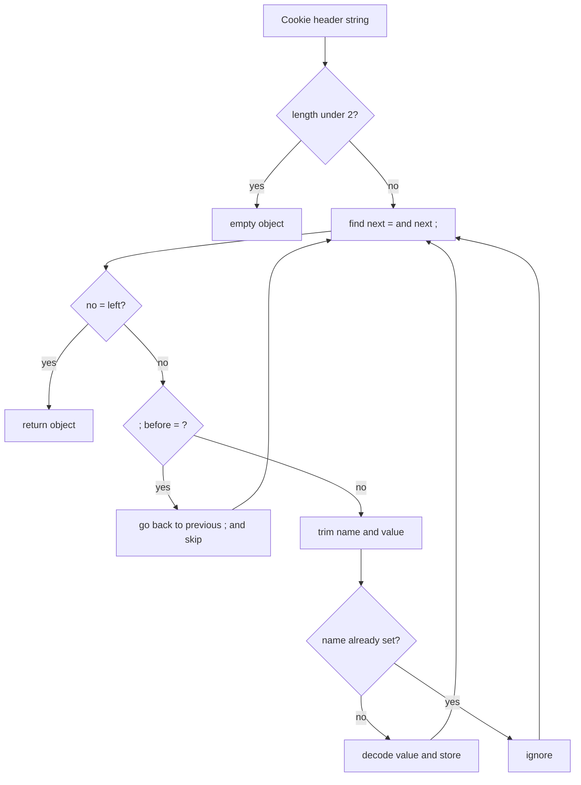

# jshttp/cookie — module: cookie-header

## Responsibility

This part of the code reads and writes the `Cookie` request header. The browser sends this header as `name=value; name2=value2`. `parseCookie` turns that string into an object. `stringifyCookie` turns an object back into the string. It also holds the character rules for names and values, and the small helper functions that trim and encode text.

## Key files

| File | Role |
|------|------|
| `src/index.ts` (lines 1-190, 478-533) | Name and value rules, `parseCookie`, `stringifyCookie`, and the helpers `eqIndex`, `endIndex`, `valueSlice`, `defaultDecode`, `defaultEncode` |
| `src/parse-cookie.spec.ts` | Tests for parsing |
| `src/stringify-cookie.spec.ts` | Tests for writing, including every character in the Basic Multilingual Plane and a round trip with the parser |

## How it works

Parsing walks the string once, with no `split`. Writing checks each name and value and joins them with `; `.

1. The result object is made from a null-prototype constructor, and a string shorter than 2 characters returns an empty object at once (`src/index.ts:113-116 @ a437ef0`).
2. The decoder is the user's `decode` option or `defaultDecode` (`src/index.ts:118 @ a437ef0`).
3. In a loop, the code finds the next `=` and the next `;` with `indexOf` (`src/index.ts:122-125 @ a437ef0`, `src/index.ts:480-491 @ a437ef0`). If there is no `=` left, the loop stops (`src/index.ts:123 @ a437ef0`).
4. If the `;` comes before the `=`, that piece has no value (for example `fizz`). The code jumps back to the previous `;` and goes on from there (`src/index.ts:127-130 @ a437ef0`).
5. The name and value are cut out with `valueSlice`, which trims spaces and tabs (`src/index.ts:133 @ a437ef0`, `src/index.ts:496-513 @ a437ef0`).
6. A name is stored only if it was not stored before, so the first cookie of a name wins (`src/index.ts:135-138 @ a437ef0`).
7. `stringifyCookie` loops over the keys, skips `undefined` values, throws a `TypeError` for a bad name, encodes the value, and joins the pairs (`src/index.ts:163-184 @ a437ef0`).

The diagram follows the loop at `src/index.ts:121-141 @ a437ef0`.

## Beyond the textbook

### Single-pass scan instead of split

- Textbook version: `header.split(";")`, then `split("=")` on each piece, then `trim()`.
- What they do: `indexOf` finds the two separators, and `valueSlice` trims by moving two indexes over char codes. No temporary arrays or strings are made for the pieces.
- Why: the code comments say the helpers are "optimized"; the loop keeps one `index` that moves forward (`src/index.ts:121-141 @ a437ef0`, `src/index.ts:496-513 @ a437ef0`). This is a header read on every request, so small costs add up.
- Evidence: `src/index.ts:112-144 @ a437ef0`

### Skip the native call when it is not needed

- Textbook version: always call `decodeURIComponent` on the value and `encodeURIComponent` on write.
- What they do: decode runs only if the value contains `%`. Encode runs only if a regular expression finds a character that is not safe.
- Why: the comments say "Optimized to skip native call" (`src/index.ts:516-519 @ a437ef0`, `src/index.ts:529-533 @ a437ef0`). The unsafe set includes `%`, so a value that holds `%` is always encoded and the round trip stays exact (`src/index.ts:31-34 @ a437ef0`).
- Evidence: `src/index.ts:518-533 @ a437ef0`

### Decode never throws

- Textbook version: `decodeURIComponent` throws `URIError` on input like `%1`, and one bad cookie breaks the whole header.
- What they do: the default decoder catches the error and returns the raw text. Parsing goes on with the next cookie.
- Why: the option comment says it returns "the cookie's original value" on error (`src/index.ts:91-92 @ a437ef0`). A test shows `foo=%1;bar=bar` still gives both cookies (`src/parse-cookie.spec.ts:65-70 @ a437ef0`). The header comes from the client, so it is untrusted.
- Evidence: `src/index.ts:521-525 @ a437ef0`

### Null-prototype result object

- Textbook version: `const obj = {}`.
- What they do: the result is built from a constructor whose prototype is `Object.create(null)`, marked `/* @__PURE__ */` so bundlers can drop it if unused.
- Why: a cookie named `toString` or `__proto__` must not clash with inherited properties. A test checks `toString` and `valueOf` as cookie names (`src/parse-cookie.spec.ts:92-97 @ a437ef0`). The `obj[key] === undefined` check in the parser also relies on this.
- Evidence: `src/index.ts:76-80 @ a437ef0`, `src/index.ts:113 @ a437ef0`

### First cookie wins, and a custom decoder can skip a value

- Textbook version: the last value overwrites earlier ones, or the library does not say.
- What they do: the first value of a name is kept. If a custom `decode` returns `undefined`, the slot stays empty and a later cookie of the same name can fill it.
- Why: browsers send the more specific path first, so the first one is the best match (this reason is not in the code; the rule is shown by the "only assign once" comment and the tests). The test "should skip undefined decoded duplicates" proves the retry (`src/parse-cookie.spec.ts:110-123 @ a437ef0`).
- Evidence: `src/index.ts:135-138 @ a437ef0`, `src/index.ts:93-95 @ a437ef0`

### Rules wider than the RFC, on purpose

- Textbook version: follow RFC 6265 exactly (names are `token`, values exclude `"`, `,` and `\`).
- What they do: the name rule allows every printable ASCII character except `=` and `;`. The value rule allows `"`, `,` and `\`. Comments link to an issue for each choice.
- Why: real sites send such cookies, so a strict check would reject traffic that browsers accept (`src/index.ts:12-14 @ a437ef0`, `src/index.ts:26-27 @ a437ef0`). The parser does not use these regular expressions at all; they guard only the write side.
- Evidence: `src/index.ts:15 @ a437ef0`, `src/index.ts:29 @ a437ef0`

### Write validates, read tolerates

- Textbook version: one set of rules for both directions.
- What they do: `stringifyCookie` throws on a bad name or on a bad value from a custom encoder. It does not re-check the value from the default encoder, because that encoder always produces safe text. `parseCookie` accepts nearly anything.
- Why: bad output could split a header or smuggle a second cookie; bad input is common and must not crash a server.
- Evidence: `src/index.ts:172-180 @ a437ef0`

## Tests and what they protect

- A snapshot test per top site parses real `Cookie` headers collected from those sites (`src/parse-cookie.spec.ts:6-12 @ a437ef0`).
- Whitespace: spaces and tabs around names and values, empty names, empty values (`src/parse-cookie.spec.ts:19-29 @ a437ef0`, `src/parse-cookie.spec.ts:50-63 @ a437ef0`).
- Pieces without `=` are ignored (`src/parse-cookie.spec.ts:72-75 @ a437ef0`). A minimum-length string `f=` works (`src/parse-cookie.spec.ts:35-38 @ a437ef0`).
- A quoted value keeps its quotes, and `%20%22%2c%3b%2f` is decoded (`src/parse-cookie.spec.ts:40-48 @ a437ef0`).
- Custom `decode` and `encode` options, including base64 (`src/parse-cookie.spec.ts:99-108 @ a437ef0`, `src/stringify-cookie.spec.ts:136-152 @ a437ef0`).
- The write test builds one case for every character from U+0000 to U+FFFF (except surrogates) and checks it against `encodeURIComponent` (`src/stringify-cookie.spec.ts:10-24 @ a437ef0`, `src/stringify-cookie.spec.ts:82-87 @ a437ef0`). Three characters outside the BMP are added too (`src/stringify-cookie.spec.ts:26-34 @ a437ef0`).
- Round trips: stringify then parse gives the same object, including the value `%20`, which is written as `%2520` (`src/stringify-cookie.spec.ts:174-180 @ a437ef0`).
- Names with a space, `;`, tab or newline throw (`src/stringify-cookie.spec.ts:102-109 @ a437ef0`). Thirteen punctuation characters are accepted in names (`src/stringify-cookie.spec.ts:117-134 @ a437ef0`).

## Error handling, performance, and security

- Bad name on write: `TypeError("cookie name is invalid: ...")` (`src/index.ts:172-174 @ a437ef0`).
- Bad value from a custom encoder: `TypeError("cookie value is invalid: ...")`, checked only when the encoder is not the default (`src/index.ts:178-180 @ a437ef0`).
- Bad percent escape on read: the raw text is returned, no throw (`src/index.ts:521-525 @ a437ef0`).
- Performance: `indexOf` scan, no `split`, no native decode call without `%` (see Beyond the textbook).
- Security: a null-prototype object guards against names such as `toString` (`src/index.ts:76-80 @ a437ef0`). Values are encoded so that `;`, `,`, spaces and `"` cannot end a cookie early (`src/stringify-cookie.spec.ts:63-74 @ a437ef0`).
- Not present in this slice: size limits on the header string. The parser has no length cap.

## Technologies and services seen

- TypeScript — the source is typed (`ParseOptions`, `Cookies`, `StringifyOptions`) (`src/index.ts:85 @ a437ef0`, `src/index.ts:104 @ a437ef0`, `src/index.ts:146 @ a437ef0`).
- Vitest — test runner (`describe`, `it`, `expect`, `it.each`, `toMatchSnapshot`) (`src/parse-cookie.spec.ts:1 @ a437ef0`, `src/stringify-cookie.spec.ts:1 @ a437ef0`).
- JavaScript built-ins `decodeURIComponent` and `encodeURIComponent` — the default value codec (`src/index.ts:522 @ a437ef0`, `src/index.ts:532 @ a437ef0`).
- Node `Buffer` — used in tests for base64 custom codecs (`src/parse-cookie.spec.ts:104 @ a437ef0`).
- JSON data file `scripts/top-cookie.json` — real headers used as a fixture (`src/parse-cookie.spec.ts:3 @ a437ef0`).
- No external service in this slice.

## Worth exploring interactively

- Parse loop of `parseCookie` — (1) check length (`src/index.ts:116 @ a437ef0`); (2) find `=` (`src/index.ts:122 @ a437ef0`); (3) find `;` (`src/index.ts:125 @ a437ef0`); (4) backtrack if `;` precedes `=` (`src/index.ts:127-130 @ a437ef0`); (5) trim name and value (`src/index.ts:133 @ a437ef0`); (6) store only the first value of a name (`src/index.ts:136-138 @ a437ef0`); (7) move to the next piece (`src/index.ts:140 @ a437ef0`) — fits AlgorithmStepper because the learner would see the two indexes move across a header string and the result object grow.
- Encode decision in `stringifyCookie` — (1) skip `undefined` (`src/index.ts:170 @ a437ef0`); (2) validate the name (`src/index.ts:172 @ a437ef0`); (3) encode only if a bad character exists (`src/index.ts:532 @ a437ef0`); (4) validate the value for custom encoders (`src/index.ts:178 @ a437ef0`); (5) join with `; ` (`src/index.ts:182-183 @ a437ef0`) — fits FlowAnimation because a value moves through checks and either passes through or is encoded.

## Open questions

- Why the first duplicate wins is not explained in a code comment in this slice; the RFC text may say which cookie a browser sends first.
- Lines 192-477 (Set-Cookie code) belong to other slices.

## My insights
