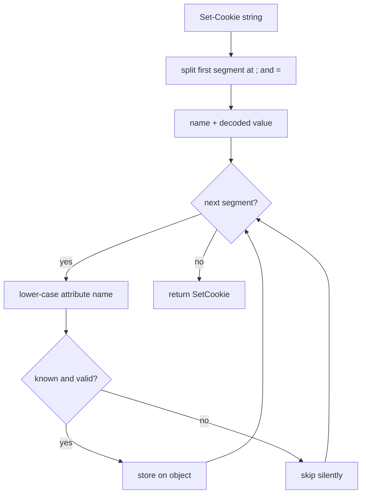

# jshttp/cookie — module: set-cookie-parse

## Responsibility

This part turns one `Set-Cookie` header string into a plain object: the name, the value, and the attributes such as `HttpOnly`, `Max-Age` and `SameSite`. It is lenient. A bad attribute is dropped, and the parser never throws on malformed text. The module is the mirror of the serializer, which is strict and throws.

## Key files

| File | Role |
|------|------|
| `src/index.ts` (lines 399-475) | `parseSetCookie`, the attribute loop |
| `src/index.ts` (lines 480-526) | Helpers: `endIndex`, `eqIndex`, `valueSlice`, `defaultDecode` |
| `src/parse-set-cookie.spec.ts` | Unit tests plus snapshot tests on real sites |

## How it works

In plain words: the parser walks along the string once. It finds the first `;` and the first `=`, cuts the name and value, then repeats for each attribute. A `switch` on the lower-cased attribute name decides what to store.

1. Pick the decoder: the caller's `decode` option, or `defaultDecode` (`src/index.ts:400 @ a437ef0`).
2. Find the end of the first segment (`;`) and the first `=` (`src/index.ts:402-403 @ a437ef0`).
3. If the `=` is inside the first segment, name and value are cut from either side. If not, the name is `""` and the whole segment is the value (`src/index.ts:404-410 @ a437ef0`).
4. Loop over the later segments. Each segment gives an attribute name and an optional value (`src/index.ts:412-421 @ a437ef0`).
5. Switch on `attr.toLowerCase()`. Flags (`httponly`, `secure`, `partitioned`) become `true` (`src/index.ts:423-432 @ a437ef0`). `domain` and `path` keep the raw text (`src/index.ts:433-438 @ a437ef0`).
6. `max-age`, `expires`, `priority` and `samesite` are checked before they are stored (see below). Anything unknown falls through the `switch` and is skipped (`src/index.ts:439-469 @ a437ef0`).
7. Move to the next segment: `index = endIdx + 1` (`src/index.ts:471 @ a437ef0`).

## Beyond the textbook

### One pass with index arithmetic, no `split`

- Textbook version: `str.split(";")`, then `split("=")` on each piece, then `trim()`.
- What they do: `endIndex` and `eqIndex` call `indexOf` from a start position and return `len` when nothing is found (`src/index.ts:480-491 @ a437ef0`). `valueSlice` trims space and tab by hand with char codes, and cuts one substring (`src/index.ts:496-513 @ a437ef0`). The loop even reuses the last `=` position until it is passed (`src/index.ts:415 @ a437ef0`).
- Why: fewer temporary arrays and strings on a hot path. The tests load real site headers from `scripts/top-set-cookie.json` (`src/parse-set-cookie.spec.ts:3 @ a437ef0`). The comment on `defaultDecode` says it is "optimized" (`src/index.ts:516 @ a437ef0`). I did not read a code comment that states the speed goal for the parser itself, so this reason is an inference.
- Evidence: `src/index.ts:480-513 @ a437ef0`

### Lenient reading: validate, then ignore

- Textbook version: store every attribute as text, or throw on the first error.
- What they do: `Max-Age` is stored only if it matches `^-?\d+$` (`src/index.ts:440 @ a437ef0`, regexp at `src/index.ts:74 @ a437ef0`). `Expires` is stored only if `new Date(val)` is a finite number (`src/index.ts:442-445 @ a437ef0`). `Priority` and `SameSite` are lower-cased and stored only when they equal one of the known words (`src/index.ts:447-468 @ a437ef0`).
- Why: a client must keep working when a server sends junk. The tests state this: "should ignore invalid max-age", "should ignore max-age with partial digits", "should ignore invalid Priority values" (`src/parse-set-cookie.spec.ts:146 @ a437ef0`, `src/parse-set-cookie.spec.ts:153 @ a437ef0`, `src/parse-set-cookie.spec.ts:320 @ a437ef0`). A negative `Max-Age` is kept, because it is the standard way to delete a cookie (`src/parse-set-cookie.spec.ts:167-172 @ a437ef0`).
- Evidence: `src/index.ts:439-468 @ a437ef0`

### Case-folded output, boolean flags ignore their value

- Textbook version: keep the attribute text as it came.
- What they do: `SameSite=Strict` and `SameSite=strict` both give `"strict"`; the same holds for `Priority` (`src/parse-set-cookie.spec.ts:227-239 @ a437ef0`, `src/parse-set-cookie.spec.ts:278-290 @ a437ef0`). `HttpOnly=true; Secure=false` still sets both flags to `true`, because the code never reads `val` for flags (`src/parse-set-cookie.spec.ts:81-88 @ a437ef0`, `src/index.ts:424-432 @ a437ef0`).- Why: one normalized shape lets later code compare with `===`. The "Secure=false" case is a safe default: if in doubt, the flag is on.
- Evidence: `src/index.ts:458-467 @ a437ef0`

### Decoder that never throws, and a custom hook

- Textbook version: call `decodeURIComponent` directly, which throws `URIError` on `%zz`.
- What they do: `defaultDecode` skips the native call when the string has no `%`, and returns the raw string if decoding throws (`src/index.ts:518-526 @ a437ef0`). The caller can pass `decode` in `ParseOptions`; the doc comment warns that custom functions must handle their own errors (`src/index.ts:91-93 @ a437ef0`).
- Why: one malformed value must not break a whole response. The fast path avoids work for the common case.
- Evidence: `src/index.ts:518-526 @ a437ef0`, test `src/parse-set-cookie.spec.ts:108-115 @ a437ef0`

### Snapshot tests over real top-site headers

- Textbook version: a few hand-written examples.
- What they do: the spec loops over every header in `scripts/top-set-cookie.json` and calls `toMatchSnapshot()` (`src/parse-set-cookie.spec.ts:6-16 @ a437ef0`).
- Why: real headers hold odd cases no one would invent; a snapshot makes any behaviour change visible in review. The generated snapshot files were out of scope for this slice.
- Evidence: `src/parse-set-cookie.spec.ts:3-16 @ a437ef0`

## Tests and what they protect

The spec uses Vitest (`src/parse-set-cookie.spec.ts:1 @ a437ef0`). Groups of tests protect these behaviours:

- Shape of the first pair: `key=value`, `key=` (empty value), no `=` (name `""`), empty string, only spaces, and `=` inside the value (`src/parse-set-cookie.spec.ts:18-64 @ a437ef0`).
- Whitespace: spaces and tabs around name and value, extra spaces around attributes, and empty segments like `;;;` (`src/parse-set-cookie.spec.ts:33-42 @ a437ef0`, `src/parse-set-cookie.spec.ts:90-106 @ a437ef0`).
- Unknown attributes are ignored (`src/parse-set-cookie.spec.ts:66-70 @ a437ef0`).
- Each attribute: `Expires` valid and invalid, `Max-Age` valid, invalid, partial digits, decimals, negative; `Domain`, `Path`, flags, `SameSite`, `Priority` (`src/parse-set-cookie.spec.ts:118-326 @ a437ef0`).
- URL-decoding and a custom `decode` (`src/parse-set-cookie.spec.ts:52-57 @ a437ef0`, `src/parse-set-cookie.spec.ts:108-116 @ a437ef0`).

Not tested in this file: `Domain` and `Path` are stored without validation, so there is no test of a bad domain.

## Error handling, performance, and security

- Error handling: the parser has no `throw`. Bad numbers, dates, and enum words are skipped (`src/index.ts:440-468 @ a437ef0`). Bad `%` escapes fall back to the raw string (`src/index.ts:521-525 @ a437ef0`).
- Performance: no `split`, no regexp in the main loop except one cheap `Max-Age` test (`src/index.ts:440 @ a437ef0`); `defaultDecode` has a no-`%` fast path (`src/index.ts:519 @ a437ef0`).
- Security: `Domain` and `Path` values are copied as they are (`src/index.ts:433-438 @ a437ef0`). The parser reads what the server sent; it does not decide whether a browser would accept it. The serializer applies the domain and path regexps (`src/index.ts:59-69 @ a437ef0`). Code that reads untrusted `Set-Cookie` text must check these values itself. A risk to note: `Expires` uses `new Date(val)`, which accepts many formats beyond the cookie date grammar (`src/index.ts:444 @ a437ef0`). That is my reading of JavaScript behaviour, not something the repository states.

## Technologies and services seen

- TypeScript — typed `SetCookie` result and `ParseOptions` (`src/index.ts:85 @ a437ef0`, `src/index.ts:399 @ a437ef0`)
- Vitest — test runner with `describe`, `it`, `expect` and snapshots (`src/parse-set-cookie.spec.ts:1 @ a437ef0`)
- JSON data file of real top-site cookies as test input (`src/parse-set-cookie.spec.ts:3 @ a437ef0`)
- `decodeURIComponent` — built-in decoder (`src/index.ts:522 @ a437ef0`)

## Worth exploring interactively

- `parseSetCookie` on `key=value; Max-Age=3600; HttpOnly; SameSite=lax` — steps: pick decoder (`src/index.ts:400 @ a437ef0`), find first `;` and `=` (`src/index.ts:402-403 @ a437ef0`), build `{name, value}` (`src/index.ts:404-410 @ a437ef0`), read each segment (`src/index.ts:413-421 @ a437ef0`), switch on attribute name and validate (`src/index.ts:423-468 @ a437ef0`), advance the index (`src/index.ts:471 @ a437ef0`) — fits AlgorithmStepper because the learner would see two cursors (`index`, `endIdx`) move along the string and the result object grow one field at a time.
- Valid versus invalid attribute — steps: `Max-Age=3600` passes the regexp (`src/index.ts:440 @ a437ef0`); `Max-Age=1.5` fails and is skipped (`src/parse-set-cookie.spec.ts:160-165 @ a437ef0`); `SameSite=Invalid` is skipped (`src/index.ts:461-467 @ a437ef0`) — fits StateMachine because each segment ends in "stored" or "skipped".

## Open questions

- Does the benchmark compare `parseSetCookie` against another library? That belongs to the build-and-infra slice.
- Why do `Domain` and `Path` get no check on parse, while the serializer checks them? The code does not say.

## My insights
