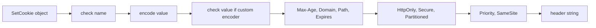

# jshttp/cookie — module: set-cookie-serialize

## Responsibility

This part builds a `Set-Cookie` header string from a plain object. Before it writes each piece, it checks the piece against the cookie grammar and throws a `TypeError` when the piece is not allowed. The goal is that a bad value can never add a second attribute or a new header line.

## Key files

| File | Role |
|------|------|
| `src/index.ts` (lines 192-391) | The `SetCookie` type and the `stringifySetCookie` function |
| `src/index.ts` (lines 1-75) | The name, value, domain and path regular expressions it uses |
| `src/stringify-set-cookie.spec.ts` | The spec: valid and invalid input for every attribute |

## How it works

1. The `SetCookie` interface lists every field: `name`, `value`, `maxAge`, `expires`, `domain`, `path`, `httpOnly`, `secure`, `partitioned`, `priority`, `sameSite` (`src/index.ts:192-269 @ a437ef0`).
2. The function picks the encoder: the caller's `encode` option, or `defaultEncode` (`src/index.ts:290 @ a437ef0`).
3. It tests the name against `cookieNameRegExp` and throws if it fails (`src/index.ts:292-294 @ a437ef0`).
4. It encodes the value. A `null` or `undefined` value becomes an empty string (`src/index.ts:296 @ a437ef0`).
5. If the caller gave a custom encoder, the encoded value is checked against `cookieValueRegExp` (`src/index.ts:298-300 @ a437ef0`).
6. It starts the string with `name=value` (`src/index.ts:302 @ a437ef0`).
7. It then appends attributes in a fixed order: Max-Age, Domain, Path, Expires, HttpOnly, Secure, Partitioned, Priority, SameSite (`src/index.ts:304-388 @ a437ef0`).
8. Each attribute that has a rule is checked before it is appended. The function returns the finished string (`src/index.ts:390 @ a437ef0`).

## Beyond the textbook

### Validate every attribute, not only the value

- Textbook version: join `name=value` and the options with `"; "`, and encode the value only.
- What they do: Domain, Path, Max-Age, Expires, Priority and SameSite each have their own check and their own error message (`src/index.ts:305-307 @ a437ef0`, `src/index.ts:313-315 @ a437ef0`, `src/index.ts:321-323 @ a437ef0`, `src/index.ts:329-332 @ a437ef0`, `src/index.ts:364-366 @ a437ef0`, `src/index.ts:385-387 @ a437ef0`).
- Why: an attribute written without a check lets a caller smuggle in a second attribute. The tests use inputs like `example.com; Path=/` for Domain and `/; Path=/sensitive-data` for Path, and expect a throw (`src/stringify-set-cookie.spec.ts:103-114 @ a437ef0`, `src/stringify-set-cookie.spec.ts:240-249 @ a437ef0`).
- Evidence: `src/index.ts:292-388 @ a437ef0`

### The domain check follows the DNS label rules

- Textbook version: accept any string that has no `;`.
- What they do: the regular expression allows labels of 1 to 63 characters made of letters, digits and inner hyphens, joined by dots. It also allows one leading dot (`src/index.ts:59-60 @ a437ef0`).
- Why: the comment quotes RFC 1034 and RFC 1123 for the label rules. It keeps the leading dot because of an issue the team linked, and notes that a trailing dot makes a browser ignore the attribute (`src/index.ts:37-57 @ a437ef0`). The tests accept `.example.com` and `localhost`, and reject `domain..com` (`src/stringify-set-cookie.spec.ts:90-109 @ a437ef0`).
- Evidence: `src/index.ts:37-60 @ a437ef0`

### Check the cookie date range, not only that it is a date

- Textbook version: call `toUTCString()` on the date.
- What they do: the UTC year must be from 1601 to 9999. An invalid `Date` has a `NaN` year, so the same test rejects it (`src/index.ts:329-332 @ a437ef0`).
- Why: the type comment says the year must be in this range when serializing (`src/index.ts:211 @ a437ef0`). The spec rejects years 1600, 10000 and the two-digit years 49, 50, 69 and 99, and accepts 1601, 1970 and 9999 (`src/stringify-set-cookie.spec.ts:168-188 @ a437ef0`).
- Evidence: `src/index.ts:328-335 @ a437ef0`

### Max-Age must be a safe integer

- Textbook version: print `Max-Age=` and any number.
- What they do: `Number.isSafeInteger` rejects `Infinity`, `3.14` and `1e21`. The value `0` is allowed, which is how a server expires a cookie (`src/index.ts:304-309 @ a437ef0`, `src/stringify-set-cookie.spec.ts:202-220 @ a437ef0`).
- Why: the spec tests these four bad inputs by name: non-number, Infinity, non-integer, unsafe integer (`src/stringify-set-cookie.spec.ts:202-207 @ a437ef0`).
- Evidence: `src/index.ts:304-310 @ a437ef0`

### Value encoding that does not break a round trip

- Textbook version: always call `encodeURIComponent`.
- What they do: `defaultEncode` encodes only when the value has a character that is not safe, including `%` (`src/index.ts:531-533 @ a437ef0`). The matching regular expression says it includes `%` "for roundtrip safety" (`src/index.ts:32-34 @ a437ef0`).
- Why: a safe value stays unchanged, and a value like `100%` becomes `100%25` so a decoder gives the original back. The spec passes the whole set of safe characters through untouched (`src/stringify-set-cookie.spec.ts:19-28 @ a437ef0`).
- Evidence: `src/index.ts:531-533 @ a437ef0`

### A custom encoder gets checked too

- Textbook version: trust the encoder the caller passes in.
- What they do: when `encode` is not the default, the output must match `cookieValueRegExp`. A base64 encoder passes. An identity encoder with a space, tab, semicolon or non-ASCII character throws (`src/index.ts:298-300 @ a437ef0`, `src/stringify-set-cookie.spec.ts:117-154 @ a437ef0`).
- Why: the default encoder is known to be safe, so only a caller's encoder needs the extra check. The same rule applies to an empty value (`src/stringify-set-cookie.spec.ts:129-136 @ a437ef0`).
- Evidence: `src/index.ts:298-300 @ a437ef0`

### Friendly input, strict output

- Textbook version: accept exactly one spelling for each option.
- What they do: `priority` and `sameSite` are lowercased before the switch, so `High` and `Lax` work. `sameSite: true` means `Strict` (`src/index.ts:350-353 @ a437ef0`, `src/index.ts:370-377 @ a437ef0`). The output always uses one fixed spelling, such as `Priority=High`.
- Why: the spec checks that `"High"` gives `Priority=High` and `"Lax"` gives `SameSite=Lax`. A non-string priority such as `42` throws (`src/stringify-set-cookie.spec.ts:279-303 @ a437ef0`).
- Evidence: `src/index.ts:349-388 @ a437ef0`

## Tests and what they protect

- Name rules: 28 legal names such as `foo,bar` and `foo"bar` serialize, and six illegal ones (newline, `=`, `;`, space, tab, a non-ASCII character) throw `cookie name is invalid` (`src/stringify-set-cookie.spec.ts:43-87 @ a437ef0`).
- Injection attempts: Domain, Path and a `<script>` path are all rejected (`src/stringify-set-cookie.spec.ts:103-114 @ a437ef0`, `src/stringify-set-cookie.spec.ts:240-249 @ a437ef0`).
- Odd but legal paths such as `../foo/` and `/foo"bar"` are accepted, which shows the team follows the grammar and not a guess about "sensible" paths (`src/stringify-set-cookie.spec.ts:224-238 @ a437ef0`).
- Boolean flags appear only when `true`, in the order HttpOnly, Secure, Partitioned (`src/stringify-set-cookie.spec.ts:254-278 @ a437ef0`).
- Error messages are matched by regular expression, so each message prefix is part of the tested behaviour (for example `src/stringify-set-cookie.spec.ts:85 @ a437ef0`).
- The spec runs on Vitest (`src/stringify-set-cookie.spec.ts:1 @ a437ef0`).

## Error handling, performance, and security

- Bad input throws `TypeError` with the field name and the bad value in the message (`src/index.ts:293 @ a437ef0`, `src/index.ts:306 @ a437ef0`). The function never fixes bad input silently.
- Security: the path regular expression excludes control characters and `;` (`src/index.ts:69 @ a437ef0`). The domain regular expression has no `;` or space.
- The type allows `value: string | undefined`, so a caller can write an empty cookie (`src/index.ts:200 @ a437ef0`, `src/index.ts:296 @ a437ef0`).
- Performance: the function builds one string with `+=` and no intermediate arrays (`src/index.ts:302-309 @ a437ef0`). The attribute checks are single regular expression tests.
- Partitioned is documented as not fully standardized and a client may ignore it (`src/index.ts:243-244 @ a437ef0`). `Secure` and `HttpOnly` are only written, never forced; the library does not decide a policy.
- The older `SerializeOptions` type is kept as an alias for backward compatibility (`src/index.ts:271-275 @ a437ef0`).

## Technologies and services seen

- TypeScript — the typed `SetCookie` interface and `import`-style modules (`src/index.ts:192 @ a437ef0`)
- Vitest — spec runner, `describe`, `it`, `expect` (`src/stringify-set-cookie.spec.ts:1 @ a437ef0`)
- Node `Buffer` — used in one spec to build a base64 encoder (`src/stringify-set-cookie.spec.ts:123 @ a437ef0`)
- IETF drafts — Partitioned, Priority and SameSite links in the doc comments (`src/index.ts:240 @ a437ef0`, `src/index.ts:249 @ a437ef0`, `src/index.ts:259 @ a437ef0`)

## Worth exploring interactively

- Building a Set-Cookie header — steps: check name (`src/index.ts:292 @ a437ef0`), encode value (`src/index.ts:296 @ a437ef0`), start `name=value` (`src/index.ts:302 @ a437ef0`), add Max-Age (`src/index.ts:304-309 @ a437ef0`), Domain (`src/index.ts:312-318 @ a437ef0`), Path (`src/index.ts:320-326 @ a437ef0`), Expires (`src/index.ts:328-335 @ a437ef0`), flags (`src/index.ts:337-347 @ a437ef0`), Priority (`src/index.ts:349-367 @ a437ef0`), SameSite (`src/index.ts:369-388 @ a437ef0`) — fits FlowAnimation because the learner would watch the string grow one attribute at a time, and see an invalid attribute stop the flow with a `TypeError`.
- Attribute validator — a learner types a Domain or Path and sees which regular expression accepts or rejects it (`src/index.ts:59-60 @ a437ef0`, `src/index.ts:69 @ a437ef0`, `src/stringify-set-cookie.spec.ts:103-114 @ a437ef0`) — fits AlgorithmStepper because the input is checked character by character against the label rule.

## Open questions

- The spec does not test attribute order when many options are set together; the order is fixed by the code only.
- `Secure` is not forced when `SameSite=None` or `Partitioned` is set. Browsers require it, but this slice shows no check.

## My insights
